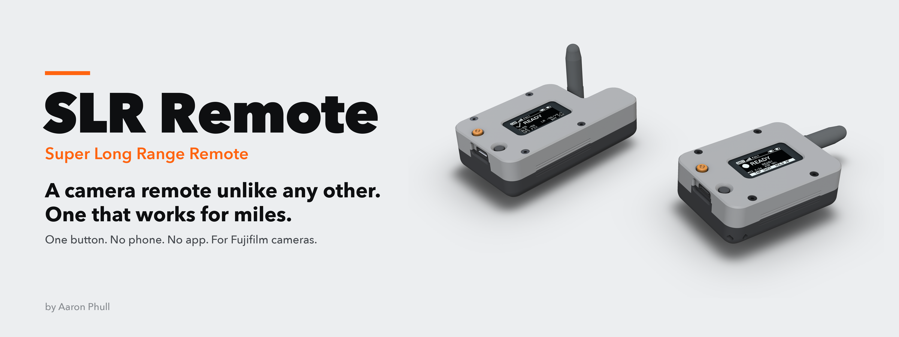
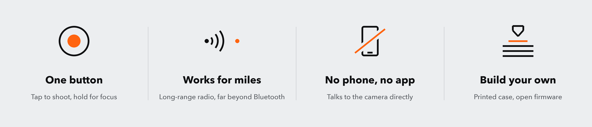
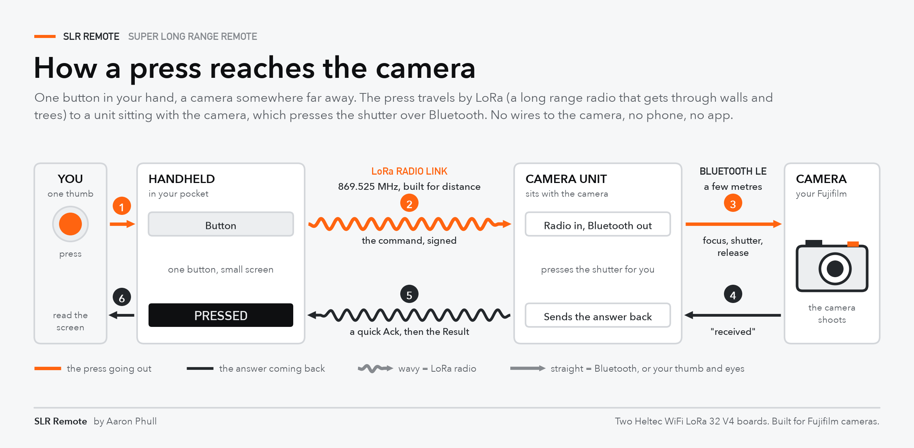
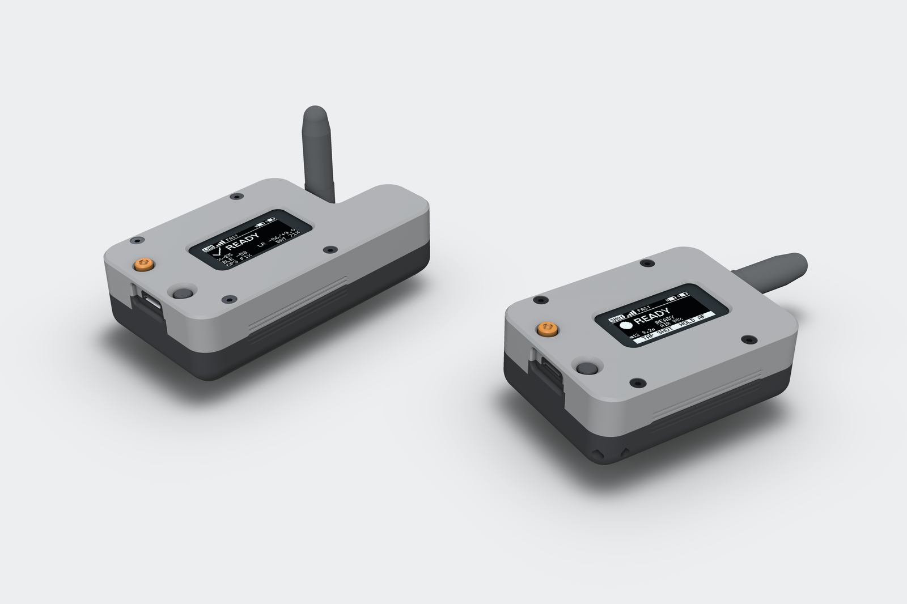
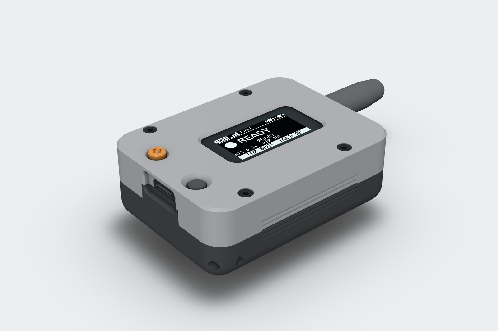
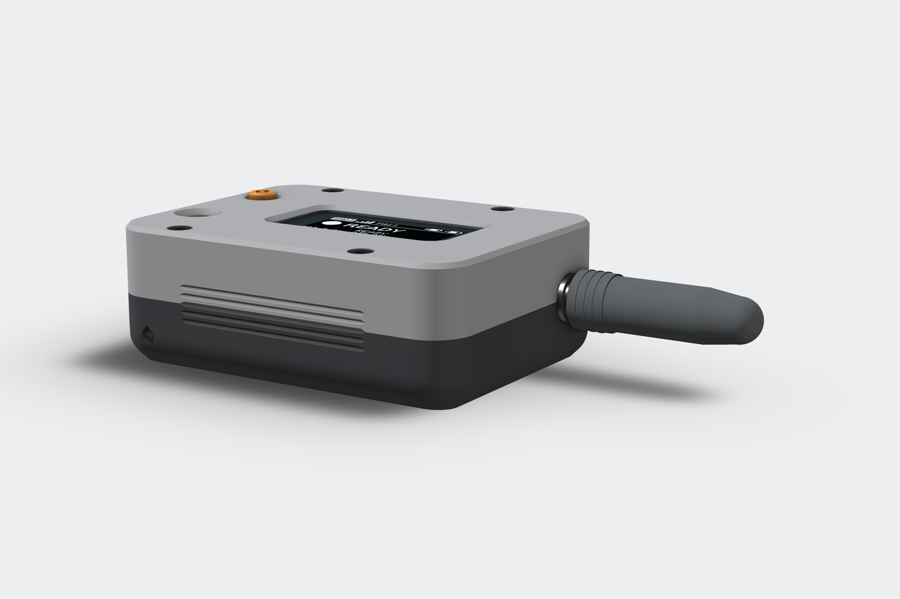
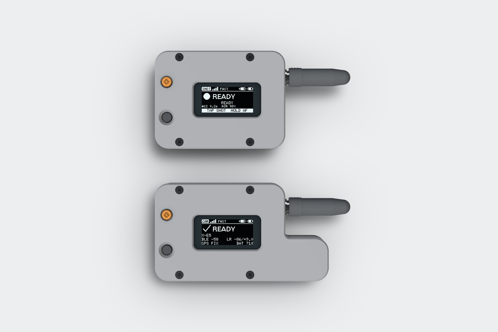
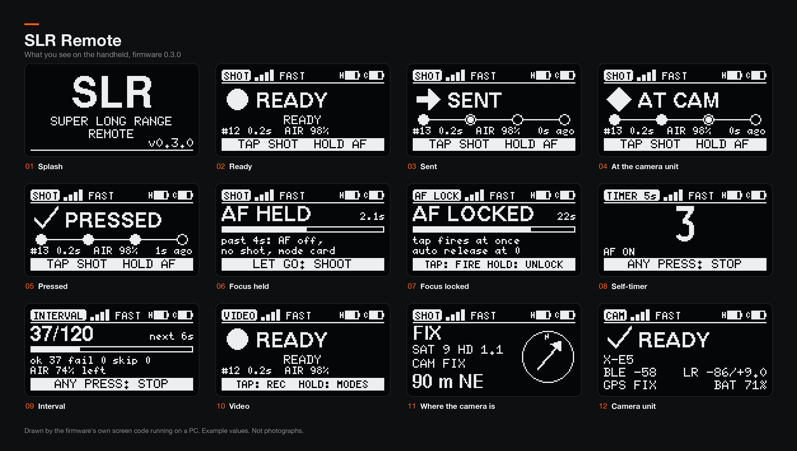
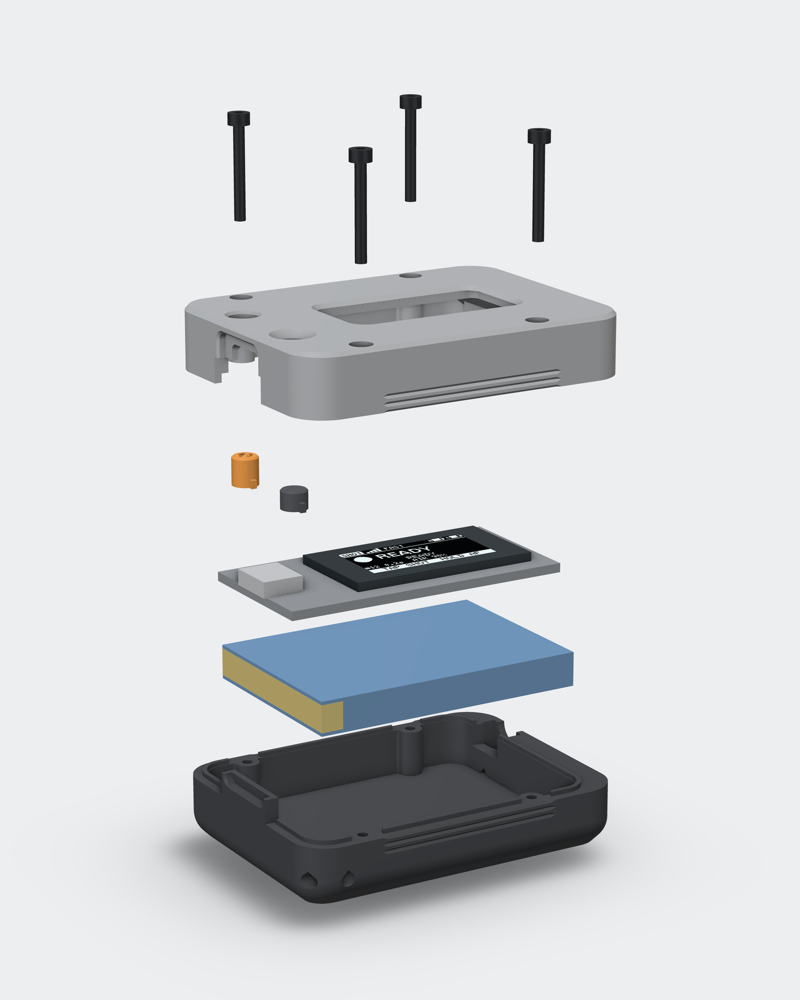
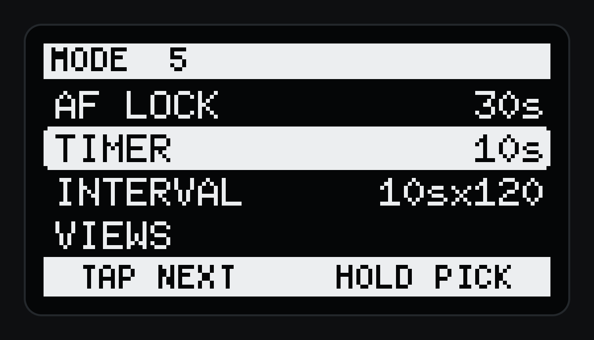

<picture>
  <source media="(prefers-color-scheme: dark)" srcset="assets/banner-dark.png">
  
</picture>

# A camera remote unlike any other camera remote. One that works for miles.

Picture the camera on a tripod at the edge of the lake and you two fields away with one button in your hand. You press it, and the shutter fires.

SLR Remote (SLR stands for Super Long Range) is a pocket shutter release for Fujifilm cameras that reaches far beyond any Bluetooth or infrared remote. There is no cable to the camera, no phone and no app. Half-press holds focus, a tap takes the picture, and the little screen tells you the camera got the message.

I built it because I wanted one, and you can build one too. By Aaron Phull ([iinde](https://github.com/iinde)).

## What it is

Two small units. The handheld lives in your pocket: one shoot button, a small OLED screen, an antenna. The camera unit stays with the camera, on the tripod, in the bag underneath it, or tucked beside it in a hide.

The handheld talks to the camera unit over LoRa, the long range radio used for links of several miles in open country. The camera unit then presses the shutter over Bluetooth, using the camera's own built-in remote release, the same one Fujifilm's phone app uses. The camera thinks a remote a few inches away is asking it to shoot. It has no idea you are on the far side of the valley.

Nothing plugs into the camera and nothing needs a signal, a network or an account. Switch both on, and the one button does the rest.

## How it works

Press the button and the handheld sends a short signed radio message. The camera unit hears it, presses the shutter over Bluetooth, and sends word back, so the handheld shows `PRESSED` about as fast as you can look down at it.

Every hop in detail is in [docs/data-flow.md](docs/data-flow.md). The radio link, pairing and safety behaviour are in [docs/how-it-works.md](docs/how-it-works.md).

## Gallery

| | |
|---|---|
|  |  |
| The pair: handheld and camera unit | The handheld, with its knurled shoot button |
|  |  |
| The rolled back edge and the grip band across the seam | Both units from above |

   
  What goes inside each one

## On a shoot

### Wildlife from a hide, or no hide at all

Set the camera low by the feeder or the fox run, pre-focus, and walk away. The LoRa link gets through hedges, walls and car doors: on my first walk test the camera unit was shut inside a parked car and the remote was still firing it about 90 metres away with no line of sight.

### Self-portraits and group shots from far off

Frame the whole hillside with you as a small figure in it. Hold the button to focus, let go to shoot. For the family photo, the timer mode gives you a countdown on the screen so you can get the remote out of sight.

### Long exposures

Hands off the camera, so nothing shakes. Fire a long shutter speed with a tap from any distance. Or, with the handheld beside the camera, use bulb mode to open the shutter for anything from 30 seconds to 30 minutes and watch the clock count up on the handheld.

### Time-lapse

Interval mode takes a frame every few seconds, for a set number of frames or until you stop it. Before it starts it shows you how long the run will take and what the battery has in it.

### Video

Switch the camera to movie mode and the same button becomes record: one press starts the take, another stops it. Good for filming yourself when the camera is a long walk away.

### A camera left where you cannot stand

Beside the track, over the water, up on the scaffold, behind the goal. Put the camera unit with it and shoot from somewhere safe and comfortable.

## What it does

The modes, as they appear on the handheld:

| Mode | On a shoot |
|---|---|
| `SHOT` | Tap for a photo: focus, a short pause, shutter. Or hold the button for a half-press, wait for focus, and let go to shoot. |
| `AF LOCK` | Tap to lock focus for 10, 30 or 60 seconds (30 by default). Tap again and it fires at once, with no focus delay. |
| `TIMER` | A self-timer on the remote, 2 to 20 seconds from the handheld, with a big countdown. Any press stops it. |
| `INTERVAL` | A frame every 2 to 60 seconds, for 10 to 360 frames or until you stop it. |
| `BURST` | Holds the shutter down for a set time, half a second to three seconds, so the camera rattles off a sequence in continuous drive. (Direct mode: handheld straight to the camera.) |
| `BULB` | Opens the shutter and closes it at the time you set, 30 seconds to 30 minutes. Any press closes it early. (Direct mode: handheld straight to the camera.) |
| `VIDEO` | One press to start recording, one to stop, with a running clock on the screen. |

It ships showing `SHOT`, `AF LOCK`, `TIMER` and `INTERVAL`. Set "Modes shown" to "All" in the setup menu to add the rest.

One button drives everything. A tap shoots, a hold is a half-press, and a longer hold opens the mode card. If you would rather have a real two-stage shutter switch, or a second button for the menu, the firmware supports both.

The link looks after itself. Close in, it runs fast. As you walk away it shifts to a slower, longer reaching setting and the screen changes from `FAST` to `SLOW`. Walk back and it speeds up again. If the two units lose each other, they find each other again without you touching anything.

It keeps itself legal on the air too, so you never have to think about it.

A few more things I am pleased with:

- It can run on one board. In direct mode the handheld talks Bluetooth to the camera itself, which makes a tidy phone-free remote for close work. Burst and bulb run in this mode.
- If the handheld loses power or goes out of reach while you are holding a press, the camera unit lets go of the shutter by itself. I tested it: about 10 seconds on the fast link setting.
- The two units are paired to each other with a 6-digit code you check on both screens, and every message is signed. Nobody else's remote will fire your camera.
- The handheld sleeps after a minute and wakes on the button. The press that wakes it takes the photo.
- The screen shows battery for both units, signal strength, and how the last press went.
- Add the optional GPS module to the camera unit and it can geotag your photos and share an accurate clock with the handheld. Fit a second module to the handheld as well and the screen shows the distance and compass direction back to your camera.
- An optional tally LED on the camera unit lights when a shot fires, so the people in the group shot know when to smile.

Every gesture and every screen word is explained in [docs/user-guide.md](docs/user-guide.md).

## Build one

1. Gather the parts: two Heltec WiFi LoRa 32 V4 boards, two LiPo cells, two 868 MHz antennas and eight screws. The list is in [docs/shopping-list.md](docs/shopping-list.md).
2. Print the cases and put the units together. Every part prints with no supports, and there is very little wiring. See [docs/build-guide.md](docs/build-guide.md).
3. Flash the same firmware onto both boards, choose which is the handheld, and pair them with each other and the camera. See [docs/flashing-and-pairing.md](docs/flashing-and-pairing.md).
4. Go and shoot. Keep [docs/user-guide.md](docs/user-guide.md) open the first time out.

New to all of this? Start at [docs/getting-started.md](docs/getting-started.md). If something will not behave, try [docs/troubleshooting.md](docs/troubleshooting.md) and the [FAQ](docs/faq.md). Read [docs/safety-and-legal.md](docs/safety-and-legal.md) before you transmit, and always fit the antenna before you switch on.

## Specs

| | |
|---|---|
| Camera | Fujifilm X and GFX cameras with Bluetooth, through the standard Fujifilm remote release. Built and tested on the X-E5 |
| Boards | 2 x Heltec WiFi LoRa 32 V4 (ESP32-S3, SX1262 LoRa radio, 0.96 inch OLED) |
| Long range link | LoRa at 869.525 MHz (UK and EU band), 125 kHz bandwidth, spreading factor 7 to 12, chosen automatically |
| Radio power | Up to the legal limit for the band (27 dBm ERP), capped from the antenna gain you tell it |
| Response | On the bench, at the fast link setting: about 180 to 225 ms from the handheld sending to the camera unit accepting the press, then about 140 ms for each Bluetooth command to the camera |
| Camera link | Bluetooth LE (the low energy kind of Bluetooth), using the camera's built-in remote release |
| Pairing | 6-digit code checked on both screens, every message signed |
| Power | One LiPo cell per unit (LP603449 fits the case) |
| Options | Quectel L76K GPS module, tally LED |
| Handheld | 61 x 45.7 x 21.6 mm, without antenna |
| Camera unit | 81.3 x 45.7 x 21.6 mm, without antenna |
| Case | 8 printed pieces, no supports, 4 x M2 x 16 mm screws per unit |
| Firmware | 0.3.0, open source, built with PlatformIO |

How speed trades against reach at each link setting is in [docs/range.md](docs/range.md). What changed in each version is in the [changelog](CHANGELOG.md). How the project got here, including the shoot button that jammed and the one that replaced it, is in [docs/design-story.md](docs/design-story.md).

## Credits

The Bluetooth camera work builds on the open-source [Furble](https://github.com/gkoh/furble) project (MIT licence). The case is adapted from the "Meshtastic Heltec V4 Miniworks case" by Chem_Kid (Thingiverse thing 7367243, CC BY-NC). The firmware stands on RadioLib, NimBLE-Arduino, U8g2 and TinyGPSPlus.

SLR Remote is an independent home-built project, not affiliated with Fujifilm or Heltec.

The full list is in [CREDITS.md](CREDITS.md).

## Licence

- Firmware: MIT. See [LICENSE](LICENSE).
- Case, docs and media: CC BY-NC 4.0. See [LICENSE-CASE.md](LICENSE-CASE.md). The case derives from a CC BY-NC design, so it stays non-commercial: build it for yourself, keep the credit, do not sell it.
