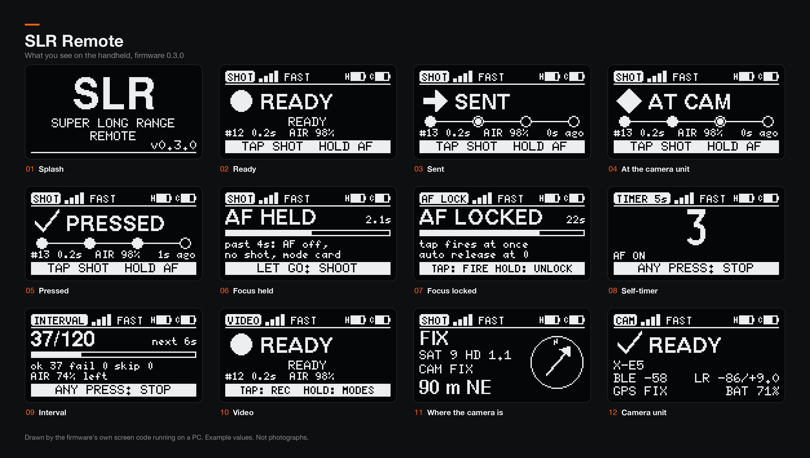

# SLR Remote: screen mock-ups

These are redrawn mock-ups of the firmware screens, not photographs of a real display.

The OLED on each board is 128 x 64 pixels, white on black. To get the mock-ups right pixel for pixel, I run the firmware's own drawing code (`firmware/src/ui.cpp`) on a PC against the real U8g2 graphics library, with the display bus swapped for a memory buffer. Each 128 x 64 frame is then scaled 8 times with no smoothing and placed on a dark bezel.

What that means in practice:

- Layout, fonts and wording are what firmware 0.3.0 draws.
- The numbers (battery levels, signal, shot counts) are example values I chose.
- A real OLED looks different in the hand: it glows, and the pixels have small gaps between them.

## Files

| No. | File | What it shows |
| --- | --- | --- |
| 01 | [`splash.png`](splash.png) | Start-up splash, shown for about 1.7 s on a cold boot only. |
| 02 | [`ready.png`](ready.png) | Home screen in SHOT mode: link up, camera ready. Top bar: mode, signal bars, link speed, handheld (H) and camera unit (C) batteries. |
| 03 | [`sending.png`](sending.png) | A press has gone out over LoRa. First of four progress dots filled. |
| 04 | [`at-cam.png`](at-cam.png) | The camera unit has received the press (second dot). |
| 05 | [`pressed.png`](pressed.png) | The camera took the press over Bluetooth (third dot). This is the tick to look for. |
| 06 | [`af-hold.png`](af-hold.png) | Button held: half-press, focus held. Let go and it shoots. |
| 07 | [`af-lock.png`](af-lock.png) | AF LOCK mode: a tap has locked focus for 30 s. The next tap fires at once, a hold unlocks. |
| 08 | [`timer.png`](timer.png) | Self-timer (set to 5 s here) counting down with focus held (AF ON). Any press stops it. |
| 09 | [`interval.png`](interval.png) | Interval run: shots taken, time to the next one, and the airtime left this hour. |
| 10 | [`video.png`](video.png) | VIDEO mode: a tap starts recording, the next tap stops it. |
| 11 | [`gps.png`](gps.png) | GPS view with both boards holding a fix: distance and compass direction to the camera unit. |
| 12 | [`camera-unit.png`](camera-unit.png) | The camera unit's own status page: Bluetooth state, camera name, radio signal, GPS and battery. |
| 13 | [`slow-link.png`](slow-link.png) | Same home screen on the long-range setting: SLOW in the top bar (spreading factor 10 to 12). |
| 14 | [`mode-card.png`](mode-card.png) | The mode card: tap moves down the list, hold picks. It closes by itself after 6 s. |
| 15 | [`link.png`](link.png) | LINK view: signal each way, margin, spreading factor and bandwidth, transmit power, success rate, round trip time and airtime used. |
| 16 | [`menu.png`](menu.png) | Setup menu on a relay handheld: click moves on, hold 1 s changes the item. |
| 17 | [`checking.png`](checking.png) | Just after power-on: the handheld has asked the camera unit and is waiting for its first reply (radar sweep). |
| 18 | [`unknown.png`](unknown.png) | The press reached the camera unit but no result came back. Shown as UNKNOWN until the next press. |

Two sheets are made from these:

- [`screens-sheet.png`](screens-sheet.png) is the first twelve: the screens you see on a shoot.
- [`screens-all.png`](screens-all.png) is all 18, with the link, menu and status pages as well.

Most are handheld screens in relay mode (handheld to camera unit over LoRa, camera unit to camera over Bluetooth LE). The Splash is the same on both boards apart from one line, and the Camera unit page belongs to the camera unit.

## Reading the home screen

- **Top left tag**: the shooting mode in use (SHOT, TIMER 10s and so on).
- **Signal bars**: how much margin the LoRa link has. LoRa is a slow, long-range radio system.
- **FAST or SLOW**: the link speed. LoRa trades speed for range with a setting called the spreading factor. The firmware picks it by itself: 7 to 9 shows as FAST, 10 to 12 as SLOW.
- **H and C**: handheld and camera unit batteries.
- **AIR n%**: how much of this hour's legal transmit time is left. In the EU band used here a device may transmit for at most 10% of any hour (the duty cycle).
- **Bottom bar**: what a tap or a hold of the one button does right now.

## The four progress dots

A press passes through four stages in relay mode, one dot each:

1. **SENT**: the handheld has transmitted it.
2. **AT CAM**: the camera unit has received it.
3. **PRESSED**: the camera accepted the press over Bluetooth.
4. **CAM EVT**: the camera sent a notification afterwards.

PRESSED is the one to look for: the camera has taken the press. The fourth dot is there for any extra notification the camera chooses to send afterwards.

## Rebuilding them

The sources are in [`../src/oled`](../src/oled).

1. Build the firmware once with PlatformIO so the U8g2 library is downloaded.
2. Run `build.sh <U8g2 library folder> <work folder>`. It compiles `ui.cpp` with a C compiler for the PC and writes one frame per screen.
3. Copy the frames into `../src/oled/frames` and run `python make_screens.py` (needs Pillow).

The frames used for these images are kept in `../src/oled/frames`, so step 3 works without the first two.
