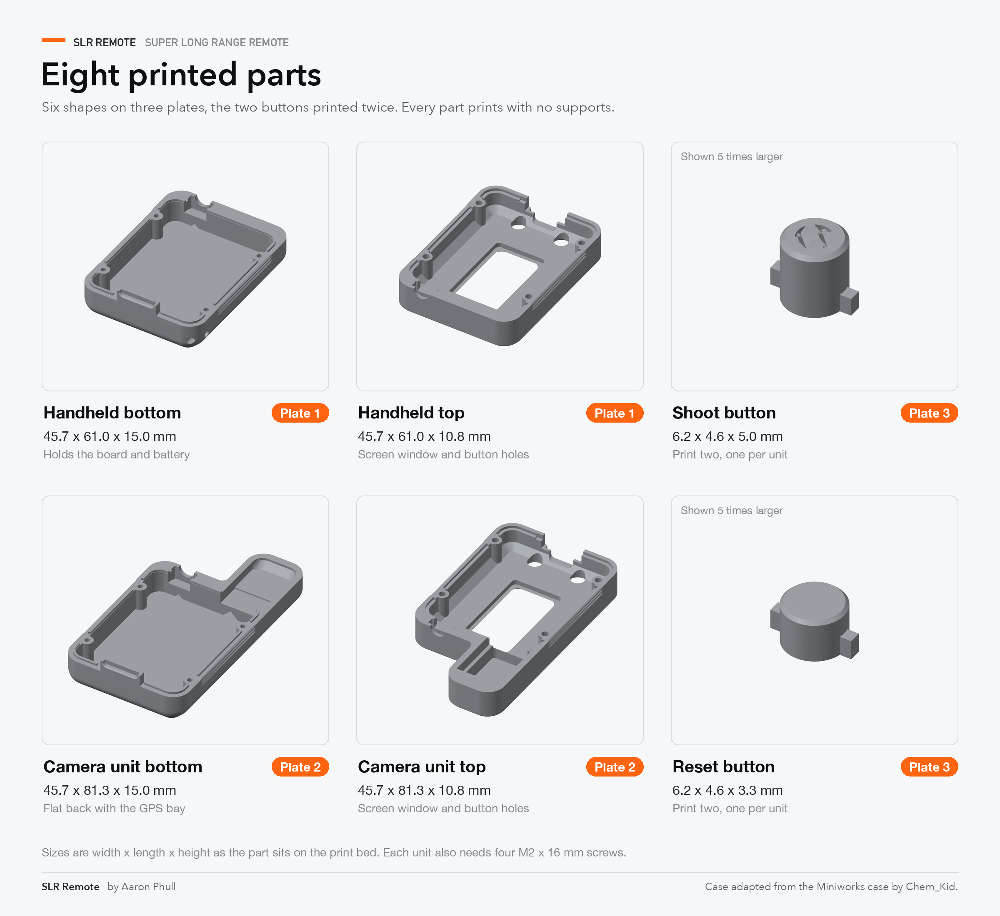
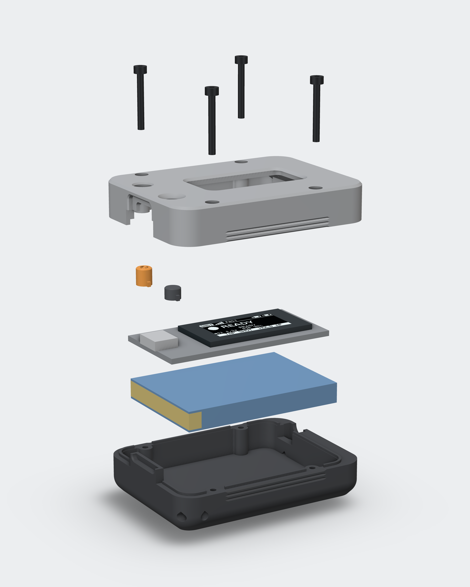
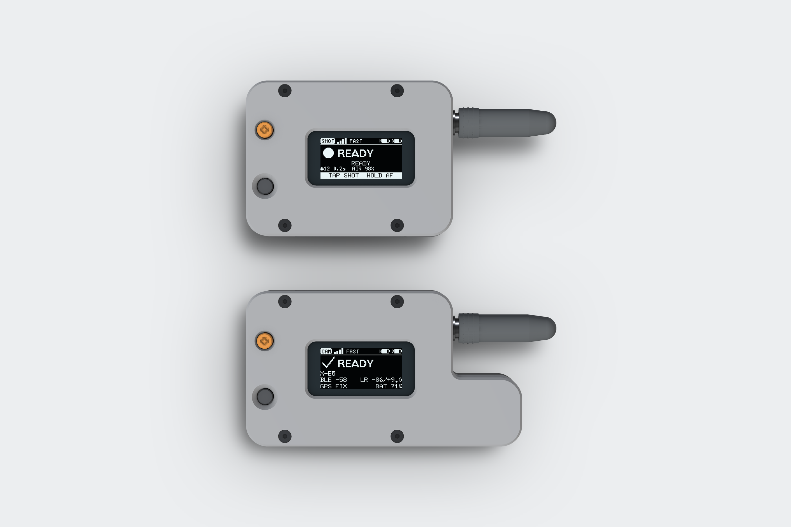

# SLR Remote case

The remote that works for miles lives in two small printed cases: a **handheld** that disappears into a pocket, and a slightly longer **camera unit** that sits with the camera and has a bay for the GPS module. Every part prints with no supports.



The case is adapted from the "Meshtastic Heltec V4 Miniworks case" by Chem_Kid (Thingiverse thing 7367243). It is for personal, non-commercial use: see [Licence](#licence) below.

If you only want to print and build, you need this page as far as [Assembly](#assembly), then [docs/build-guide.md](../docs/build-guide.md).

## The printed parts

Eight pieces in total, from six shapes:

| Part | File in `print/` | Needed | Print size (mm) |
|---|---|---|---|
| Handheld bottom | `miniworks_refined_handheld_back.stl` | 1 | 45.72 x 60.96 x 15.03 |
| Handheld top | `miniworks_refined_handheld_front.stl` | 1 | 45.72 x 60.96 x 10.79 |
| Camera unit bottom | `miniworks_refined_camera_back.stl` | 1 | 45.72 x 81.28 x 15.03 |
| Camera unit top | `miniworks_refined_camera_front.stl` | 1 | 45.72 x 81.28 x 10.79 |
| Shoot button | `miniworks_refined_action_button.stl` | 2 (one per unit) | 6.23 x 4.57 x 5.0 |
| Reset button | `miniworks_refined_reset_RST.stl` | 2 (one per unit) | 6.23 x 4.57 x 3.26 |

All files are in [final/miniworks_refined/print/](final/miniworks_refined/print/), already turned to the right way up for printing. The file names and the source call the bottom half `back` and the top half `front`.

Assembled sizes, without the antenna:

| Unit | Width x length x thickness |
|---|---|
| Handheld | 45.7 x 61 x 21.6 mm |
| Camera unit | 45.7 x 81.3 x 21.6 mm |



## Print plates

Ready-made plates in the same folder, in `.3mf` format:

| Plate | What is on it | Estimated time |
|---|---|---|
| `handheld_refined.3mf` | Handheld bottom and top | about 46 min |
| `camera_refined_flat_back.3mf` | Camera unit bottom and top | about 54 min |
| `buttons_refined.3mf` | Two shoot buttons, two reset buttons | about 6 min |
| `tops_and_shoot_buttons.3mf` | Both tops and two shoot buttons only | about 50 min |

**A full set is the first three plates**, about 1 hour 45 minutes of printing in all.

The fourth plate is a reprint for anyone who made the earlier oval-button version: the bottoms and reset buttons from that version are reused, so only the tops and shoot buttons need printing again.

The times are the slicer's estimates for the settings below on a Bambu Lab X1 Carbon. Yours will differ.

## Print settings

These are the settings I print with and the ones the plates are checked against.

| Setting | Value |
|---|---|
| Printer profile | Bambu Lab X1 Carbon, 0.4 mm nozzle |
| Layer height | 0.20 mm (the stock "0.20mm Standard" process) |
| Material | PETG (the stock "Bambu PETG Basic" profile) |
| Bed | Textured PEI plate |
| Supports | Off |
| Brim | On the buttons only (3 mm, set in the plate files). The slicer check confirms none is added to the case halves |
| Orientation | As supplied. Do not let the slicer re-orient or re-arrange the parts |

How the parts sit on the bed:

- **Bottoms** print outside face down.
- **Tops** print screen side down.
- **Buttons** print standing upright on their foot.

The design is drawn for 0.20 mm layers. No overhang leans more than 45 degrees from vertical and there are no bridges, so 0.20 mm is the height to use.

Any printer that can hold those settings will do. The plates are laid out for a 256 mm bed. If you use the loose STL files, keep each part in the orientation it is saved in.

## Hardware

| Item | Quantity |
|---|---|
| M2 x 16 mm screws | 4 per unit, 8 in all |

The screws go in from the top (screen side), through a clearance hole with a recess for the head, and cut their own thread in a 1.8 mm pilot hole in the bottom. There are no nuts and no threaded inserts.

The head recess is 3.9 mm across and 2.2 mm deep, so pick screws with a head that sits inside it.

The battery bay is sized for an LP603449 LiPo cell. Everything else that goes inside is listed in [docs/shopping-list.md](../docs/shopping-list.md).

## Assembly

The full walkthrough, with the wiring, is in [docs/build-guide.md](../docs/build-guide.md). The things that are specific to the case:

- **Buttons go in first, from the inside.** Drop the shoot button and the reset button into the top half from the inside before anything else. Each has a foot wider than its hole, so once the case is closed they cannot fall out.
- **Which button is which.** The taller knurled one is the shoot button. The shorter smooth one is the reset button, which sits just below the surface so it is hard to press by accident.
- **The halves locate themselves.** A raised rim on the bottom fits a groove in the top. If the halves will not close flat, something is trapped. Do not force it with the screws.
- **Do not overtighten.** The screws thread into plastic. Stop when the seam closes.
- **Mind the battery lead.** There is a small pocket for the battery wires beside the USB opening. Keep them out of the seam and away from the screws.

## What the case has



- **One smooth outline** with no screw ears or lugs.
- **Rolled back edge.** It starts at 45 degrees on the bed and curves into the side wall, which is comfortable in the hand and prints without supports.
- **Grip band.** Five fine V grooves along each long side, centred on the seam, so the join between the halves reads as one of the grooves.
- **Round knurled shoot button**, standing about 0.9 mm proud, with a diamond pattern on top so you can find it by feel.
- **Recessed reset button**, 0.8 mm below the surface.
- **Chunky USB-C opening**, 13.4 x 6.3 mm, with room for the plastic body of a cable plug.
- **Antenna connector mount** for an SMA connector at the far end, with a pocket for its nut.
- **Lanyard hole** (handheld only), tunnelled through the corner by the USB opening. Nothing sticks out. The passage is 2.5 mm across.
- **GPS bay** (camera unit only), sized for the L76K GPS module the original design was drawn around.
- **Flat back** on the camera unit, so it sits flat against whatever you fix it to. Fix it to the camera, strap or tripod however suits your kit.

## How it is made

The case is written in Python. A set of scripts load Chem_Kid's original files, take measurements from them and build the new parts as solids. Change a number, run the build, and you get new print files and a fresh set of checks.

Each layer imports the one before it:

| Folder in `final/` | What it adds |
|---|---|
| `miniworks_integrated/` | The shell: outline, screws, locating rim, grip band, rolled edge, the openings |
| `miniworks_onepiece_corrected/` | The buttons |
| `miniworks_lanyard_integrated/` | The lanyard passage |
| `miniworks_refined/` | The USB area, the final part list, and the build, check and slice scripts |
| `camera_block/` | Shared geometry helpers and the layer-by-layer overhang scan the checks use. Not a case of its own, and the build needs it |

## Rebuilding from source

### What you need

- Python 3.13 (the version I used)
- The packages in [requirements.txt](requirements.txt). The build itself uses `manifold3d`, `trimesh` and `numpy`.
- The original design files in [vendor/miniworks/](vendor/miniworks/). They are in the repository. The build reads them, so leave them where they are.
- For the slicing check only: Bambu Studio, installed in the standard place on a Mac (`/Applications/BambuStudio.app`).

### Set up

From this `case/` folder:

```
python3 -m venv .venv
.venv/bin/pip install -r requirements.txt
```

On Windows use `.venv\Scripts\pip` and `..\..\.venv\Scripts\python` in place of the `.venv/bin/` paths.

### Build, check, slice

```
cd final/miniworks_refined
../../.venv/bin/python build.py
../../.venv/bin/python validate.py
../../.venv/bin/python slice_check.py
```

| Script | What it does | What it writes |
|---|---|---|
| `build.py` | Builds the six parts and the four plates. Refuses to export any part that is not a single closed solid | `print/*.stl`, `print/*.3mf`, `dimensions.json` |
| `validate.py` | Runs the 107 checks below. Exits with an error if any fail | `validation.json` |
| `slice_check.py` | Slices all four plates with Bambu Studio's command line. It never sends anything to a printer | `slicer_check/summary.json` |

`slice_check.py` is written for a Mac with Bambu Studio. The first two scripts need only Python.

The pictures in `assets/renders/` are made by [tools/render_studio.py](tools/render_studio.py), which uses `pyvista`.

### Where to change things

Dimensions are named constants near the top of each `design.py` or `model.py`. For example the screw positions and hole sizes are in `final/miniworks_integrated/model.py`, and the button knurl is in `final/miniworks_onepiece_corrected/design.py`. Always run `validate.py` after a change: it is there to catch a change that quietly breaks a fit somewhere else.

## What the validation checks

107 checks, all passing on the files in this repository.

| Group | Checks | What they confirm |
|---|---|---|
| Every part | 24 | Each of the six parts is one closed solid, has the expected volume, sits flat on its print face, and passes a layer-by-layer scan at 0.20 mm for anything that would need support |
| Buttons | 5 | The button shapes, heights and which hole each belongs to |
| Each unit | 60 (30 per unit) | The halves close without colliding. The outside size is right. There is clear space for the battery, the board, the screen, the USB socket and a USB plug, and the antenna connector with its nut. Both buttons can be pressed 1.2 mm, drop in from the inside, and cannot escape outwards. All four screws have a pilot hole, head room, and stop short of the bottom |
| Camera unit only | 2 | The GPS bay and the flat back |
| Handheld only | 2 | The lanyard passage is complete and is the only extra hole |
| Print plates | 14 | Each plate holds the right parts, each sitting on the bed, with supports off |

The layer scan is the important one for printing. It walks up each part 0.2 mm at a time and allows each layer to overhang the one below by no more than one layer height (a 45 degree slope). The result for all six parts is no bridges and no failures.

`validate.py` covers the three main plates. The reprint plate `tops_and_shoot_buttons.3mf` gets its check from the slicer script.

## What changed from the original

Chem_Kid's Miniworks case is a single compact case for a Heltec V4 running Meshtastic, held with four M3 screws, with one button design used twice. This version keeps its internal fit and changes most of the outside.

1. **Two cases from one design.** A short handheld with no GPS bay, and a longer camera unit with one.
2. **One continuous outline.** The screw ears are gone. The handheld is one plain rounded rectangle, and the camera unit keeps a narrower GPS section beside the antenna.
3. **Smaller screws.** Four M2 x 16 in place of four M3, moved inside the outline, with recessed heads.
4. **Rolled back edge** in place of the chamfer.
5. **Grip band** of V grooves along the seam.
6. **Locating rim.** A tongue on the bottom and a groove in the top, so the halves line up by themselves.
7. **Prints without supports.** The split and every overhang were redrawn so bottoms print outside face down and tops print screen side down.
8. **Reworked USB end.** The wall under the socket now belongs to the bottom half, with a straight-sided pocket large enough for a cable plug.
9. **Lanyard passage** through the handheld's corner.
10. **New buttons.** A proud, knurled, round shoot button and a recessed smooth reset button, in place of the original single plunger design.
11. **Hollow sections** in the antenna end and GPS cover to save material.
12. **Flat battery floor** to suit the LP603449 cell.

Kept from the original: the screen opening, the button positions, the USB socket position, the antenna connector mount, the GPS bay and the 45.72 mm width.

Tried along the way and replaced with something better: an engraved logo, a wide oval shoot button (it caught on real prints, and the round knurled one took its place), and two other button ideas that stayed as mock-ups.

## Good to know

The bottoms and the earlier tops printed well. The round-button tops are the newest part of the design: they pass every check and slice cleanly, and at the time of writing they were still to be printed. If you print a set, tell me how the buttons feel.

## Licence

The case is a derivative of Chem_Kid's design, which is licensed Creative Commons Attribution-NonCommercial. My version carries the same conditions, as CC BY-NC 4.0. Full details are in [LICENSE-CASE.md](../LICENSE-CASE.md).

What that means:

- **Print it for yourself**, change it, share your changes.
- **Keep the credit** with anything you share:

  > SLR Remote case by Aaron Phull, adapted from "Meshtastic Heltec V4 Miniworks case" by Chem_Kid (Thingiverse thing 7367243). CC BY-NC 4.0.

- **Do not sell** the case, the files, or prints made from them.

The original files are in [vendor/miniworks/](vendor/miniworks/), unedited, with Chem_Kid's own description and licence statement ([LICENSE_original.txt](vendor/miniworks/LICENSE_original.txt)). The credit is also written into the metadata of every print plate.

Thank you to Chem_Kid for a well-made case to start from. See [CREDITS.md](../CREDITS.md).
