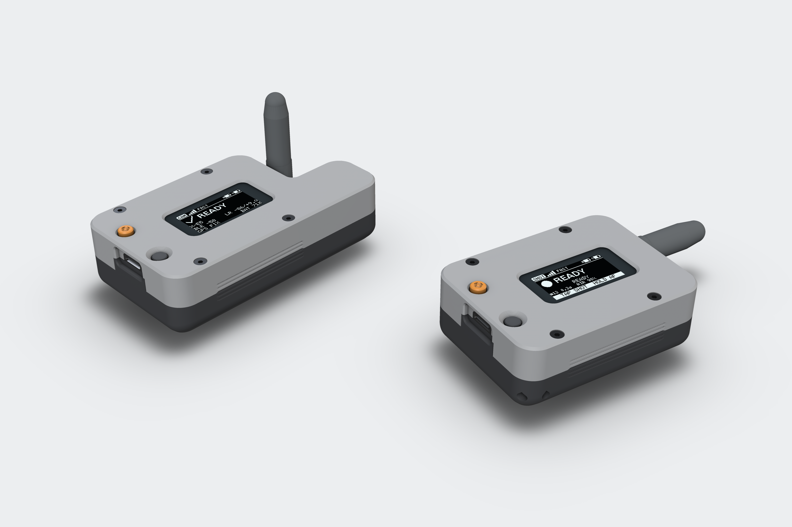
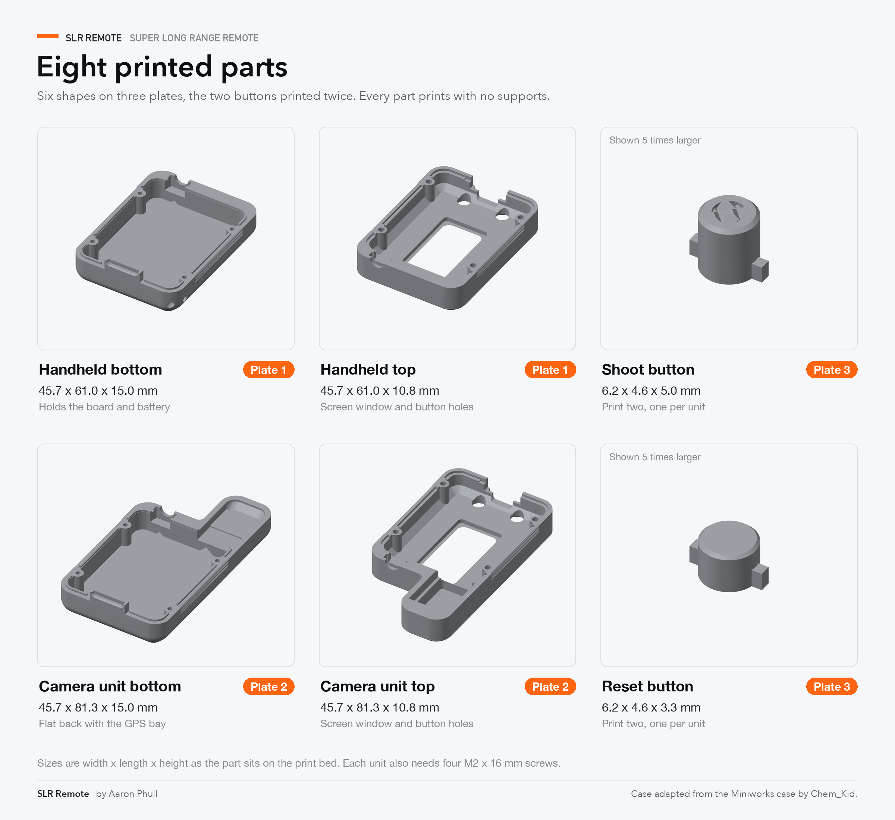
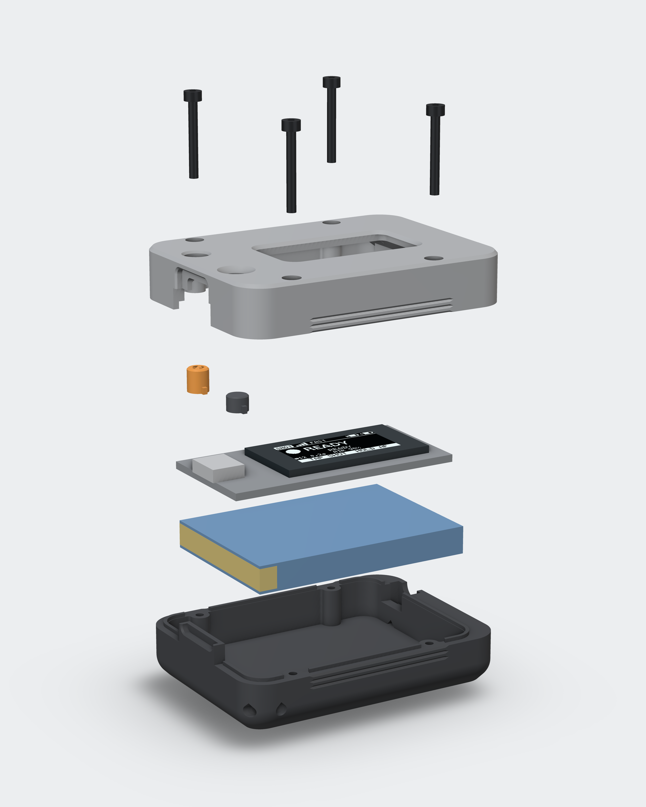
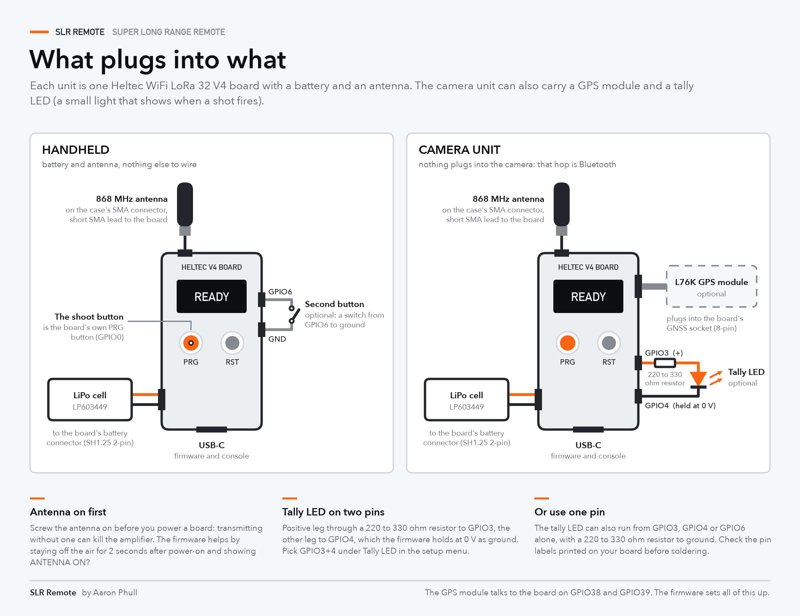
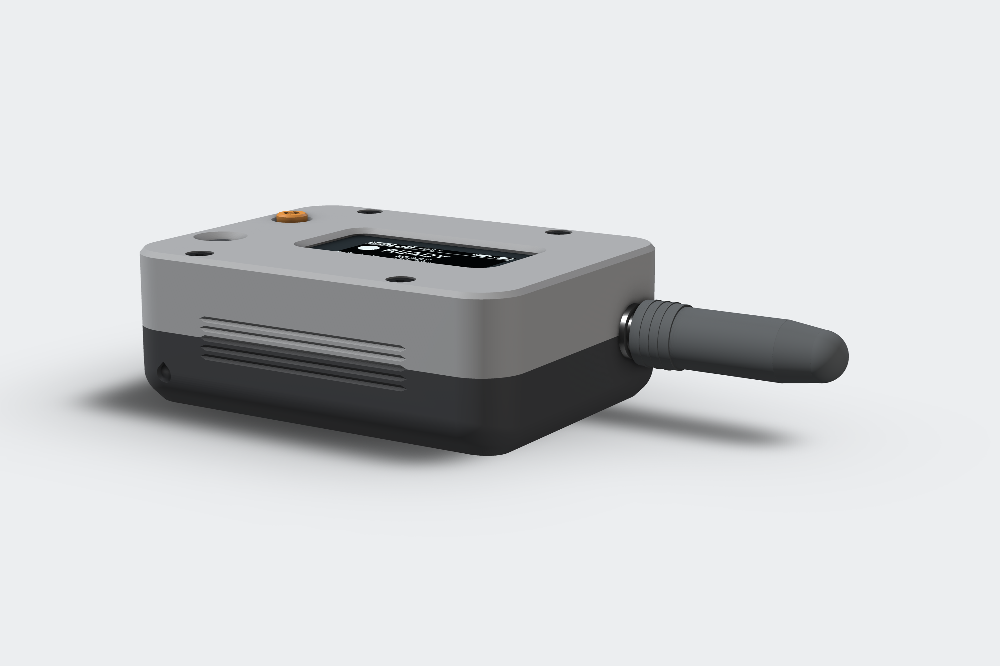

# Build guide: print, assemble, wire

Two small cases, eight printed parts, eight screws. This page takes you from a spool of filament to a finished handheld and camera unit.

Parts are in the [shopping list](shopping-list.md). Flash and pair the boards on the desk first ([flashing-and-pairing.md](flashing-and-pairing.md)), while you can still get at everything.

## The case

I wanted the handheld to feel like something you would happily carry on every shoot: small, smooth, nothing to snag in a pocket, and a shoot button your thumb finds without looking.

- One clean outline with a rolled back edge that sits well in the hand.
- A grip band of fine grooves down each long side. The join between the halves hides in one of the grooves.
- A round, knurled shoot button that stands just proud of the surface, and a smooth reset button sunk below it so you cannot press it by accident.
- A lanyard passage through the corner of the handheld, with nothing sticking out.
- A generous USB-C opening that takes chunky charging cables.
- A longer camera unit with a flat back and a bay for the GPS module.

The handheld is 61 x 45.7 x 21.6 mm and the camera unit 81.3 x 45.7 x 21.6 mm, without antennas.

The design is adapted from the "Meshtastic Heltec V4 Miniworks case" by Chem_Kid. Credit and licence are at the foot of this page.

## The parts

| Printed part | How many | Print size (mm) | Notes |
|---|---|---|---|
| Handheld bottom (`handheld_back`) | 1 | 45.72 x 60.96 x 15.03 | Lanyard passage in one corner |
| Handheld top (`handheld_front`) | 1 | 45.72 x 60.96 x 10.79 | Screen window and two button holes |
| Camera unit bottom (`camera_back`) | 1 | 45.72 x 81.28 x 15.03 | Flat back, longer body |
| Camera unit top (`camera_front`) | 1 | 45.72 x 81.28 x 10.79 | Includes the GPS bay cover |
| Shoot button (`action_button`) | 2 | 6.23 x 4.57 x 5.0 | Round, knurled, stands 0.94 mm proud |
| Reset button (`reset_RST`) | 2 | 6.23 x 4.57 x 3.26 | Smooth, sits 0.8 mm below the surface |

## Printing

### Which files

The ready-to-print plates are in [`case/final/miniworks_refined/print/`](../case/final/miniworks_refined/print/). Print these three:

| Plate file | What is on it | Slicer estimate |
|---|---|---|
| `handheld_refined.3mf` | Handheld bottom and top | about 46 minutes |
| `camera_refined_flat_back.3mf` | Camera unit bottom and top | about 54 minutes |
| `buttons_refined.3mf` | Two shoot buttons, two reset buttons | about 6 minutes |

That is about 1 hour 45 minutes for the lot (Bambu Studio estimates on an X1 Carbon).

A fourth plate, `tops_and_shoot_buttons.3mf`, holds both tops and two shoot buttons. It is there for anyone who wants to reprint only the tops and shoot buttons.

If your slicer does not open `.3mf` plates, the same folder has one `.stl` per part (`miniworks_refined_handheld_back.stl` and so on), already turned the right way up for printing.

### Orientation

The plates are laid out for you. If you place the STL files yourself:

- **Bottoms:** outside back face on the bed, open side up.
- **Tops:** screen side face down on the bed, open side up.
- **Buttons:** upright, foot on the bed, pressed surface on top.

Switch off auto-orient in the slicer so it leaves them alone.

### Supports off

Every part prints with **no supports**. No overhang leans more than 45 degrees from vertical: the rolled back edge, the pointed roof of the lanyard passage, the pockets inside and the grip grooves. The plates carry supports switched off inside the file. Leave them that way and the parts come off the bed ready to use.

### Settings

These are the settings the plates are set up and checked with:

| Setting | Value |
|---|---|
| Printer profile | Bambu Lab X1 Carbon, 0.4 mm nozzle |
| Process | 0.20 mm Standard |
| Material | PETG (Bambu PETG Basic profile) |
| Bed | Textured PEI plate |
| Supports | Off |
| Brim | On the buttons only (3 mm, set inside the buttons plate). The slicer check confirms none is added to the case halves. |

Walls, infill, speeds and temperatures are the stock profile. Keep the 0.20 mm layer height: the 45 degree overhangs are designed around it.

### After printing

- Peel the brim off the buttons and make sure each foot is clean. A whisker of brim is the usual cause of a sticky button.
- Drop each button into its hole from the inside of the top and press it a few times. It should slide freely (there is a 0.25 mm gap all round) and stop at the front without falling through.
- Push a bit of filament through the lanyard passage in the handheld bottom to clear it.
- Close the two halves of each unit empty. A thin raised rim on the bottom drops into a groove in the top, and the halves should meet all the way round before any screw goes in.

## Assembly

Both units go together the same way. The camera unit has two extras, the GPS bay and a tally LED if you want one, so build the handheld first.

Where everything lives:

- The **two buttons** sit in the top, at the USB end, over the board's own `PRG` and `RST` buttons.
- The **board** sits under the top with its screen looking out of the window.
- The **battery** lies flat on the floor of the bottom.
- The **antenna socket** is at the far end from the USB port, right on the join between the halves.
- The **screws** go in from the screen side and thread into the bottom.

### Wiring

There is very little of it. The battery and the GPS module plug in, and the antenna lead clips on. Only the optional tally LED is soldered.

### Handheld, step by step

The easy way is to build the stack up inside the top half while it lies face down, then put the bottom on like a lid. Do one dry run without the battery connected to see how it all sits.

1. **Check battery polarity.** With a multimeter, confirm which wire on the battery plug is positive and that it lines up with the `+` mark beside the board's battery socket. See [about the battery plug](shopping-list.md#about-the-battery-plug).

2. **Buttons in.** Lay the top face down. Drop the knurled shoot button and the smooth reset button into their holes from the inside, foot last. The shoot button goes over the board's `PRG` button and the reset button over `RST`. Seen from the front of the finished unit with the USB port to your left, the shoot button is the upper one.

3. **Antenna lead onto the board.** Press the small plug of the lead straight down onto the board's LoRa antenna socket until it clicks.

4. **Board in.** Lower the board into the top, screen down, with the screen in its window and the USB port at the end with the buttons. The board now keeps the buttons in place.

5. **Antenna socket.** Sit the SMA socket in its hole at the far end with its nut in the pocket beside it, and nip the nut up while you can reach it. The hole and pocket span both halves, so the case closes around the connector.

6. **Battery.** Plug the cell into the board. The board will start up, which is fine. Lay the cell flat on the back of the board, with its wires towards the small pocket beside the USB opening so they are not pinched.

7. **Close.** Lower the bottom over the stack. The rim should drop into its groove all the way round. If the halves will not meet, a wire is in the way: open up and tuck it clear of the screw positions and the seam.

8. **Four screws.** Turn the unit over, check both buttons click, and fit four M2 x 16 mm screws from the screen side. They cut their own thread the first time, so go gently and stop when the head seats.

9. **Antenna on.** Screw the antenna onto the SMA socket.

10. **Lanyard.** Thread a thin cord through the passage in the corner at the USB end. It goes in on the end face and comes out on the side.

### Camera unit, step by step

Same steps as the handheld, plus the extras below if you are fitting them.

#### Optional: GPS module

The longer body of the camera unit has a bay for an L76K GPS module at the antenna end, beside the SMA socket. With it fitted the camera unit can stamp your location into each photo. If the handheld has a GPS module of its own as well, it can show how far away the camera is and in which direction.

1. Plug the module's cable into the board's 8-pin GNSS socket.
2. Sit the module in the bay before the battery goes in, as the cable is short. Two rails in the top hold it once the case is closed. Give the flat ceramic antenna on the module a clear view out of the case.

The GPS stays switched off until you turn on `Geotag` in the camera unit's setup menu, or the handheld asks where the camera is.

#### Optional: tally LED

A tally LED lights while the shutter is down and for a quarter of a second on each accepted shot. Stand in front of the camera for a self-portrait and you can see the moment it fires. Wire it one of two ways, then switch it on in the setup menu.

| Wiring | Connect | Menu setting | Console |
|---|---|---|---|
| Two pin | LED long leg (anode, +) through a 220 to 330 ohm resistor to GPIO3, short leg (cathode) to GPIO4 | `Tally LED` = `GPIO3+4` | `tally 34` |
| Single pin | LED + to GPIO3, GPIO4 or GPIO6. Other leg through a 220 to 330 ohm resistor to GND | `Tally LED` = `GPIO3`, `GPIO4` or `GPIO6` | `tally 3`, `tally 4` or `tally 6` |

- In the two-pin wiring the firmware holds GPIO4 at 0 V, so it acts as the LED's ground and you need no ground pad. The resistor is still needed.
- Find the pins from the labels printed on your own board.
- GPIO3 and GPIO4 are also the board's QuickLink connector, so leave that connector free when the tally LED uses them.
- Where the LED shows is your choice: drill a small hole where it suits how you shoot.
- A change to the tally setting takes effect after a restart.

#### Where the camera unit goes

Anywhere near the camera. It talks to the camera by Bluetooth, so a pocket of the camera bag hung from the tripod, a strap, or a patch of hook-and-loop on a tripod leg all work. The flat back makes it easy to fix to things. For the best reach, let the antenna stand upright and clear.

## Checklist before you close each unit up

Run through this for each unit.

- [ ] Antenna lead clicked onto the board's LoRa socket
- [ ] SMA nut tight and the **antenna screwed on**
- [ ] Battery polarity checked against the board's `+` mark
- [ ] No wire across a screw position or caught in the seam
- [ ] Both buttons click and spring back
- [ ] Screen square in its window
- [ ] USB-C plug goes fully home in the opening
- [ ] Four screws seated
- [ ] (Camera unit) GPS cable fully in, if fitted
- [ ] (Camera unit) tally LED the right way round, if fitted

From cold, the board plays a short splash (an iris opening, then `SLR`, `SUPER LONG RANGE`, `REMOTE`, to which the camera unit adds `CAMERA UNIT`) with the firmware version in the corner. The board then shows `ANTENNA ON?` for a few seconds as a friendly last reminder.

## Good to know

The round shoot button is the newest part of the case. An earlier wide oval button stuck on real prints, so I redrew it round. The bottoms and the earlier tops printed well; the round-button tops were waiting for their first print when I wrote this. The steps above follow how the case is designed to go together, so do the dry run and trust what you see.

## Changing the case

The case is written as Python scripts, so you can change a dimension and rebuild the print files. See [case/README.md](../case/README.md).

## Credit and licence for the case

The case is adapted from the "Meshtastic Heltec V4 Miniworks case" by Chem_Kid (Thingiverse thing 7367243), shared under Creative Commons Attribution, Non-Commercial. Make one for yourself, keep the credit with any file made from it, and do not sell the case or anything built from it. See [LICENSE-CASE.md](../LICENSE-CASE.md) and [CREDITS.md](../CREDITS.md).

Next: [user-guide.md](user-guide.md).
