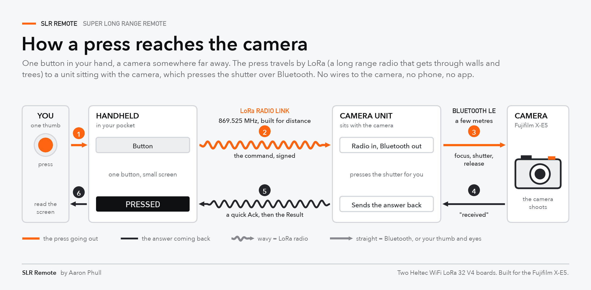
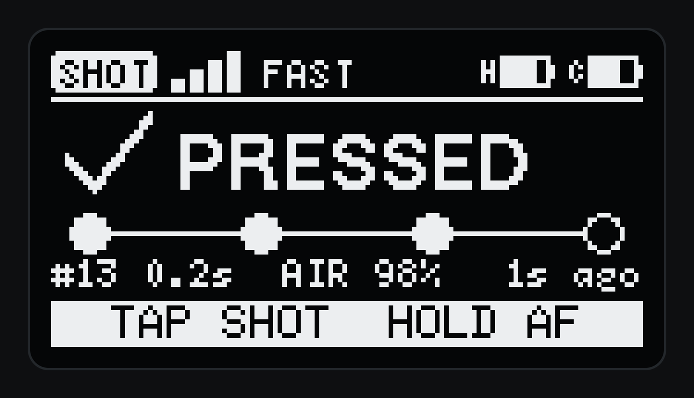
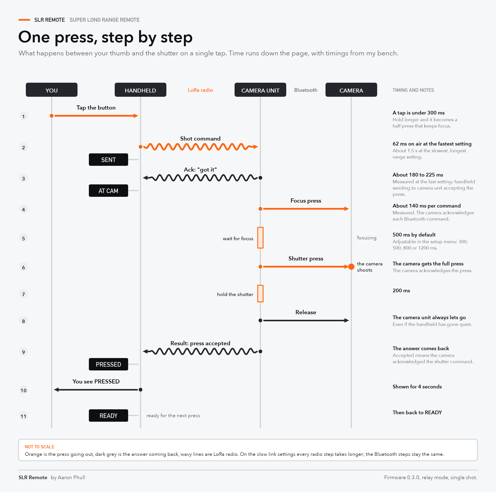
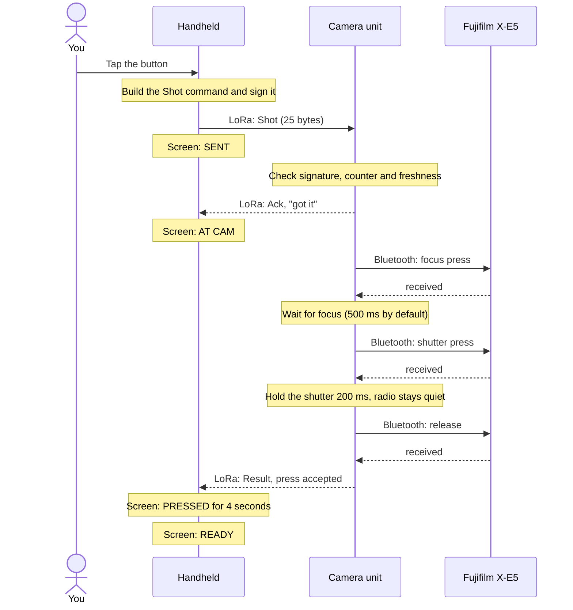

# Data flow: from your thumb to the shutter

You press the one button in your pocket, and somewhere out of sight a shutter goes.

This page follows that one press all the way there and back. It is the plain-English tour. The radio settings, the security and the code map are in [How it works](how-it-works.md).



## The idea in one line

```
thumb  >  handheld  ~~ LoRa radio, 868 MHz ~~  camera unit  ~~ Bluetooth ~~  camera
```

SLR Remote is two small boxes. The **handheld** lives in your pocket and has one button and a small screen. The **camera unit** sits with the camera.

They talk to each other over **LoRa**, a radio system made for sending tiny messages a very long way on very little power. It is the technology used for links of several miles in open country. The camera unit then presses the shutter over **Bluetooth LE** (BLE, the low-power kind of Bluetooth), using the camera's own built-in remote release. That is the same feature the phone app uses, so there is nothing plugged into the camera, and no phone or app anywhere in the chain.

Bluetooth only has to cross the gap between the camera unit and the camera. LoRa does the distance.

## The six hops

The numbers match the picture above.

### 1. You press the button

A tap takes a photo. A hold is a half-press: it keeps focus until you let go, and letting go takes the shot. Anything shorter than 300 ms counts as a tap.

If the button ends up squashed in a bag, the handheld notices. After 15 seconds held it shows `BUTTON STUCK`, lets go of anything it was holding and goes to sleep.

### 2. The handheld sends a command by LoRa

The handheld builds a 25 byte message called a **Shot**, which means "focus, wait, shoot, let go". It signs the message with a key that only my two units share, then sends it on 869.525 MHz. On the fast link setting the message is on the air for about 62 ms. The screen shows `SENT`.

If no answer comes back, the handheld sends it again, up to four times in all. Every retry carries the same command number, so the camera unit knows it is the same press and will never take a second photo for it. A press that cannot go out promptly is dropped and the screen says so (`NOT SENT`). It never fires late, when you have stopped expecting it.

### 3. The camera unit presses the shutter

The camera unit checks the signature, checks the message is new and fresh, then works the camera's shutter button for you over Bluetooth in three commands:

1. Focus press (a half-press).
2. Wait the focus time (500 ms by default), then shutter press.
3. Hold for 200 ms, then release.

Each Bluetooth command takes about 140 ms on my bench. While the shutter is down the camera unit keeps its radio quiet, so nothing can stretch the press.

If the camera is switched off or has wandered out of Bluetooth reach, the camera unit says so at once (`CAM NOT READY`) and nothing is pressed. The shutter command itself is never retried, because a retry could take two photos.

### 4. The camera acknowledges

The camera confirms it received each Bluetooth command. That is all it reports, and it is what the word `PRESSED` on the handheld is built on.

### 5. The camera unit answers by LoRa

Two answers come back. A quick **Ack** ("got it") goes out as soon as the command arrives, before the camera unit touches the camera. On the fast setting that lands about 180 to 225 ms after the handheld sent the press, and the screen changes to `AT CAM`. Then, once the press is done and the shutter released, a **Result** follows.

If an answer is lost on the way, the handheld asks again. The camera unit recognises the repeat and replies from memory. It does not run the press twice.

### 6. The handheld shows PRESSED

`PRESSED` appears with a small iris animation, stays for four seconds, then the screen goes back to `READY` for the next frame. A failed or unknown outcome stays on screen until you press again, so you never miss one.



## One press, step by step



The same press again, this time with a clock running. Time runs down the page. Orange is the press going out, dark grey is the answer coming back, and the wavy lines are LoRa.

| Step | What happens | Handheld screen | Timing |
|---|---|---|---|
| 1 | You tap the button | | A tap is under 300 ms |
| 2 | Shot command goes out by LoRa | `SENT` | 62 ms on air at the fastest setting |
| 3 | Ack comes back: "got it" | `AT CAM` | About 180 to 225 ms from sending to the camera unit accepting the press |
| 4 | Focus press, over Bluetooth | | About 140 ms per Bluetooth command |
| 5 | The camera unit waits while the camera focuses | | 500 ms by default (300, 500, 800 or 1200 ms in the setup menu) |
| 6 | Shutter press. This is the photo. | | About 140 ms |
| 7 | The shutter is held | | 200 ms |
| 8 | Release | | The camera unit always lets go |
| 9 | Result comes back by LoRa | `PRESSED` | |
| 10 | You see `PRESSED` | `PRESSED` | Shown for 4 seconds |
| 11 | Ready for the next press | `READY` | |

Add the early steps together and the shutter goes roughly a second after your thumb on the fast setting. Half of that second is the focus wait, which is there on purpose so the camera has time to find focus before the shutter goes. If you have focused already, or the subject is easy, turn it down to 300 ms.

The 180 to 225 ms and 140 ms figures were timed on my bench. The airtime figures come from the firmware's own LoRa airtime formula.

When the handheld is a long way off, the link shifts itself to a longer-reach setting and the screen says `SLOW`. Every radio step then takes longer (the Shot message alone is about 1.5 seconds on the air at the slowest setting) while the Bluetooth steps stay the same. That is the trade LoRa offers: give up some speed, gain a lot of reach. See [Adaptive link speed](how-it-works.md#adaptive-link-speed-fast-and-slow).

### Holding instead of tapping

Hold the button and the flow splits in two. A **Focus** message goes when you hold, and the camera holds focus like a half-pressed shutter button. A **Shoot** message goes when you let go. The camera unit then lets go of the shutter by itself 200 ms later, on its own clock, so the press is always crisp even if the radio is slow.

## The same thing as a sequence diagram

GitHub draws this one from text, so it still works if the pictures do not load.



## What rides along

The answers coming back carry more than "yes". Every Ack and Result includes a small status report from the camera unit, and the handheld's regular check-ins (pings) carry a little the other way. That is how a screen in your pocket knows what is going on at a tripod two fields away.

| What | Which way | Where you see it |
|---|---|---|
| Camera unit battery level | Camera unit to handheld | The `C` battery icon, next to the handheld's own `H` |
| Handheld battery level | Handheld to camera unit | Carried in each ping |
| Signal quality in both directions | Both ways | The four signal bars, and the LINK page |
| Whether the camera is connected | Camera unit to handheld | `READY`, `NO CAM`, `SCAN` or `CONN` |
| Link speed | Camera unit to handheld | `FAST` or `SLOW` in the top bar |
| Airtime used this hour | Camera unit to handheld | `AIR n%`, the airtime left on whichever unit has used more |
| The clock, from GPS | Camera unit to handheld | The handheld sets its clock from it, so it needs no GPS of its own |
| The camera unit's position, if it has a GPS fix | Camera unit to handheld | Distance and compass direction to the camera on the GPS page, when the handheld has a fix too |

Between presses the handheld pings every few seconds on the fast setting (further apart on the slow ones) and the camera unit answers. Those pings are how the remote measures the link and decides when to speed up or slow down.

## What never comes back

One thing: a message from the camera saying "photo taken".

Fujifilm's Bluetooth remote release confirms that the camera received the press, and stops there. I tested it. A real exposure and a press where autofocus could not lock look exactly the same from outside.

So the remote uses its words carefully. `PRESSED` means the camera accepted the shutter press, which is the strongest confirmation the camera offers. The screen never claims more than came back. If the remote ever cannot tell what happened (a reply lost at the edge of range, say) it shows `UNKNOWN` and leaves it on screen.

Video works the same way. With the camera in movie mode, a press starts recording and another press stops it. The camera does not report its recording state, so VIDEO mode shows `REC?` with a running clock as a reminder to glance at the camera when you can.

## If the link drops while you are holding

Say you are holding focus on a bird at the feeder and the handheld's battery picks that moment to die.

While you hold, the handheld keeps sending a quiet "still holding" message. If the camera unit stops hearing it, it lets go of the camera's shutter by itself and shows `HOLD RELEASED: NO LINK`. On the fast setting that takes about 10 seconds. I tested it by pulling the power from the handheld mid-hold.

The camera unit also starts every new Bluetooth connection with a release, which clears any press the camera might still be holding from before.

## Where next

- [How it works](how-it-works.md): the two radios, link speeds, pairing and the code map.
- [Range](range.md): how far it reaches and how to get the most from it.
- [User guide](user-guide.md): every screen, gesture and shooting mode.
- [Troubleshooting](troubleshooting.md): what each message on the screen means.
