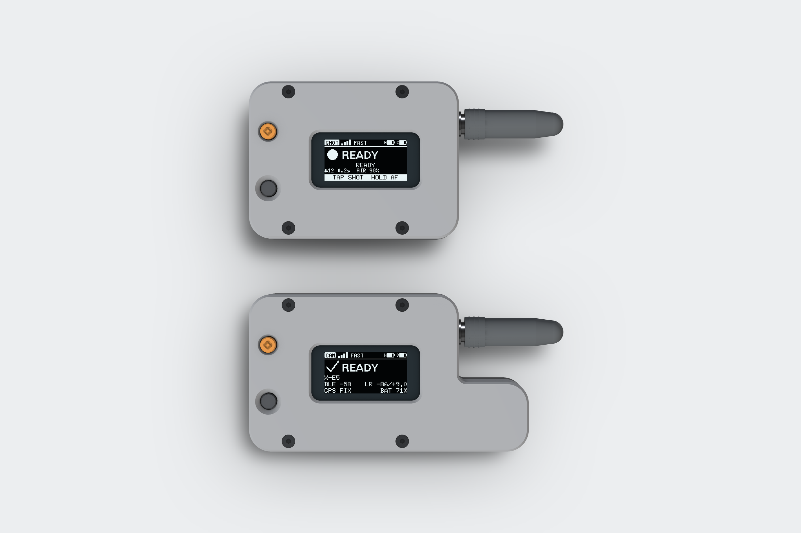
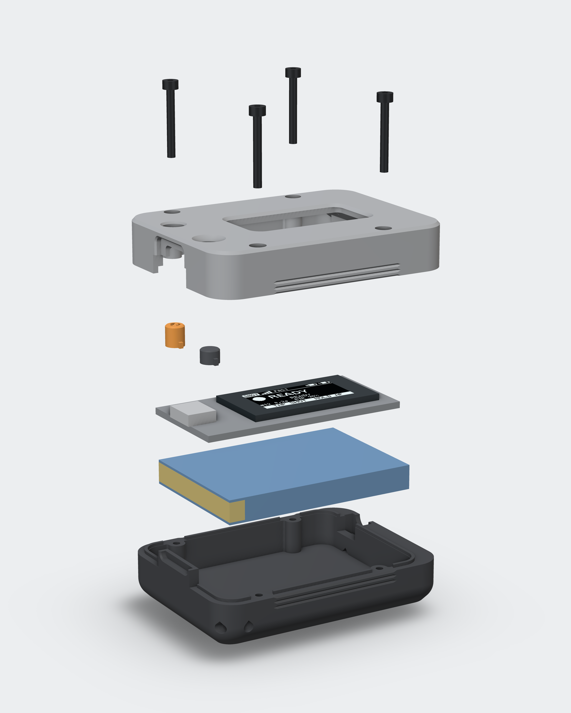
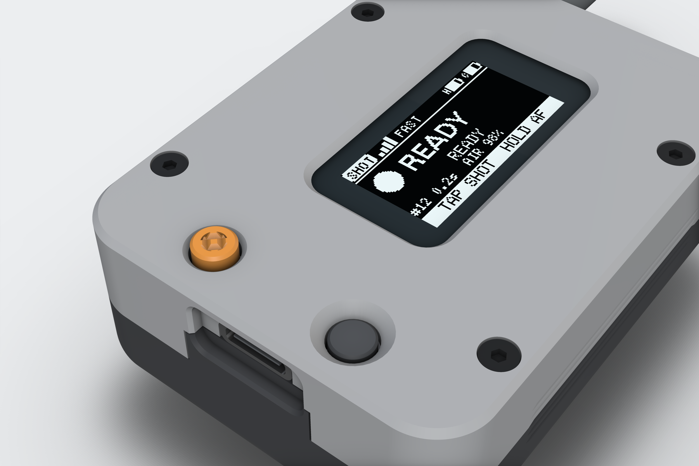

# Design story

How SLR Remote went from an itch to two working boxes in a week, told in order, wrong turns included.

It all happened between 7 and 13 November 2026.

## The idea

I shoot with a Fujifilm X-E5. It has a Bluetooth remote release built in, and it does work, but it reaches a few metres and you need a phone in your hand to use it.

That is fine for a selfie at arm's length plus a bit. It is no use for the pictures I actually wanted a remote for. A camera left on a tripod by the water while I stand back where the birds do not mind me. A self-portrait where I am a small figure a long way down the path. A group shot where I am in the group and the phone is in my coat on a bench.

What I wanted was one button in my pocket that fires the camera from far beyond Bluetooth range. No phone to unlock, and nothing plugged into the camera.

Bluetooth was never going to do the distance. LoRa could. LoRa is a radio system built for sending tiny messages a very long way on very little power, the sort of thing used for links of several miles across open country, and a shutter press is about as tiny as a message gets. The catch is that cameras do not speak LoRa. So the plan became two boxes: one in my pocket, one with the camera, LoRa between them, and Bluetooth for the last hop into the camera.

The name came later. SLR stands for Super Long Range, and yes, it is also a camera joke.

## Proof of concept on the bench

Before building any kind of relay I needed to know one thing: can a small board press this camera's shutter over Bluetooth at all?

The open-source [Furble](https://github.com/gkoh/furble) project had already worked out how Fujifilm's Bluetooth remote release behaves. I ported that to a Heltec WiFi LoRa 32 V4, a board with Bluetooth, a LoRa radio, a small OLED screen and a button all on one piece of fibreglass.

One board, straight to the camera, on the bench. It worked, and it kept working as I threw more at it:

- Half-press held focus.
- Single shot, burst, bulb, timer and interval all worked.
- Video worked too. With the camera in movie mode, a press starts recording and another press stops it.

Everything a finger on the shutter button can do, a board on the bench could do.

Two findings from the bench shaped everything after.

The camera acknowledges a press and says nothing about the photo. I compared a real exposure against a press where autofocus could not lock, and what came back was identical. So the remote says `PRESSED`, which is exactly what it knows, and it has a proper `UNKNOWN` for the rare time a reply goes missing.

The camera lets go by itself if the remote dies. I pulled the power mid-press to see what a held shutter would do, and the X-E5 released it. Reassuring, though I still gave the camera unit a watchdog of its own later, because I would rather have two safety nets than one.

## The first relay, and the bugs it showed

Next came the second board and the LoRa link: handheld to camera unit over LoRa, camera unit to camera over Bluetooth.

The basic relay came up quickly. I pressed a button on one board and the camera across the room took a picture, with nothing between them but radio. Then the interesting bugs arrived.

Radios like these are **half duplex**: they can talk or listen, never both. While a board is transmitting it is deaf. On the fast setting that is a fraction of a second, which turns out to be plenty of time to miss something.

- A reply collided with a release. When I held the button and let go, the camera unit sent its result at the same moment the handheld sent its backup "release". Both were talking, neither was listening, and the handheld never saw the shot confirmed. Now the camera unit holds its result back until the release is in.
- Two replies back to back lost the second one, every time. A 250 ms gap between replies gives the handheld time to get back to listening.
- A slow release stretches the press. Over a relay the "let go" message arrives a whole message-time after the "press", and with the camera in a continuous drive mode a stretched press means extra frames. So the handheld now tells the camera unit how long to hold, and the camera unit lets go on its own clock.

All three taught me the same thing. On a slow radio, the order and timing of messages is a design job of its own.

Once those were sorted the bench timing settled at about 180 to 225 ms from the handheld sending to the camera unit accepting the press, and about 140 ms for each Bluetooth command to the camera.

## The walk test

Then I took it outside, and I was not kind to it.

The camera unit went inside a parked car, which is a metal box and a poor place to put a radio. Both units had the small stock antennas. I walked away with the handheld in my hand until the car was out of sight, pressing as I went.

At about 90 metres, with no line of sight at all, it was still firing. That was simply where my walk ended. The link had not.

For comparison, the camera's own Bluetooth remote gives up after a few metres with nothing in the way. And this was LoRa with one hand tied behind its back: the antenna shut inside a car and no view between the two units. Give it a clear view and it is the same radio technology people use for miles. Measuring exactly how far, in the open, is the test I am most looking forward to. More in [Range](range.md).

## Choosing one button

My first plan for the handheld was grander: a proper two-stage shutter switch with a half-press and a full press, plus extra keys for the menu. I got as far as choosing the parts.

Then I threw that out and went with one button.

The board already has a button on it (labelled PRG) which can also wake the board from sleep. Using it means no extra parts, nothing to solder, and a case with one fewer thing to get wrong.

More to the point, think about when you use a remote. The camera is set up, framed and far away. Nearly every time, what you want is "take the picture". That should be one tap, findable by feel with cold hands, and very hard to get wrong.

Everything else still has to fit somewhere, so it fits on the same button. A tap shoots. A hold is a half-press: it holds focus, and letting go takes the shot. Keep holding past the focus limit and a card of modes appears (timer, interval and so on) that you step through with taps. I built three styles of this, kept all three as options, and made the simplest the default.

The firmware still supports a two-stage switch and a second button if you fancy wiring them. The case is built around the one.

## The case

### Starting from someone else's good work

I did not draw the case from nothing. It is adapted from the "Meshtastic Heltec V4 Miniworks case" by Chem_Kid (Thingiverse thing 7367243, Creative Commons Attribution Non-Commercial). That design already fitted the board, the battery, the antenna connector and the GPS module, and it was a pleasure to build on. The original files sit untouched in `case/vendor/miniworks/`, and the licence terms carry over to my version: see [LICENSE-CASE.md](../LICENSE-CASE.md) and [CREDITS.md](../CREDITS.md).

I wanted three things on top. Two units of different lengths from one design. A shape that feels right in the hand. And a case that prints with **no supports**. Supports are the scaffolding a printer adds under overhangs. They cost time, they leave a rough surface, and picking them out of small parts is miserable.

### Making it print without supports

The case is written as code (Python, using the manifold3d and trimesh libraries), so every dimension is a number I can change and rebuild. The rule I set myself: no overhang leans more than 45 degrees from vertical at 0.2 mm layers, which a printer can lay down in thin air.

That one rule shaped most of what you see.

- One smooth outline. The original's screw ears went. The handheld is one plain rounded rectangle, and the camera unit carries a narrower GPS section on beside the antenna.
- A rolled back edge. It starts at 45 degrees on the print bed and curves into the side wall. It prints cleanly and it sits nicely in the palm. My first go was a plain chamfer, and the roll is much better.
- A grip band across the seam. Five fine V-grooves down each long side, with the join between the two halves hidden as one of the grooves.
- Roofs that close to a point. The lanyard hole and the internal pockets have 45 degree pointed roofs, so nothing has to bridge a gap.
- A USB-C opening shared between the halves. The lower wall of the port belongs to the back half, so neither half has an unsupported lip. I made the opening generous, because chunky USB-C plugs exist.
- Smaller screws. Four M2 x 16 mm screws per unit, tucked inside the outline, where the original used M3.

The camera unit kept the original's GPS bay and has a plain flat back. The handheld is shorter, has no GPS bay, and gained a lanyard hole set into one corner with nothing sticking out to snag a pocket.

A script checks all of it on every rebuild: 107 checks covering fit, clearances, button travel and a layer-by-layer overhang scan. A second script slices the plates in Bambu Studio and fails if the slicer wants to add a single support. Between them they caught a lot of mistakes before any plastic was melted.

The finished sizes are 61 x 45.7 x 21.6 mm for the handheld and 81.3 x 45.7 x 21.6 mm for the camera unit, without the antenna. Pocket sized, both of them.

### Dead ends

**The cold-shoe mount.** An early camera unit had a slide groove so it could ride in the camera's shoe. I took it out. The flat-backed unit is tidier, prints better, and can go wherever suits the shot: on the tripod, in the bag underneath, in a pocket of the hide.

**The engraved logo.** I put an SLR mark on the case, did not like it, and took it off again.

**The wide oval button.** This one cost me a reprint. I wanted a big, wide, oval shoot button that a thumb could not miss. On screen it looked perfect. On real prints it caught in its hole and jammed. A wide cap on a short guide tips when you press it off-centre, and a tipped button binds.

I mocked up two ways to rescue it, a flexing pad and an oval with a longer guide, and used neither.

### The round button that replaced it

The fix was to stop being clever. The shoot button is now a plain round plunger in a round hole, with a 0.25 mm gap all round, a longer guide, and a knurled top that stands just under a millimetre proud so your thumb finds it without looking. A round plunger has no long side to tip over. The reset button beside it is smooth and recessed, so it stays out of the way.

Both buttons drop in from the inside before the case is closed, and small tabs at the foot keep them from falling out of the front.

## The line-by-line review

By the middle of the week the firmware worked. It had also grown fast, to about 13,000 lines, and it controls a radio transmitter with a legal airtime limit and a camera I care about. Working on the bench was not enough for me.

So I stopped adding features and read all of it, line by line, hunting for anything that behaved on the bench and would trip up in a field.

The review turned up 39 issues. None were in the security code or in the legal airtime limit, which was good to see. Two examples of what it did find:

- The hold watchdog could use the wrong timeout. If the handheld dies while holding a press, the camera unit lets go after a short wait. But once the camera unit had dropped itself to the slowest link setting, it was using that setting's wait: nearly four minutes, where it should have been about ten seconds. On the bench, on the fast setting, that could never have shown itself. It now uses the timeout for the setting the handheld was last heard on.
- The tally LED could stay stuck after a sleep, because a pin held during deep sleep was not being let go on the next boot.

Everything was fixed bar three minor points that I left open on purpose, and the result is firmware 0.3.0. Then I went back to the bench and checked what the fixes touched: the screens start, a wake press takes the shot with no warm-up wait, a held focus drops about 10 seconds after the handheld loses power, and the tally LED works after an off and on.

Alongside that sits a suite of automated unit tests that run on a PC and cover the parts that need no hardware: the message format, the airtime tally, the link speed rules and the one-button logic.

## What I would do next

1. Print the round-button tops. The bottoms and the earlier tops printed well. The new tops pass every check and slice with no supports, and at the time of writing they are waiting for their turn on the printer.
2. A proper range day. Open country, clear line of sight, the built-in range log running, at each link setting. I want to know how many miles "miles" is.
3. Time the battery, for both units, awake and asleep.
4. BURST and BULB over the LoRa link. They run in direct mode today.
5. Work out what the camera's own notifications mean. If one of them turns out to mean "exposed", the screen could go one better than `PRESSED`.
6. Other cameras and other regions. It is built and tested on the X-E5 and the UK and EU 868 MHz band. It uses Fujifilm's standard Bluetooth remote release, so most modern Fujifilm bodies with Bluetooth should take to it, and they are the obvious next thing to try. Firmware 0.4.0 added a `Region` setting with a `US 915` choice for builders in the United States. It is built to the US rules and waiting for its first test on air, which has to come from someone over there, because I cannot legally transmit on that band from the UK.
7. A neat way for the camera unit to ride on the tripod.

## Lessons learned

- Prove the frightening part first. One board pressing the shutter on the bench told me the project was possible before I had built anything else.
- Simple shapes move best. Round button, round hole.
- Test it unkindly. A walk with the camera unit shut in a car told me things the bench never could.

## Where next

- [Data flow](data-flow.md): what happens when you press the button.
- [How it works](how-it-works.md): the two radios, link speeds and pairing.
- [Build guide](build-guide.md): print, assemble and wire your own.
- [User guide](user-guide.md): every screen, gesture and shooting mode.
