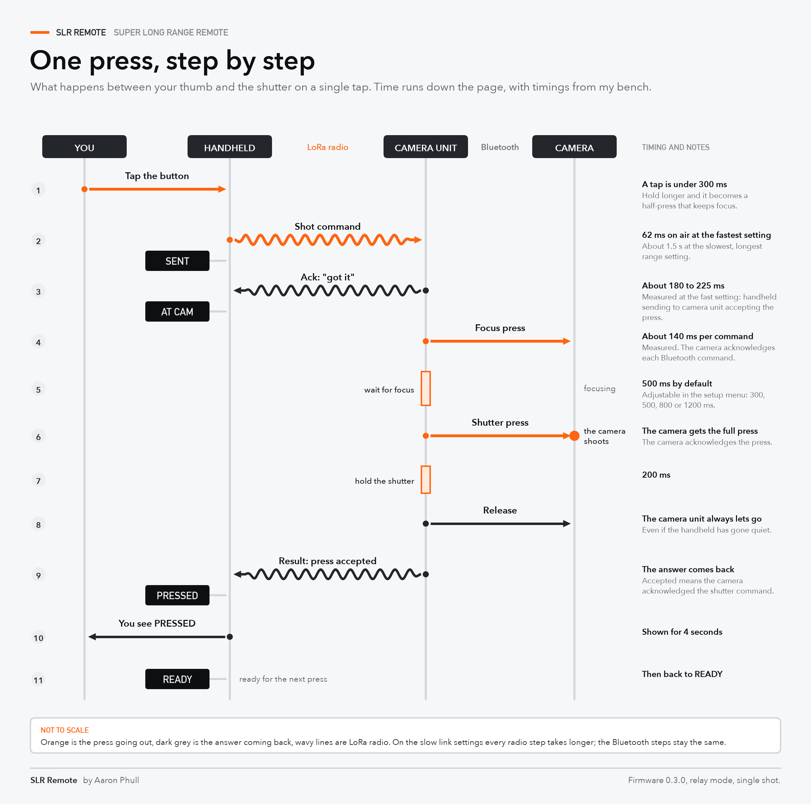
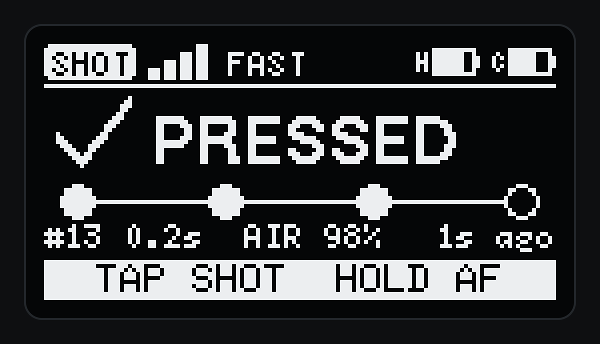

# Flashing and pairing

Two blank boards go in, and a remote that fires your camera from far beyond Bluetooth range comes out. This page covers loading the firmware, telling each board what it is, introducing the boards to each other and to the camera, and taking the first frame.

Do it with the bare boards on the desk, before they go in their cases.

The order is:

1. Install PlatformIO
2. Build the firmware and flash both boards
3. Choose each board's role
4. Pair the two boards with each other
5. Pair the camera unit with the camera
6. First shot
7. Later: re-pairing and resetting



## Before you plug anything in

- **Fit an antenna to each board.** Click the antenna lead onto the board's small LoRa socket, then screw the 868 MHz antenna onto the lead's SMA end. Do this before a board is ever powered: a radio transmitting with no antenna can damage its amplifier.
- Use a USB-C cable that carries data. A charge-only cable powers the board but the computer never sees it.
- Both boards must run the **same firmware build**. A mixed pair will not talk.
- There is one firmware for both boards. Which one is the handheld and which is the camera unit is a setting, chosen after flashing.

## How the one button works in setup

Each board has two small push buttons: `PRG` and `RST`. All of setup is done with `PRG`.

| Action | Meaning |
|---|---|
| Click `PRG` | Next item |
| Hold `PRG` for 1 second | Select or change the item |
| Tap `RST` once | Restart the board |
| Tap `RST`, then tap it again when the screen says `RST AGAIN NOW = SETUP` | Open the setup menu |

The setup menu has the title `SETUP 0.3.0` and shows your position as `n/N`.

## 1. Install PlatformIO

PlatformIO is the build tool. It downloads the compiler and the libraries the firmware needs by itself.

The easy route is the PlatformIO extension for VS Code. Install it, open the `firmware` folder, and use its Build and Upload buttons. They run the same commands shown on this page.

If you would rather use a terminal, install the command-line tool. You need Python 3 first.

| System | Command |
|---|---|
| macOS | `brew install platformio` or `pipx install platformio` |
| Linux | `pipx install platformio` |
| Windows | `python -m pip install -U platformio` |

Check it works:

```sh
pio --version
```

## 2. Build and flash

Get the repository onto your computer, then open a terminal in its `firmware` folder.

```sh
cd firmware
```

### Build only (optional check)

```sh
pio run -e heltec_v4
```

The first build takes a while, because PlatformIO downloads the ESP32 toolchain and four libraries at pinned versions (RadioLib, NimBLE-Arduino, U8g2 and TinyGPSPlus). Later builds are quick.

### Flash a board

Plug in **one** board and run:

```sh
pio run -e heltec_v4 -t upload
```

This builds and uploads in one go. When it finishes the board restarts straight into the setup menu, titled `SETUP 0.3.0`, with `Role` showing `--`. (The splash, an iris then `SLR`, `SUPER LONG RANGE`, `REMOTE` and `v0.3.0`, appears from the next start once a role is set.)

Unplug it, plug in the second board, and run the same command again.

### If the upload cannot find the board

Put the board into its bootloader by hand, then retry:

1. Hold `PRG`.
2. Tap `RST`.
3. Release `PRG`.

The screen goes black. That is normal: the board is waiting for firmware. Now run the upload again:

```sh
pio run -e heltec_v4 -t upload
```

When it has finished, tap `RST` once to start the new firmware. If you ever end up on a black screen by accident, tapping `RST` gets you out.

If you have more than one serial device connected, you can name the port:

```sh
pio device list
pio run -e heltec_v4 -t upload --upload-port <your port>
```

### Watch the serial console (optional)

The board has a text console over USB at 115200 baud. It is useful for seeing what is going on, and everything in the setup menu can also be done by typing.

```sh
pio device monitor
```

Type `help` for the command list and `stat` for a status summary. One command per line.

### Run the unit tests (optional)

The 147 unit tests run on a Mac and need no board (the test build uses macOS CommonCrypto; see [firmware/README.md](../firmware/README.md#tests) for Linux and Windows):

```sh
pio test -e native
```

## 3. Choose each board's role

A freshly flashed board has no role, so it starts straight in the setup menu.

Decide now which board is which and label them. A bit of tape will do.

### The camera unit

1. The first item is `Role`, showing `--`.
2. Hold `PRG` for 1 second. It changes to `Handheld`.
3. Hold again. It changes to `Camera`.
4. Leave it there for now. Do not exit yet: pairing is done from this menu.

### The handheld

1. On `Role`, hold `PRG` once so it reads `Handheld`.
2. Click to `Mode`. It shows `Direct`.
3. Hold to change it to `Relay`.

`Relay` is the two-board setup this project is about: handheld to camera unit by LoRa radio, then camera unit to camera by Bluetooth. `Direct` is a one-board setup where the handheld talks Bluetooth straight to the camera at short range. A new board defaults to `Direct`, so this step matters.

`Pair boards` appears in the menu as soon as `Mode` reads `Relay` (it takes the place of `Pair camera`).

### Doing the same from the console

```text
role c
```

on the camera unit, and on the handheld:

```text
role h
mode relay
reboot
```

On a new board, `role` saves and restarts the board at once, so the console disconnects for a moment and the board comes back running its role. Wait for it, then type `mode relay` and `reboot` on the handheld. To pair from here, type `pair boards` on each board (it reopens the menu for you), or tap `RST` twice.

### If you leave the menu alone

- With no role set, the board shows `NO ROLE` and `Sleeping: PRG wakes`, then sleeps. Press `PRG` to bring the menu back.
- With a role set, it saves and restarts after 5 minutes.
- `Exit` with no role set is refused with `Pick a role first`.

## 4. Pair the two boards

Pairing gives the two boards a shared secret key, so your camera unit only obeys your handheld. It runs over the radio at the lowest power setting on purpose, to keep the exchange local, so put the boards side by side.

1. Put the two boards next to each other, antennas fitted.
2. On **both** boards, click to `Pair boards` and hold `PRG` to select it. Start them at about the same time. You have 2 minutes.
3. The handheld shows `PAIRING...` and the camera unit shows `WAITING...`. Both show `Other board: Pair` until they find each other.
4. Both screens then show `CODE` and six digits, with `Same? hold PRG`.
5. **Compare the two codes.** If they match, hold `PRG` on each board. If they do not match, click `PRG` to reject, and start again.
6. The screens show `CHECKING...` while the boards prove to each other that they hold the same key. Nothing is saved until that succeeds.
7. Finished: `PAIRED`, and the menu shows `Boards paired`. The `Pair boards` item now reads `Paired`.

Why the code matters: it is worked out from the new key on each board separately. Matching codes mean nobody else's radio got in between the two boards during pairing.

From the console, `pair boards` on each board starts the same process. The yes is still a hold of `PRG` on each board: it cannot be confirmed by typing.

### If pairing does not finish

| Screen | Meaning | What to do |
|---|---|---|
| `Pair timed out` | The boards did not find each other in 2 minutes | Start both again, closer together and closer in time |
| `PAIR ABORTED` / `Other pairing nearby?` | A pairing message arrived that did not belong to this session | Try again. Move away from any other pair being set up |
| `UNSURE: PAIR AGAIN` or `PAIR UNSURE` | One board may have saved the new key and the other not | Pair again on both |
| `Failed, nothing saved` | The check did not complete | Pair again. The old pairing, if any, is untouched |
| `DUTY LIMIT` / `Pairing waits for airtime` | The board has used its legal airtime for the hour | Wait. Rare on a new board |
| `Radio failed` | The radio did not start | Restart the board. Check the firmware matches the board |

## 5. Pair the camera unit with the camera

In the two-board setup, only the **camera unit** pairs with the camera. The relay handheld never talks to the camera and has no `Pair camera` item.

### On the camera

These are the X-E5 menus. Other Fujifilm bodies are very similar.

1. Turn Bluetooth on.
2. Open **Pairing Registration** in the camera's Bluetooth settings.

The camera unit's own screen gives the same hint while it searches: `Cam: BT > Pairing reg`. The camera's manual shows where its Bluetooth menu lives.

Set the camera's focus mode to AF-S for the first test, so a tap focuses and fires cleanly.

### On the camera unit

1. In the setup menu, click to `Pair camera` and hold `PRG`.
2. The screen shows `PAIR CAM` with a countdown from 60 seconds, and the current step underneath: `PAIR`, `CONN`, `BOND`, `SETUP`.
3. If the camera asks you to confirm anything, approve it on the camera. If a six-digit code is involved, the camera unit shows it as `CODE nnnnnn` so you can compare it with the camera's screen. The camera unit accepts its side by itself.
4. Result: `Camera paired`. The `Pair camera` item now reads `Saved`.
5. Click to `Exit` and hold. The board shows `SAVED`, then restarts.

A click during the search cancels it (`Cancelled`). If it ends with `Camera pair failed`, check the camera is still on the Pairing Registration screen and try again.

After the restart the camera unit's main page should read `READY`, with the camera's name underneath. From now on it reconnects to the camera by itself whenever both are switched on. The camera unit's screen turns itself off after 10 seconds to save power. A click of `PRG` brings it back.

From the console, `pair cam` starts the same search.

## 6. First shot

1. Make sure the handheld has left the setup menu: choose `Exit` and hold. It restarts.
2. The handheld's screen shows `NOT CHECKED` with `press any button to connect`. After a power-on it deliberately sends nothing until you touch the button, in case the antenna is not fitted.
3. Tap `PRG`. The handheld contacts the camera unit: `CHECKING`, then `READY`.
4. Tap `PRG` again, a short tap of under a third of a second.

The screen steps through:

| Screen word | What it means |
|---|---|
| `SENT` | The handheld transmitted the command |
| `AT CAM` | The camera unit received it |
| `PRESSED` | The camera accepted the shutter press over Bluetooth |
| `CAM EVT` | The camera sent something more back within 2 seconds. The X-E5 does not, so `PRESSED` is your last word |

The camera focuses, waits half a second, and fires. The board's LED blinks twice when a shot is sent, and a small iris animation plays on the screen when it is accepted.



`PRESSED` means the camera accepted the press. That is your confirmation at the handheld, wherever the camera is. More on what each word means in [how-it-works.md](how-it-works.md).

Now hold the button instead of tapping it. That is a half-press: the camera focuses and holds (`AF HELD`), and letting go takes the picture.

Want video? Switch the camera to movie mode and pick `VIDEO` on the handheld (set `Modes shown` to `All` in the setup menu to see it). One tap starts recording and the next tap stops it.

If you get something else:

| Screen | Likely cause |
|---|---|
| `NO LINK` / `no reply from cam board` | Camera unit off, not paired, or on a different firmware build |
| `NOT PAIRED` | The boards have not been paired (step 4) |
| `FAILED` / `CAM NOT READY` | The camera unit heard you but has no Bluetooth link to the camera. Is the camera on? |
| `UNKNOWN` / `NO REPLY: MAY HAVE FIRED` | The command went out but no answer came back. Check the camera |

There is a fuller list in [troubleshooting.md](troubleshooting.md).

The handheld goes to sleep after 60 seconds of no use (it stays awake while plugged into a computer). Press `PRG` to wake it. By default the waking tap also takes the photo.

Now learn the rest of the button in [user-guide.md](user-guide.md), then put everything in its case with [build-guide.md](build-guide.md).

## 7. Re-pairing and resetting

### Getting back into the setup menu

Any of these works:

- Tap `RST`, wait for `RST AGAIN NOW = SETUP`, and tap `RST` again within 3 seconds.
- On the handheld: open the mode card, pick `SETUP`, and hold to confirm.
- From the console: `setup`
- Power on, then press and hold `PRG` just **after** tapping `RST`, not before. Holding `PRG` while `RST` is released puts the board in its bootloader (black screen). Tap `RST` to get out.

A menu opened by `RST` taps and then left untouched closes itself after 30 seconds (`NO INPUT`).

### Pair the two boards again

Run `Pair boards` on both boards again, as in step 4. The old pairing is only replaced once the new one has been confirmed, so a failed attempt does not leave you with nothing.

To delete the pairing on one board without making a new one:

```text
forget-pair
reboot
```

### Pair with the camera again, or with a different camera

Put the camera in Pairing Registration and run `Pair camera` again on the camera unit. A fresh pairing replaces the old record for that camera.

To clear the camera first, use the `Forget camera` menu item (`Forget camera?`, then hold for yes or click for no), or from the console:

```text
forget-cam
```

The camera keeps its own list of paired devices in its Bluetooth settings, if you want to tidy that side too.

### Restart

Tap `RST` once, or from the console:

```text
reboot
```

### Factory reset

This wipes everything on that board: role, settings, the board pairing, the camera pairing and the range log.

Menu: `Factory reset`, which asks `Factory reset?` with `Hold=yes Click=no`. Hold `PRG` to confirm. The board shows `RESET DONE` and restarts into the setup menu with no role, exactly like a freshly flashed board.

Console:

```text
reset
```

After a factory reset on either board, pair the two boards again. After one on the camera unit, pair the camera again too.

### Updating the firmware later

Flash **both** boards with the new build, using the same upload command as in step 2. Settings and pairings are kept in a separate part of the board's storage. If a pair ever acts oddly after an update, a factory reset on both and a fresh pairing puts everything back to a clean start.

## Console quick reference

All at 115200 baud, one command per line.

| Command | Does |
|---|---|
| `help` | Lists the commands |
| `stat` | Version, role, battery, link and camera status |
| `role h` / `role c` | Set handheld or camera unit (takes effect on restart) |
| `mode relay` / `mode direct` | Handheld link mode (takes effect on restart) |
| `pair boards` | Start board pairing (confirm by holding `PRG`) |
| `pair cam` | Start camera pairing |
| `forget-pair` | Delete the board pairing |
| `forget-cam` | Delete the camera record |
| `setup` | Restart into the setup menu |
| `reboot` | Restart |
| `reset` | Factory reset |

Replies are `ok`, `ok (reboot to apply)` or `error: ...` with a reason.
