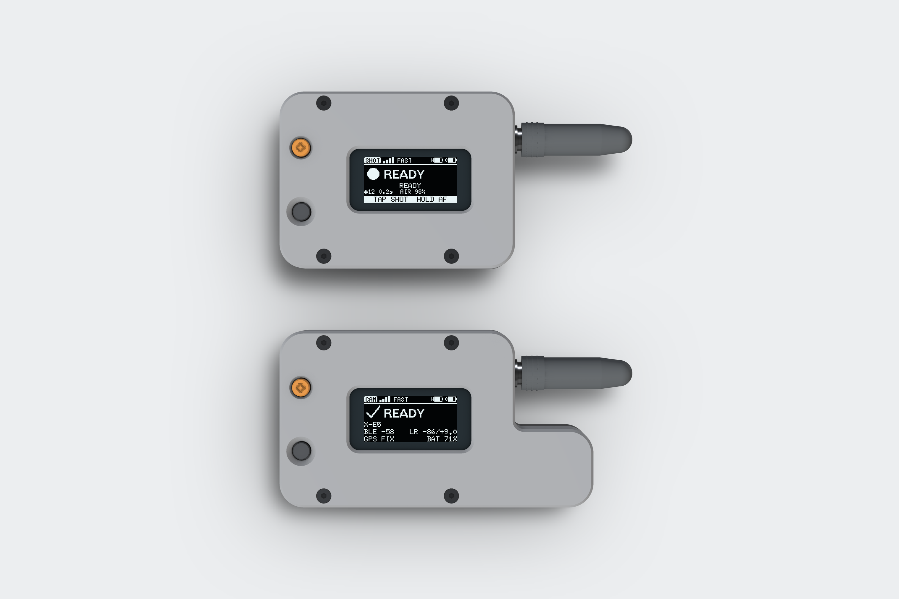
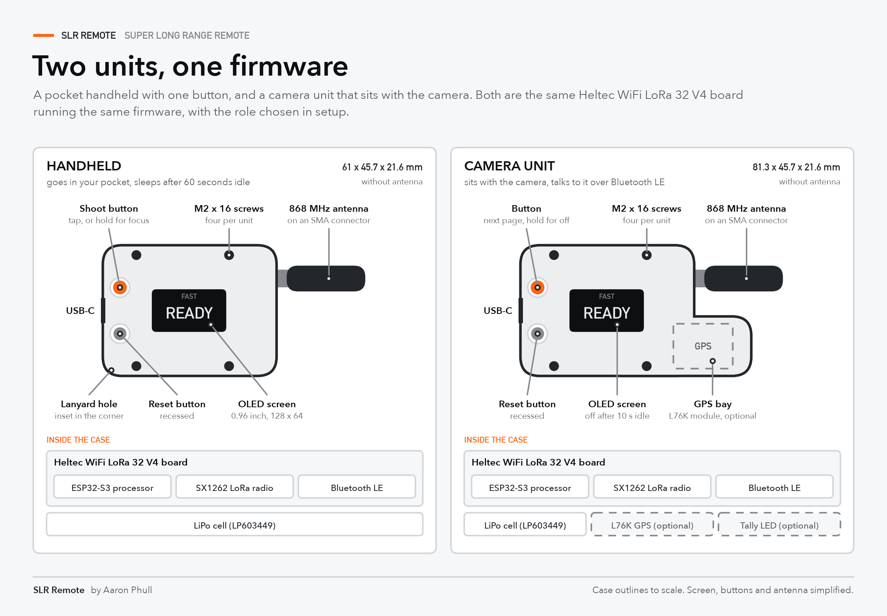
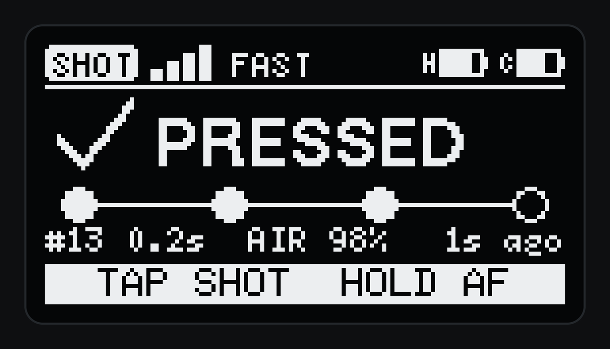

# Getting started

**A camera remote unlike any other camera remote. One that works for miles.**

Tucked in a hide while the camera sits by the feeder, or out with the dog while the tripod waits by the gate. You press one button in your pocket and the shutter goes. Nothing plugs into the camera, and your phone stays out of it.

This page is the short path from an empty desk to that first remote frame. Each step links to the page with the detail.

## What you are building

SLR Remote (Super Long Range Remote) comes in two parts.

- The **handheld** lives in your pocket. One button, a small screen, a wrist lanyard if you like.
- The **camera unit** stays with the camera, in the bag pocket or on the tripod. It presses the shutter for you over Bluetooth, using the camera's own built-in remote release, the same one Fujifilm's phone app uses.

Between the two is LoRa, a long-range radio system built for sending small messages a very long way on very little power. It is the same technology people use for links of several miles in open country, and it gets through hedges, walls and car doors that stop a Bluetooth or infrared remote dead.

With it you get the whole shutter button at a distance: half-press to hold focus, single shots, a self-timer, interval shooting, and video start and stop when the camera is in movie mode. Burst and bulb are there too when one board talks straight to the camera. The [user guide](user-guide.md) has every mode.

## Before you buy

The camera: this is for Fujifilm cameras. I built and tested it on the X-E5, and it uses Fujifilm's standard Bluetooth remote release, the same one the phone app uses, so it will likely work with most modern Fujifilm X and GFX cameras that have Bluetooth. If you try it on another body, I would love to hear how it goes.

Where you live: the radio is set for the UK and EU licence-free band at 868 MHz, and the firmware keeps itself inside the legal limits without you thinking about it. See [safety-and-legal.md](safety-and-legal.md).

What you need to be able to do:

| You need | For |
|---|---|
| A 3D printer, or a print service | The case: eight small parts, no supports |
| A computer with PlatformIO (free) | Loading the firmware onto both boards over USB-C |
| Basic soldering | Only if your battery arrives with the wrong plug, or you add the optional tally LED |
| A small screwdriver | Eight M2 screws |

If you have ever fitted a battery grip and updated a lens's firmware, you can build this.

## The checklist

1. Order the parts. Two Heltec WiFi LoRa 32 V4 boards (the 868 MHz version, which some sellers list as EU868 or 863 to 928 MHz), two LiPo cells, two 868 MHz antennas, eight M2 x 16 mm screws and some filament.
   Detail: [shopping-list.md](shopping-list.md)

2. Print the case. Three plates, supports off. The slicer estimate is about 46 minutes for the handheld, 54 for the camera unit and 6 for the buttons, so around 1 hour 45 minutes of printing.
   Detail: [build-guide.md](build-guide.md#printing)

3. Fit an antenna to each board. Click the antenna lead onto the board's small LoRa socket, then screw the 868 MHz antenna onto the lead's SMA end. Do this before a board is ever powered: a radio transmitting with no antenna can damage itself.

4. Flash both boards. One firmware goes on both. Do it with the bare boards on the desk, where you can reach the buttons and see the screens.
   Detail: [flashing-and-pairing.md](flashing-and-pairing.md#2-build-and-flash)

5. Choose each board's role. One becomes the handheld (in relay mode), the other the camera unit.
   Detail: [flashing-and-pairing.md](flashing-and-pairing.md#3-choose-each-boards-role)

6. Pair the two boards. Both screens show a six-digit code. If they match, hold the button on each. You have 2 minutes.
   Detail: [flashing-and-pairing.md](flashing-and-pairing.md#4-pair-the-two-boards)

7. Pair the camera unit with the camera. Bluetooth on, Pairing Registration open on the camera, then `Pair camera` on the camera unit. It searches for 60 seconds.
   Detail: [flashing-and-pairing.md](flashing-and-pairing.md#5-pair-the-camera-unit-with-the-camera)

8. Take the first shot. Tap the handheld's button. The screen steps through `SENT`, `AT CAM` and `PRESSED`, and the camera fires.
   Detail: [flashing-and-pairing.md](flashing-and-pairing.md#6-first-shot)

   

9. Put both units in their cases. Buttons, board, antenna socket, battery, four screws.
   Detail: [build-guide.md](build-guide.md#assembly)

10. Learn the button. Tap to shoot. Hold to focus, let go to shoot. Hold longer for the mode card with timer, interval and the rest.
    Detail: [user-guide.md](user-guide.md)

11. Walk away from the camera. Leave it on the tripod, go round the corner, and press. Watch the signal bars and the `FAST` or `SLOW` word on the handheld as you go.
    Detail: [range.md](range.md)

## Want to try it with one board first?

You can. Set a single board to `Handheld` with `Mode` on `Direct` and it talks Bluetooth straight to the camera at ordinary Bluetooth range. That is how I proved the idea on the bench before the second board joined in, and it is a good way to meet the menus while the rest of the parts are in the post.

## Good to know

- On my first walk test the camera unit was shut inside a parked car, with the small stock antennas fitted and no line of sight, and at about 90 metres it was still firing. Open-country range and battery life are the next things to measure, so tell me what you get.
- `PRESSED` on the screen means the camera has accepted the press. Take one test frame and look at it on the camera before you walk away.
- The round shoot button is the newest part of the case. There is a note about it in the [build guide](build-guide.md#good-to-know).
- This is my own project, with no connection to Fujifilm or Heltec.

## Where to look next

- Every mode and screen: [user-guide.md](user-guide.md)
- A message on the screen you do not recognise: [troubleshooting.md](troubleshooting.md)
- Quick answers: [faq.md](faq.md)
- How the radio link and pairing work: [how-it-works.md](how-it-works.md) and [data-flow.md](data-flow.md)
