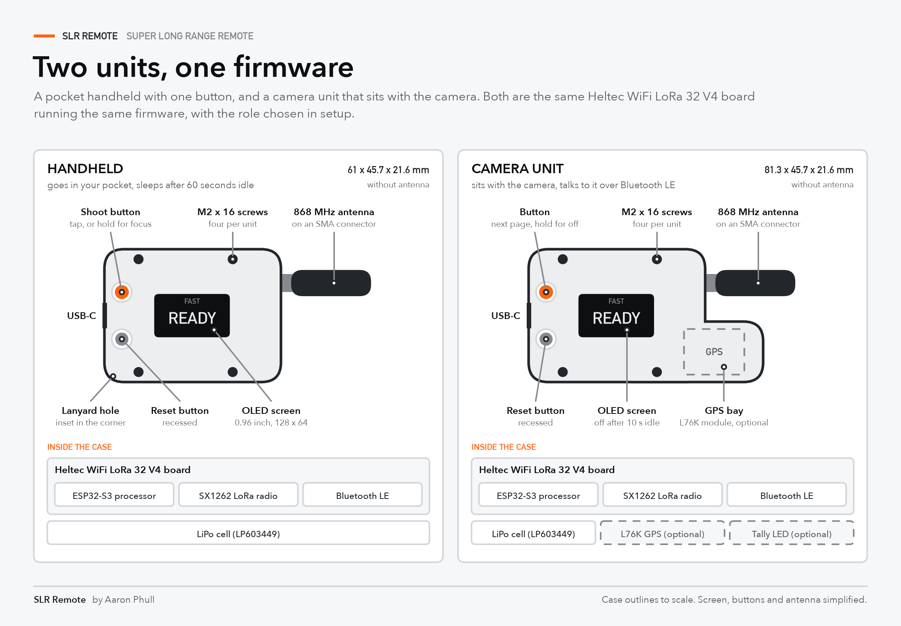
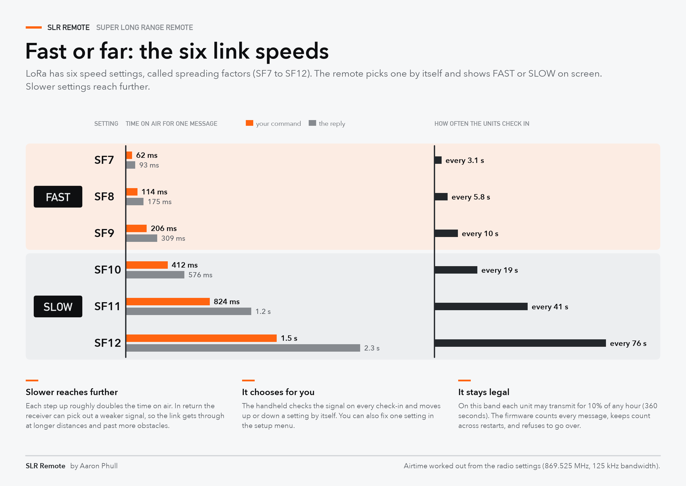
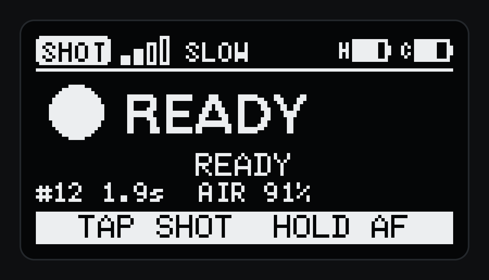

# How it works

A camera remote unlike any other camera remote. One that works for miles.

This page is the look under the lid, written for makers and for photographers who like to know what their kit is doing. If you want the picture of one press travelling from thumb to shutter first, start with [Data flow](data-flow.md) and come back.

Everything here describes firmware 0.3.0 on two Heltec WiFi LoRa 32 V4 boards with a Fujifilm X-E5, on the UK and EU 868 MHz band.

## Contents

- [The two units](#the-two-units)
- [Why two radios](#why-two-radios)
- [Adaptive link speed: FAST and SLOW](#adaptive-link-speed-fast-and-slow)
- [The airtime rule](#the-airtime-rule)
- [Pairing, and why a stranger cannot fire your camera](#pairing-and-why-a-stranger-cannot-fire-your-camera)
- [Safety behaviours](#safety-behaviours)
- [The camera side](#the-camera-side)
- [Sleep and battery](#sleep-and-battery)
- [Where the code lives](#where-the-code-lives)

## The two units

Both units are the same board running the same firmware. You pick the role, `Handheld` or `Camera`, in the setup menu.

| Part | What it is | What it does here |
|---|---|---|
| ESP32-S3 | The processor on the Heltec board | Runs the firmware and provides the Bluetooth LE radio. Clocked at 80 MHz to save battery. |
| SX1262 | The LoRa radio chip | Carries the long-range messages between the two units, through the board's RF amplifier. |
| 0.96 inch OLED | 128 x 64 pixel screen | Status, the mode card and the setup menu. |
| PRG button | The board's own button | The one button. It also wakes the board from sleep. |
| LiPo cell | One per unit (an LP603449 fits the case) | Power. The board reads the cell voltage to show a battery level. |
| 868 MHz antenna | On an SMA connector | The LoRa antenna. Fit it before you power on. |
| L76K GPS module | Optional, camera unit | The clock, position and optional geotagging. |
| Tally LED | Optional | Lights while the shutter is down and for a moment after each accepted shot, like the lamp on a studio camera. |

The handheld is the one you hold. The camera unit needs nothing from your hands once it is switched on: it listens for the handheld and works the camera.

The handheld needs no GPS. The camera unit shares its clock over the radio link, so the handheld gets the time for free.

There is also a **direct mode**, where a single board talks Bluetooth straight to the camera with no LoRa link. It is how the project started, it makes a tidy pocket remote on its own, and it is where BURST and BULB live.

## Why two radios

The camera speaks Bluetooth LE, and only Bluetooth LE. Its built-in remote release is quick and sips power, and it reaches a few metres with a phone in your hand.

**LoRa** is a different animal. It sends very small messages quite slowly, spread out in a way that lets a receiver pick them out from underneath the background noise. What you get for that patience is reach: links of several miles in open country, and a signal that gets through hedges, walls and car bodies that stop Bluetooth dead.

So each radio does the job it is good at.

| | Bluetooth LE | LoRa (868 MHz) |
|---|---|---|
| Carries | Camera unit to camera | Handheld to camera unit |
| Has to cover | The gap between the unit and the camera | As far as you want to stand from the tripod |
| Speed | About 140 ms per command on my bench | 62 ms to 2.3 s per message, depending on the link setting |
| Chosen by | Fujifilm: it is the remote release the camera offers | Me |

The trade is range against speed. A LoRa message on the longest-reach setting spends about 24 times as long on the air as on the fastest one. Standing ten metres from a group shot, you want it snappy. Sitting in a hide with the camera on the far bank, you want it to get through. The firmware moves between the two by itself, and that is the next section.

How far does it go? LoRa at the legal power limit is built for miles with a clear view. My walk test, and how to get the most reach from yours, are in [Range](range.md).

## Adaptive link speed: FAST and SLOW

LoRa has a setting called the **spreading factor** (SF), numbered 7 to 12. Each step up roughly doubles the time a message spends on the air, and in return the receiver can hear a signal about 2.5 dB weaker. SF7 is the quick one. SF12 is the one that gets through.

The rest of the radio stays put: 869.525 MHz, 125 kHz bandwidth, coding rate 4/5.

### What the screen shows

- `FAST` means SF7, SF8 or SF9.
- `SLOW` means SF10, SF11 or SF12, the long-range settings.
- The word shown inverted with a `!` means the remote is searching for the link (see [Rescue](#rescue)).

### What each setting costs

These come from the firmware's own LoRa airtime formula.

| Setting | Screen | Shot message on air | Ack or Result on air | Ping every | A held press is let go after |
|---|---|---|---|---|---|
| SF7 | `FAST` | 62 ms | 93 ms | 3.1 s | 9.4 s |
| SF8 | `FAST` | 114 ms | 175 ms | 5.8 s | 17.5 s |
| SF9 | `FAST` | 206 ms | 309 ms | 10.3 s | 31.1 s |
| SF10 | `SLOW` | 412 ms | 576 ms | 18.9 s | 57.2 s |
| SF11 | `SLOW` | 824 ms | 1.2 s | 41.1 s | 124 s |
| SF12 | `SLOW` | 1.5 s | 2.3 s | 75.7 s | 229 s |

Pings are spaced further apart on the slower settings on purpose, so idle pinging uses the same small slice of the hour's airtime whatever the setting.

### How it decides

Between presses the handheld sends a **ping** and the camera unit answers. Each end measures how far the signal sat above the weakest it could have decoded. That spare signal is the **margin**, and the remote goes by the worse of the two directions.

- One ping with less than 5 dB of margin, and the handheld asks to go one step slower for more reach.
- Five good pings in a row, each with more than 12 dB, and it speeds up, dropping as many steps as it can while keeping at least 8 dB in hand.
- On a very strong link (two pings above 20 dB, or one above 25 dB) it speeds up straight away. Walk back towards the camera and you are on `FAST` again within seconds.

The change itself is done carefully. The handheld asks on the old setting, the camera unit answers on the old setting and only then switches, and the handheld switches when it hears that answer. A change never starts in the middle of a press, and a press always jumps the queue ahead of one.

Transmit power is left alone at the legal cap. Only the speed moves.

If you would rather choose for yourself, the setup menu has `SF`: `Auto`, or a fixed `SF7` to `SF12`.

### Rescue

If three pings or commands in a row go unanswered, the handheld shows `RESCUE SF12` and goes looking. It tries the slowest, longest-reach setting, and between those tries it sweeps the faster ones. The camera unit does its half too: if it hears nothing valid for long enough, it drops itself to SF12 and waits there. Whichever setting gets an answer, both ends adopt it and the handheld shows `LINK FOUND`.

## The airtime rule

The slice of spectrum this remote uses (869.40 to 869.65 MHz) is licence-free in the UK and EU on two conditions. One is a power limit of 500 mW ERP (effective radiated power, meaning what actually leaves the antenna). The other is a **duty cycle** of 10%. Duty cycle is the share of time a device spends transmitting, so 10% means each unit may be on the air for at most six minutes in any hour.

The firmware treats that as a hard rule and keeps the books for each unit separately.

### How it budgets

- Each unit has 360 seconds of airtime per rolling hour.
- Every transmission that starts is counted, in one-minute buckets, with the time rounded up so it can never be under-counted.
- Routine traffic (pings and speed changes) stops at 80% of the budget. The handheld shows `DUTY: PINGS PAUSED`.
- Presses can use the full 100%. Shots, focus, release and their replies all count as presses, so idle chatter can never eat the airtime a real photo needs.
- At 100% a press is refused before it is sent, and the screen says `NOT SENT: DUTY`.

A single shot costs a fraction of a second of airtime, so on an ordinary shoot you will never see any of this. It earns its keep on long interval runs at the slow settings.

### It remembers across restarts

Switching a unit off and on does not wipe the tally. The count lives in memory that survives deep sleep and resets, and a snapshot goes to flash at quiet moments and before every sleep. After a power cut the saved tally comes back as if no time had passed, plus an allowance for anything sent since the last snapshot, so any error is on the cautious side. Once the unit has real time from GPS, it ages the saved tally by the true gap.

### What you see

- `AIR n%` on the handheld is the airtime left this hour on whichever unit has used more.
- The LINK page shows `DUTY n%` for this unit.
- INTERVAL mode plans ahead. Before a run starts, the ARM screen works out whether the whole sequence fits in the hour (`needs AIR n% have n%`), and if it does not, it tells you what would: a longer gap, or fewer frames.

### Transmit power

The power limit gets the same treatment. Tell the firmware your antenna's gain in the setup menu (`Antenna`: 2, 3 or 5 dBi) and it works out the highest radio setting that keeps the radiated power inside 27 dBm ERP. Anything above that is clamped. The figure it uses for the board's amplifier gain comes from published Meshtastic measurements.

Legal notes for your own build are in [Safety and legal](safety-and-legal.md).

## Pairing, and why a stranger cannot fire your camera

LoRa is an open radio. Anyone nearby with a similar board can hear the messages and transmit on the same frequency. So the remote is built on the assumption that somebody is listening, and makes listening useless to them.

The messages are signed, and sent in the clear. A shutter press is no secret, though the replies also carry the camera unit's battery, signal figures and, when its GPS has a fix, its position, so anyone listening nearby could read those (see [Safety and legal](safety-and-legal.md#your-link-is-yours)). What matters is that nobody else can make a message your camera unit will act on. Four things see to that.

### 1. A shared key from pairing

You pair the two units once, from the setup menu, with them side by side.

- They agree a 32 byte secret key over the radio using a standard key exchange (X25519). Someone recording the exchange cannot work out the key from it.
- Both screens then show a six digit code, `CODE nnnnnn`. If the codes match, both units hold the same key and nobody is sitting in the middle. You say yes by holding the button on each.
- Pairing runs at the radio's lowest power setting on purpose, to keep the exchange local. Do it with the two units side by side. The matching code on both screens is what proves nobody else is in the middle.
- Nothing is saved until both units have proved to each other that the key works. A pairing that fails part way leaves the old one in place. The one exception is the very last confirmation going missing: the handheld then shows `PAIR UNSURE`, and you simply pair again.

### 2. Every message is signed

Each message carries a short tag worked out from the message and the key (HMAC-SHA256, cut to 8 bytes). The receiver works out what the tag should be and drops anything that does not match. No key, no valid tag, no press.

### 3. Counters stop replays

Somebody could skip forging and simply record a real press to play back later. So every message carries a counter that only ever goes up, and a receiver accepts a message only if its counter is higher than every one it has accepted before. A recording is an old number.

Restarts are the awkward part, and the units handle them by reserving counter numbers in flash ahead of time. A unit never reuses a counter after a reboot, and the camera unit saves its place before it acts on a message.

### 4. Commands must be fresh

One trick is left: jam a real press so the camera unit never hears it, record it, and play it later. Its counter would still be unused.

To close that door, a shutter command has to quote the counter of the newest message the handheld has heard from the camera unit. The camera unit runs the command only if it sent that message recently (within 30 seconds on SF7 to SF10, longer on SF11 and SF12 where pings are further apart). A recording played back later quotes something stale and is refused.

If a genuine press is refused for being stale, the handheld resends it once by itself with a fresh quote. In use you would not notice.

Release is exempt from the freshness check. A release can never fire anything, and it must always get through.

## Safety behaviours

Two promises sit at the heart of the firmware. The camera never gets left with its shutter button held down, and one press never turns into two photos.

### The camera unit always lets go

**Hold watchdog.** While you hold a press, the handheld sends a regular "still holding" message. If the camera unit stops hearing the handheld for the time in the table above (about 10 seconds on the fastest setting), it releases the camera by itself and shows `HOLD RELEASED: NO LINK`. I tested this by cutting the handheld's power during a held focus.

**Reset detection.** If the handheld restarts mid-hold, its next message says "I am not holding anything" and the camera unit lets go at once.

**Timed presses.** A hold-then-let-go shot tells the camera unit to release by itself after 200 ms. The handheld's own release message follows as a backup. Over a slow link that message could arrive seconds later, and with the camera in a continuous drive mode a stretched press would mean extra frames.

**Release always gets through.** The handheld keeps repeating an unanswered release for up to 30 seconds. The camera unit keeps retrying an unacknowledged Bluetooth release for up to a minute.

**Clean start, clean stop.** The first Bluetooth command on every new connection to the camera is a release, to clear anything left from a link that dropped. Neither unit will sleep, power off or restart into the menu while holding the camera's button.

**Stuck button.** A button held for 15 seconds is treated as stuck. Anything held is released and the unit sleeps.

### One press can never fire twice

- Every press has a command number. Retries reuse it, and the camera unit remembers the last 16 and runs each one once.
- The Bluetooth shutter command is never retried.
- If the camera unit restarts, it refuses any command first sent before the restart, because it might already have run it.
- A press that cannot be sent promptly is dropped. It never fires late.

### The screen only claims what came back

The handheld reports each stage as it is confirmed: `SENT`, `AT CAM`, `PRESSED`. If a reply is lost and the remote cannot know the outcome, it shows `UNKNOWN` and leaves it there until you press again. See [What never comes back](data-flow.md#what-never-comes-back).

## The camera side

The camera unit uses the camera's own built-in Bluetooth remote release, the same feature the phone app uses. The camera is not modified and nothing is plugged into it.

The Fujifilm Bluetooth protocol code is ported from the open-source [Furble](https://github.com/gkoh/furble) project (MIT licence), which worked all of this out first. See [CREDITS.md](../CREDITS.md).

### Pairing with the camera

Put the camera into Bluetooth pairing registration and choose `Pair camera` in the unit's setup menu. The unit finds the camera, bonds with it (an encrypted, remembered Bluetooth pairing) and saves the record. From then on it reconnects by itself whenever the camera is on and nearby. The steps are in [Flashing and pairing](flashing-and-pairing.md).

### Pressing the shutter

There are three actions, each a short Bluetooth write that the camera acknowledges.

| Action | Same as |
|---|---|
| Focus press | Half-pressing the shutter button |
| Shutter press | Pressing it fully |
| Release | Letting go |

A one-tap shot is: focus press, wait the focus time (500 ms by default), shutter press, hold 200 ms, release. Each command takes about 140 ms on my bench. The unit asks the camera for a fast Bluetooth connection interval to get there.

### What it does on the bench

Because the remote works the camera's own shutter button, whatever the camera does with that button, the remote can do from a distance.

- Half-press holds focus.
- Single shot, burst, bulb, timer and interval all work.
- Video works. With the camera in movie mode, a press starts recording and another press stops it. In a stills mode the same press takes a photo.

Over the LoRa link you get SHOT, AF LOCK, TIMER, INTERVAL, VIDEO and HOLD AF. BURST and BULB hold the shutter down for a long stretch, and they run in direct mode.

### Geotagging

With a GPS module fitted and `Geotag` turned on, the camera unit keeps a fresh position and time (updated every second) and hands them to the camera over Bluetooth each time the camera asks, and the camera writes them into your photos. It is off by default, and shutter commands always go first.

## Sleep and battery

Each unit runs from a single LiPo cell. Here is what the firmware does to make that cell last.

**Handheld**

- It deep-sleeps after 60 seconds with nothing to do. A press of the button wakes it.
- The wake press can take the photo (`Wake press`: `Act`), so there is no "wake it, then press again". Pull it from your pocket, press once, done.
- It never sleeps while something is running, held, locked or queued.
- Before it sleeps it releases anything held and tells the camera unit it is going, so the camera unit does not mistake the quiet for a lost link.
- The link speed, shooting mode and airtime tally all survive the sleep.

**Camera unit**

- The screen turns off after 10 seconds. The unit itself stays awake, listening on LoRa and keeping its Bluetooth link to the camera, ready for a press at any moment.
- It powers down when you tell it to: hold the button for 4 seconds until it shows `OFF`.
- If the camera has been out of sight for about five minutes, the unit scans for it less often to save power. It goes back to full scanning the moment a command arrives.

**Both**

- The processor runs at 80 MHz, the lowest speed Bluetooth allows.
- Battery level comes from the cell voltage, on a curve from 3.30 V (0%) to 4.15 V (100%).
- INTERVAL and BULB will not start below 15% battery, and anything running stops at 5%, so the unit always has enough left to close the shutter and tidy up.

## Where the code lives

The firmware is a PlatformIO project in [firmware/](../firmware/README.md), in two halves.

- `firmware/lib/core` is the logic with no hardware in it. It builds and runs on a PC, which is how the 147 automated unit tests run.
- `firmware/src` is everything that touches the board.

### `firmware/lib/core/src` (hardware-free logic)

| File | What it covers |
|---|---|
| `proto` | The message format: types, counters, the signature tag, replay checks |
| `linkmgr` | Link quality, the adaptive speed rules, ping timing, rescue |
| `airtime` | How long a message spends on the air at each setting |
| `dutycycle` | The rolling-hour airtime tally |
| `seqplan` | Whether an interval run fits the airtime budget |
| `shotseq` | The timing of focus, shutter and release inside one shot |
| `press`, `buttons` | Turning button presses into taps, holds and gestures |
| `modes` | The one-button interface: SHOT, AF LOCK, TIMER, INTERVAL and the rest |
| `fujievt` | Which camera notifications count as a camera event |
| `battery` | Cell voltage to percentage |
| `geo` | Distance and direction between two GPS positions |
| `ledcue`, `rstgest`, `rangelog_fmt` | LED blink patterns, the double-tap-reset gesture, the range log format |
| `crypto_port` | The crypto functions, with one build for the board and one for the PC tests |

### `firmware/src` (the board)

| File | What it covers |
|---|---|
| `main.cpp` | Start-up, and choosing the role for this boot |
| `app_handheld.cpp` | The handheld: the send queue, retries, pings, sleep |
| `app_camera.cpp` | The camera unit: receiving, checking, replying, the hold watchdog |
| `cam_exec.h` | Running a shot against the camera and reporting the outcome |
| `fuji.cpp` | The Fujifilm Bluetooth protocol (ported from Furble) |
| `radio.cpp` | The SX1262 LoRa radio, through RadioLib, and the power cap |
| `duty.cpp` | Keeping the airtime tally across sleep, resets and power cuts |
| `pairing.cpp` | Pairing the two units |
| `store.cpp` | Settings, pairing records and counters in flash |
| `ui.cpp` | Everything drawn on the screen |
| `menu.cpp` | The setup menu |
| `serial.cpp` | The USB console |
| `gps.cpp`, `utc.cpp` | The GPS module and the clock |
| `hw.cpp` | Pins, battery reading, sleep and wake |
| `bootgest.cpp` | Spotting the double-tap-reset gesture at boot |

`firmware/include/config.h` holds the pin map and the radio constants in one place.

### Libraries

- RadioLib for the SX1262.
- NimBLE-Arduino for Bluetooth LE.
- U8g2 for the screen.
- TinyGPSPlus for the GPS module.

Built with PlatformIO on the Arduino framework for ESP32. Full credits are in [CREDITS.md](../CREDITS.md).

## Where next

- [Data flow](data-flow.md): one press, as a picture and a timeline.
- [Range](range.md): how far it reaches and how to get the most from it.
- [User guide](user-guide.md): every screen, gesture and shooting mode.
- [Design story](design-story.md): how it came together in a week.
