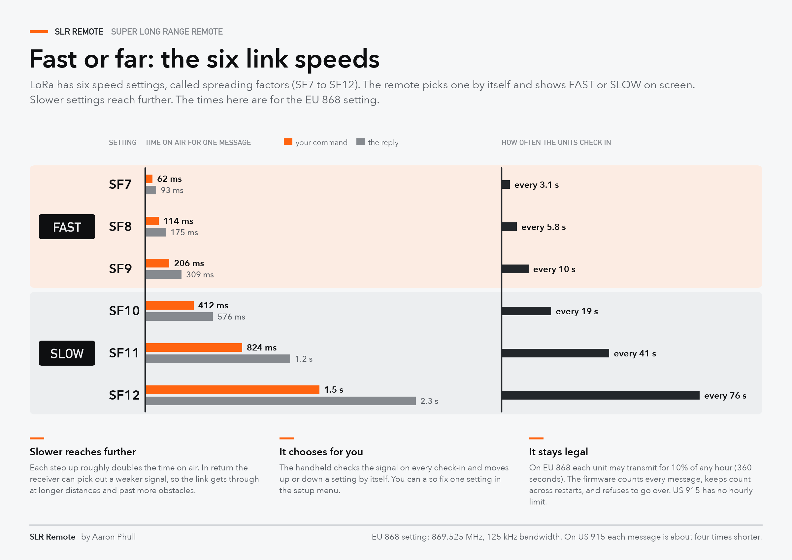

# Range: built to work for miles

A camera remote unlike any other camera remote. One that works for miles.

Infrared remotes need you in front of the lens. Bluetooth remotes give up a few metres away and want a phone in your hand. SLR Remote carries your shutter press on LoRa, the long-range radio people use for links of several miles across open country, and it runs that radio at full strength for its band. Leave the camera where the picture is and stand where you want to be.

This page covers my own test so far, what shapes range on a real shoot, how the link looks after itself, and how to squeeze out more.

## My test so far

I shut the camera unit inside a parked car and walked away with the handheld.

About 90 metres later, with no line of sight at all, it was still getting through. That was on the small stock antennas, with the camera unit sitting inside a metal box with windows, which is about the hardest place you can put a radio. And 90 metres was only where my walk ended. The link was still working when I turned round.

The camera's own Bluetooth remote reaches a few metres.

## Why this reaches for miles

SLR Remote uses two radios, each doing the job it is best at.

Bluetooth LE (BLE, the low-power Bluetooth built into cameras and phones) covers the last few centimetres, from the camera unit to the camera sitting next to it. LoRa covers the long hop from your hand to the camera unit. So the reach of the whole remote is the reach of LoRa.

LoRa goes far for three reasons:

- It works at 868 MHz in the UK and EU, or 915 MHz in the United States, both far lower frequencies than Bluetooth's 2.4 GHz. Lower frequencies lose less over distance and get round hedges, walls and bodies far better.
- The firmware transmits at the legal power limit on the UK and EU band, and at the most the board can give on the US band, which is inside the limit there. Either way it is many times what a camera's Bluetooth radio puts out.
- LoRa spreads each piece of data over a long, slow chirp, so the receiver can pull a message out of a signal that is weaker than the background noise.

That last one is adjustable, and the remote adjusts it for you. When the signal gets thin it drops to its slowest, longest-reaching setting by itself and keeps the camera within reach. More on that below.

Give it height, a clear view and a pair of proper antennas for your band and you are using LoRa the way the several-mile links use it. The open-country walk is the next test on my list, and the figure will go on this page when I have it. If you get there first, I would love to see your log: see [Help measure it](#help-measure-it).

## What shapes range on a shoot

### Antennas

The biggest single thing. The stock antennas are tiny, and they still managed my car test. A proper antenna tuned for your band on each unit (868 MHz for `EU 868`, 915 MHz for `US 915`) is the best upgrade you can make, and the case has an SMA connector mount ready for one.

Tell the remote which antenna you fitted: setup menu item `Antenna`, with 2, 3 or 5 dBi to choose from. On `EU 868` the firmware uses that figure to sit right at the legal power limit (see [safety-and-legal.md](safety-and-legal.md)).

### Height

Radio at this frequency travels close to a straight line. A camera unit on a tripod at head height sees over cars, hedges and people. One lying in the grass does not. If you are shooting from a wildlife hide or leaving a camera trap, lifting the camera unit even a metre makes a real difference.

### A clear view

Open air costs almost nothing. Buildings, vehicles, wet trees and hills all take a bite, and metal takes the most. If the camera unit can see the sky and you can roughly see where it is, you are in the sweet spot.

### The link setting

LoRa can trade speed for reach. The dial is called the spreading factor (SF), a number from 7 to 12 that sets how long the radio spends sending each piece of data. Higher numbers take longer on air and can be heard through a much weaker signal. The remote picks the setting for you.

## The six link settings

The top of the handheld's screen shows `FAST` on SF7 to SF9 and `SLOW` on SF10 to SF12, so you always know which end of the scale you are on.

| Setting | On screen | Your press on air | Each reply on air | Check-in every |
|---|---|---|---|---|
| SF7 | `FAST` | 62 ms | 93 ms | 3.1 s |
| SF8 | `FAST` | 114 ms | 175 ms | 5.8 s |
| SF9 | `FAST` | 206 ms | 309 ms | 10.3 s |
| SF10 | `SLOW` | 412 ms | 576 ms | 18.9 s |
| SF11 | `SLOW` | 824 ms | 1233 ms | 41.1 s |
| SF12 | `SLOW` | 1483 ms | 2302 ms | 75.7 s |

"Your press on air" is how long the handheld transmits for one shot. "Each reply on air" is how long each answer from the camera unit takes, and a shot gets two of them: one to say it arrived, one to say the camera took the press. "Check-in every" is how often the handheld quietly pings the camera unit between shots to keep an eye on the signal.

Each step up the table lets the receiver work with a signal 2.5 dB weaker than the step before. From SF7 to SF12 that adds up to 12.5 dB of extra reach.

These airtimes come straight from the firmware's radio settings on `EU 868` (125 kHz bandwidth, coding rate 4/5). The `US 915` figures are in [the next section](#eu-868-and-us-915-compared). On the bench at the fast setting I measured about 180 to 225 ms from the handheld sending to the camera unit accepting the press, with each Bluetooth command to the camera taking about 140 ms. Up close, it is quick.

### EU 868 and US 915 compared

The two regions do not behave quite the same, and it helps to know how before you plan a shoot.

The US rules ask for a wider radio channel: 500 kHz, against 125 kHz on the UK and EU band. Think of it as a faster shutter speed for the radio. Every message gets through about four times quicker, and in exchange the receiver gathers less of the signal, so each setting reaches a little less far than the same setting in Europe.

The link settings on `US 915`, worked out from the same firmware formula:

| Setting | On screen | Your press on air | Each reply on air | Check-in every |
|---|---|---|---|---|
| SF7 | `FAST` | 16 ms | 24 ms | 2.0 s |
| SF8 | `FAST` | 29 ms | 44 ms | 2.0 s |
| SF9 | `FAST` | 52 ms | 78 ms | 2.6 s |
| SF10 | `SLOW` | 103 ms | 144 ms | 4.7 s |
| SF11 | `SLOW` | 186 ms | 268 ms | 9.1 s |
| SF12 | `SLOW` | 371 ms | 494 ms | 16.5 s |

What that means on a shoot:

- **`FAST` is quicker in the US.** A press is on the air for a few hundredths of a second, so the radio part of the delay all but disappears.
- **`SLOW` is quicker too, and reaches less far than the European `SLOW`.** Going by the radio chip's published figures, the wider channel costs about 6 to 8 dB at each setting, which is roughly two steps of the table. The slowest US setting should reach about as far as SF10 does in Europe, and it takes about as long on the air.
- **Power is about the same.** Both regions run the board's amplifier at much the same level, around a third of a watt, so the difference in reach comes from the channel width and not from the transmitter.
- **No airtime budget in the US.** The 10% rule is a UK and EU one. On `US 915` a long interval run on `SLOW` is not rationed.
- **Your surroundings matter more than any of this.** Height, a clear view and good antennas will change your range far more than the difference between the two regions.

The honest part: all of the US figures are calculated. The `US 915` setting is built to the US rules but has not been tested on air, because I am in the UK and cannot legally transmit on 915 MHz here. Nobody has measured US range yet. If you do, please send me your log: see [Help measure it](#help-measure-it).

### How the remote chooses

A fresh pairing starts on SF7, the quickest. From there the handheld watches every check-in:

- If one comes back with less than 5 dB of signal in hand, the link steps one setting slower.
- After five in a row with more than 12 dB in hand it steps faster again, always keeping at least 8 dB spare. A really strong signal gets it there sooner.
- If three check-ins or commands in a row go unanswered, the handheld shows `RESCUE SF12` and goes looking. It calls on the slowest, longest-reaching setting and sweeps the others until the camera unit answers, then shows `LINK FOUND` and carries on.

Transmit power never drops. It stays at the cap for your region and only the speed changes.

You can pin a setting if you prefer (setup menu item `SF`, or `sf 7` to `sf 12` on the console). Set the same value on both boards.

### Speed at distance

Out at the far end of the range on `EU 868`, a press takes about a second and a half to transmit, and the replies come back a couple of seconds apart. On `US 915` the slowest setting is about four times quicker than that. For a self-portrait on a hilltop or a camera watching a nest, a few seconds between pressing and seeing `PRESSED` is nothing. For fast action, stay where the screen says `FAST`.

Slow settings also use more airtime. On `EU 868` each board is allowed 10% airtime in any rolling hour (the duty cycle rule for that band, explained in [safety-and-legal.md](safety-and-legal.md)). The handheld shows what is left as `AIR n%`, and INTERVAL checks the budget for you before a run starts.

## How to get more range

Start at the top. Each step is less effort than it sounds.

1. Fit proper antennas for your band to both units and set `Antenna` to match.
2. Get the camera unit up high and in the open: on the tripod, on a post, on the roof of the car and not inside it.
3. Keep the handheld's antenna clear of your hand and body, roughly upright like the one at the other end.
4. Go for line of sight where you can.
5. Leave `SF` on `Auto` so the link can slow down when it needs to.
6. Use the HUNT view to find the sweet spot before the shot matters.

Always screw the antenna on before you power a board. The firmware waits 2 seconds after power-on before it transmits and shows `ANTENNA ON?` to remind you.

## Watching the signal

The four bars at the top of the handheld's screen show how much signal you have in hand: one bar under 3 dB, two under 6, three under 10, four above that.

For a closer look, open the mode card, pick `VIEWS`, and hold for 1 second to step from one view to the next:

- LINK shows signal strength both ways, `MARGIN` in dB, the current setting, transmit power, the success rate over the last 20 check-ins and the round-trip time.
- HUNT is one big signal number with a bar and a best-so-far marker. Use it like a metal detector: walk, turn, lift the antenna, and watch the number. It pings quicker than normal so the reading keeps up with you.
- RANGE is the built-in range log.

With a GPS module in both units, the GPS view also shows the distance and compass direction back to the camera.

## Help measure it

The remote keeps its own range log, so a walk test needs the two units, a pair of boots and a USB cable at the end. I am collecting results, and a long open-country walk is the one I most want to see.

### What the log records

One row per press, saved as a CSV file on the handheld:

`t_s, mode, sf, tx_dbm, hh_lat, hh_lon, cam_lat, cam_lon, dist_m, rssi_up, snr_up, rssi_dn, snr_dn, ble_rssi, rtt_ms, retries, stage`

In plain words: the time, the link setting, transmit power, both positions and the distance between them (when both units have GPS), signal strength in each direction, round-trip time, retries, and how far the press got.

### Running a walk test

1. Charge both units and fit the antennas you want to test.
2. Set the camera unit up where it will stay, paired to the camera. Note where it is and how high.
3. On the handheld, open the mode card, pick `VIEWS`, then hold for 1 second at a time until you reach the `RANGE` page. The log runs while this page is showing.
4. Walk. Every so often, stop and tap to take a shot. Each tap adds a row, and the page counts `ROWS` and `SUCCESS` % as you go.
5. Keep going as far as you like, then walk back.
6. Plug the handheld into a computer, open a serial monitor at 115200 and send `dump`. Save the CSV that comes back. `clear` empties the log for next time.

The `DIST` figure and the position columns fill in when both units have a GPS fix. The handheld does not need GPS to shoot, so without one just drop a pin on a phone map at the far point. That works fine.

### What to send

- The CSV
- Which `Region` you were on, which antennas you used and the `Antenna` setting on each board
- Where each unit was: height, indoors or out, in a vehicle or not
- The ground in between: open field, street, town, woods
- Whether you could see the camera
- Firmware version (setup menu `About`, or `stat` on the console)

## More reading

- [how-it-works.md](how-it-works.md): the link and its safety behaviour in depth
- [data-flow.md](data-flow.md): a press from button to shutter, end to end
- [user-guide.md](user-guide.md): the views and the words on screen
- [troubleshooting.md](troubleshooting.md): `NO LINK`, `RESCUE SF12` and friends
- [safety-and-legal.md](safety-and-legal.md): power and airtime rules
