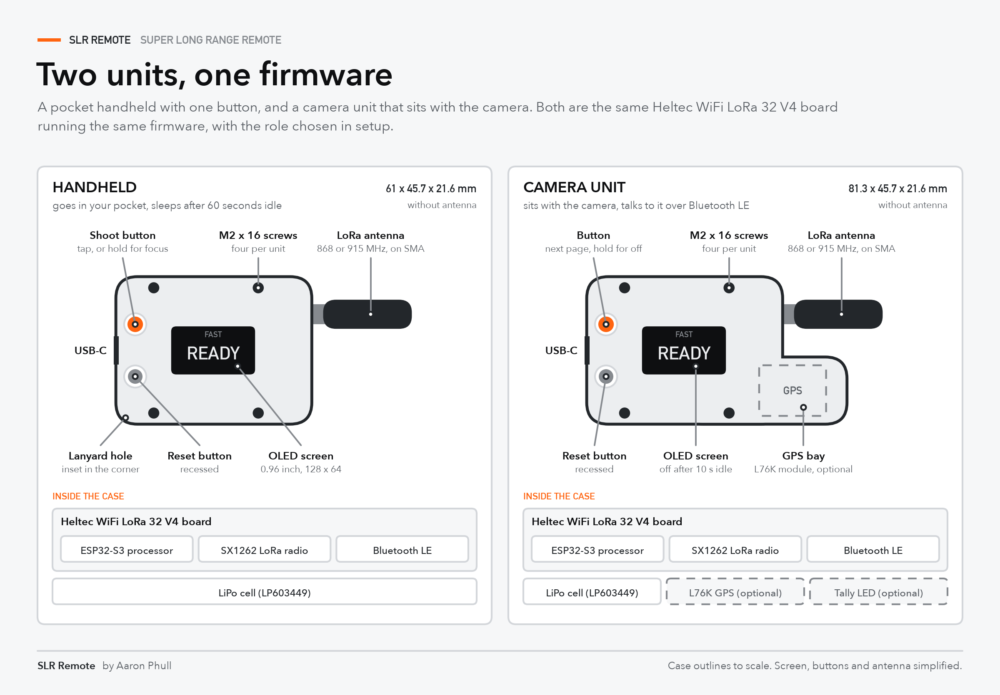

# Shopping list

Everything for one pair: a handheld for your pocket and a camera unit for the bag.

It is a short list. Two radio boards, two flat batteries, two antennas, eight screws and some filament. Each row gives the words to type into a search box and the one spec that matters, because these parts are sold by plenty of sellers and the listings change all the time.

## Essential parts

| Part | How many | Search for | The spec that matters | Easy mistakes |
|---|---|---|---|---|
| LoRa board | 2 | "Heltec WiFi LoRa 32 V4" | The **863 to 928 MHz version**, wherever you live. It covers both the UK and EU band and the US band, so builders on both sides of the Atlantic buy the same board. Sellers may label it 868 MHz, EU868, 915 MHz, US915 or 863 to 928 MHz, and it is all the same hardware. It carries the processor (ESP32-S3), the long-range radio (SX1262) and a 0.96 inch OLED screen on one board. | A board listed as 433 MHz or 433 to 510 MHz, or the older V3. The firmware and the case are made for the V4. Both V4.2 and V4.3 revisions are supported. |
| LiPo cell | 2 | "LP603449 LiPo" or "603449 3.7V" | Size about 51 x 34.5 x 6.3 mm. The battery bay allows 51.5 x 35 x 6.6 mm. Mine are 1100 mAh. | A thicker or longer cell. Plugging it in before checking the plug and polarity (see below). |
| Antenna | 2 | "868 MHz SMA antenna" in the UK and EU, "915 MHz SMA antenna" in the US | Tuned for **your band**: 868 MHz for the UK and EU, 915 MHz for the United States. An **SMA male** plug (a centre pin inside the plug). | 2.4 GHz Wi-Fi antennas look identical and are the wrong band. So is an 868 MHz antenna in the US, or a 915 MHz one in Europe: it will work poorly. **RP-SMA** antennas look almost identical and will not connect: an RP-SMA plug has a hole where the pin should be. |
| Antenna lead | 2, if not in the box | "IPEX to SMA female bulkhead pigtail" | A short lead from the small snap-on antenna socket on the board to a panel-mount SMA socket with a nut. The case has a 5.97 mm hole for the barrel and a pocket for the nut. | RP-SMA again. Look at what comes with your boards before ordering more. |
| Case screws | 8 | "M2 x 16 mm self-tapping screw" | M2, 16 mm long, four per unit. They thread straight into 1.8 mm pilot holes in the printed back. The head sits in a recess 3.9 mm across, so choose a head under 3.8 mm. | M3 screws (the original case design used them, this one does not). Anything longer than 16 mm. Wide heads. |
| Filament | Part of a spool | "PETG filament" | The print plates are set up and checked for PETG. Any colour you like. | Nothing to trip over here. The parts are small. |
| USB-C cable | 1 | "USB-C data cable" | It must carry **data**, not only charge. | A charge-only cable lights the board up but the computer never sees it. |

### Buying in the United States

The list is the same with one swap: 915 MHz antennas in place of 868 MHz ones. The board is the same Heltec V4 in its 863 to 928 MHz version. Heltec builds one board for both bands, so do not worry if the label on yours mentions 868. Avoid the 433 to 510 MHz version.

Once it is built, set `Region` to `US 915` on both boards ([flashing-and-pairing.md](flashing-and-pairing.md#3-choose-each-boards-role-and-region)). The `US 915` setting is built to the US rules but has not been tested on air yet: I am in the UK and cannot legally transmit on 915 MHz here. If you build one in the States, tell me how it goes.

One more thing for US builders: source the parts yourself, as this list assumes. The US rule that lets you build a radio for your own use without certification does not cover devices built from a kit. More in [safety-and-legal.md](safety-and-legal.md#a-hobby-build).

### About the battery plug

The Heltec V4's battery socket is a small **SH1.25 2-pin** type. My cells arrived with the larger **PH2.0** plug, so I fitted SH1.25 plugs to them. That is the only soldering in the standard build, and you can skip it by buying the cell with the right plug already on: search for the cell size plus "1.25mm JST".

**Check polarity before you plug a cell in.** Sellers do not agree on which wire is positive on these little plugs. Compare the red wire with the `+` mark beside the socket on the board, ideally with a multimeter. If it is the wrong way round, swap the pins in the plug housing first. Thirty seconds here protects the board.

## Optional parts

A first shot needs none of these. They are the nice extras.

| Part | How many | Search for | What it gives you | Notes |
|---|---|---|---|---|
| GPS module | 1, for the camera unit | "L76K GPS module Heltec V4" | Location stamped into your photos (geotagging) and an accurate clock, shared with the handheld over the radio. | A Quectel L76K module that plugs into the board's 8-pin GNSS socket. The camera unit case has a bay shaped for the small L76K board made for the Heltec V4. The handheld needs none to shoot. A second module on the handheld adds the distance and compass direction back to the camera on its screen, though the handheld case has no bay for one, so that is one for a case of your own. |
| Tally LED | 1 | "3 mm LED" plus "220 ohm resistor" | A light on the camera unit that glows when a shot fires. Lovely for self-portraits and group shots, when you want to know it went. | The resistor goes in series with the LED whichever way you wire it. Wiring is in the [build guide](build-guide.md#optional-tally-led). Colour is up to you. |
| Higher-gain antennas | 2 | "868 MHz antenna 3 dBi" or "5 dBi" (915 MHz in the US) | Better ears for the radio at long distance. | Tell the firmware what you fitted (`Antenna` in the setup menu: 2, 3 or 5 dBi). On the UK and EU band it trims its transmit power to keep the pair legal. In the US, stay at 6 dBi or under. Same rules as above: the right band, SMA male. |
| Lanyard cord | 1 | "thin lanyard cord" | A wrist loop for the handheld, through the passage in the case corner. | The passage is 2.5 mm across with a tight bend, so buy cord thinner than that. |

## Tools

| Tool | Used for | Notes |
|---|---|---|
| 3D printer, or a print service | The eight case parts | Sliced for a 0.4 mm nozzle at 0.20 mm layers. The largest part is 45.72 x 81.28 mm, so any common printer bed is big enough. |
| Small screwdriver | The M2 screws | Match it to the screws you bought. |
| Multimeter | Checking battery polarity | The cheapest insurance in the build. |
| Soldering iron | The battery plug if yours needs changing, and the tally LED if you fit one | Fine tip, with heat-shrink tube for the joints. |
| Small spanner or pliers | The SMA nut | Finger tight plus a nip. |
| Tweezers | Dropping the buttons into the case top | Handy. The buttons are about 6 mm across. |
| Computer with PlatformIO | Building and loading the firmware | Windows, macOS or Linux. See [flashing-and-pairing.md](flashing-and-pairing.md). |

## Tick list

- [ ] 2 x Heltec WiFi LoRa 32 V4, the 863 to 928 MHz version
- [ ] 2 x LP603449 LiPo cell, plug and polarity checked against the board
- [ ] 2 x antenna for your band (868 MHz in the UK and EU, 915 MHz in the US), SMA male (not RP-SMA, not 2.4 GHz)
- [ ] 2 x antenna lead from board to SMA bulkhead socket, if not supplied
- [ ] 8 x M2 x 16 mm self-tapping screws
- [ ] PETG filament
- [ ] 1 x USB-C data cable

Next: [build-guide.md](build-guide.md) for printing and assembly, or [flashing-and-pairing.md](flashing-and-pairing.md) if the boards turn up before the prints are done.
