# User guide

The camera is on its tripod, framed and focused, and you are a long walk away with the handheld in your coat pocket. One button. Tap it and the shutter fires. Hold it and the camera focuses, let go and it shoots.

That is most of what you need to know. The rest of this page is the detail: what the little screen is telling you, self-timer, focus lock, intervals for time-lapse, bulb for long exposures, burst, video, and the setup menu for when you want it to behave differently.

It assumes both units are flashed, paired with each other and paired with the camera. If yours are not there yet, start with [Getting started](getting-started.md) and [Flashing and pairing](flashing-and-pairing.md). Everything here describes firmware 0.3.0.

## Contents

- [The two units and the two link modes](#the-two-units-and-the-two-link-modes)
- [The handheld screen](#the-handheld-screen)
- [Status words](#status-words)
- [The one button: gestures](#the-one-button-gestures)
- [The mode card](#the-mode-card)
- [Shooting modes](#shooting-modes)
- [View pages](#view-pages)
- [Sleep, wake and battery](#sleep-wake-and-battery)
- [The camera unit](#the-camera-unit)
- [Setup menu](#setup-menu)
- [LEDs: onboard and tally](#leds-onboard-and-tally)
- [GPS time and geotagging](#gps-time-and-geotagging)
- [Good to know](#good-to-know)
- [Serial console reference](#serial-console-reference)

## The two units and the two link modes

There are two boxes running the same firmware in different roles.

| Unit | What it does |
|---|---|
| Handheld | The one you hold. One button (PRG), a small OLED screen. |
| Camera unit | Sits with the camera. Receives your press by radio and presses the camera's shutter over Bluetooth. |

The handheld can work in two link modes, chosen in the setup menu.

| Mode | Path | Use it when |
|---|---|---|
| Relay | Handheld, then LoRa radio, then camera unit, then Bluetooth, then camera | You want distance: the wildlife hide, the far bank, the group shot with you in it. This is what the remote is for. |
| Direct | Handheld, then Bluetooth, then camera | You are beside the tripod, or you have built one board so far. Adds bulb and burst. |

Some jargon, once:

- **LoRa** is a slow, long-reaching radio system. Here it runs on 869.525 MHz, in the EU and UK 868 MHz licence-free band.
- **BLE** is Bluetooth Low Energy, the short-range radio the camera already has for its own remote-release feature.
- **Spreading factor (SF)** is LoRa's speed setting, from 7 to 12. A low number is fast and shorter in reach. A high number is slow and reaches further. The firmware picks it for you.
- **Duty cycle** is the legal limit on how much of each hour a transmitter may be on air. In this band it is 10%, which is 360 seconds in any rolling hour for each board.

For the full picture of what talks to what, see [Data flow](data-flow.md) and [How it works](how-it-works.md).

## The handheld screen

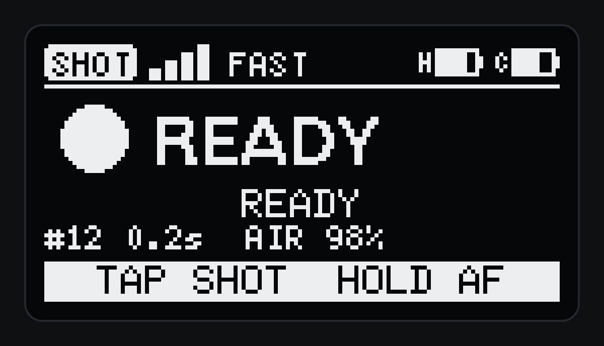

The home screen has three parts.

### Top bar

From left to right:

| Item | Meaning |
|---|---|
| Mode tag | The shooting mode in use, for example `SHOT` or `TIMER 10s`. |
| Signal bars (0 to 4) | In relay: how much spare signal the LoRa link has, taken from the weaker direction. In direct: Bluetooth signal to the camera. |
| `FAST` or `SLOW` | Relay only. The link speed the two boards have settled on. See below. |
| `H` battery icon | Handheld battery. |
| `C` battery icon | Camera unit battery (relay only; the camera unit reports it over the radio). |

The battery icons fill in proportion to charge and blink at 10% or less. A `?` means the level is unknown, or the board is running from USB with no cell.

### FAST and SLOW

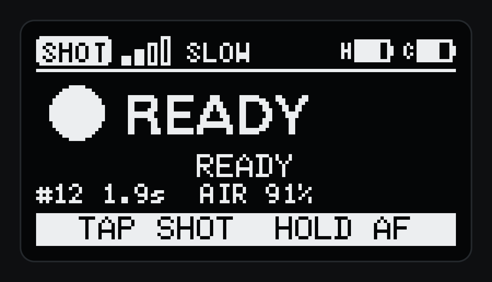

- `FAST` means spreading factor 7, 8 or 9. Presses arrive quickly.
- `SLOW` means spreading factor 10, 11 or 12. This is the long-range setting, the one that keeps the shutter under your thumb when the camera is far off or behind a hill. Each message spends longer on air, so a press takes a little longer to arrive and uses more of the hourly airtime allowance.
- If the word is shown inverted with a `!`, the boards have lost each other and the handheld is searching (rescue). A toast says `RESCUE SF12`, then `LINK FOUND` when they meet again.

You do not need to manage this. The handheld pings the camera unit, measures how much signal is in hand, and steps the speed up or down. See [Range](range.md) for what that means in practice.

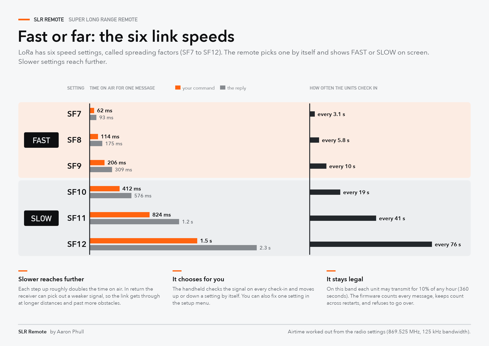

### Headline and status row

The big word in the middle is the state of the link or of your last press (see the next section).

Under it, the status row shows:

- `#N`: how many presses have actually gone to the camera this session.
- The time the last press took, in seconds.
- `AIR n%` (relay only): the airtime left this hour on whichever board has used more.
- On the right, how long ago the last press was (`Ns ago`, or `>10m`).

When the camera accepts a shot, a small iris on the screen snaps shut and opens again.

## Status words

### Link state

| Word | Meaning |
|---|---|
| `READY` | The camera link is up. Press when you like. |
| `CONNECTING`, `SEARCHING` | The Bluetooth link to the camera is coming up. |
| `NO CAM` | No camera link, or no camera paired. |
| `NOT CHECKED` | Relay, just powered on, nothing sent yet. The line under it says `press any button to connect`. The handheld stays silent after a power-on until you touch a button, so you have time to notice a missing antenna. |
| `CHECKING` | The handheld is asking the camera unit (`asking cam board`). |
| `NO LINK` | No reply from the camera unit. |

### Progress of a press

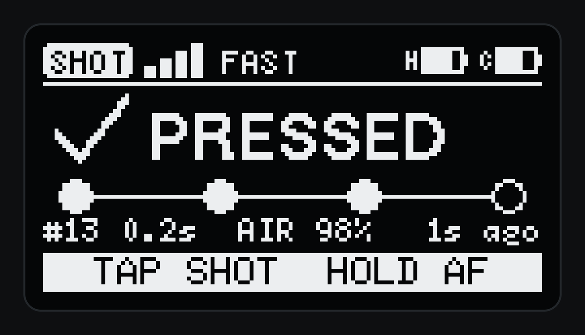

A press moves through stages, and you can watch it travel. The screen only ever claims a stage once proof of it has come back, so what you read is what happened.

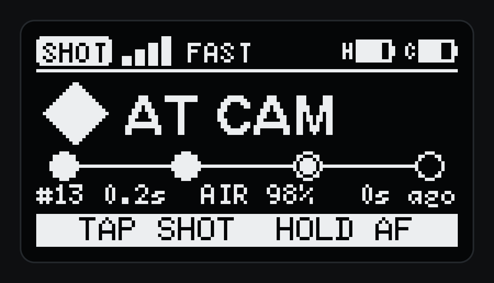

| Word | Meaning |
|---|---|
| `QUEUED` | Relay: your press is accepted but not on air yet. |
| `WAITING CAM` | Direct: the press will go as soon as the camera link is up. A countdown shows how long it will wait. |
| `SENT` | The handheld has transmitted. |
| `AT CAM` | Relay: the camera unit received it. |
| `PRESSED` | The camera accepted the shutter press over Bluetooth. |
| `CAM EVT` | The camera also sent a notification within 2 seconds of the press. |
| `FAILED` | It did not work. A reason line says why. |
| `UNKNOWN` | The outcome cannot be known. The camera may or may not have fired. Check the camera. |
| `LATE: AT CAM` | Proof of delivery arrived after the press had already been reported as failed. |

Good results stay on screen for 4 seconds and then return to `READY`. Failures and unknowns stay until the next press.

Relay shows four progress dots (sent, at camera unit, pressed, camera event). Direct shows three.

`PRESSED` is the word to look for. It means the camera itself answered and accepted the shutter press. On the X-E5 it is the last word: the camera sends nothing more after a shot, so do not wait for `CAM EVT` or the fourth dot.

### Half-press (focus) results

| Word | Meaning |
|---|---|
| `FOCUS` | Focus is being held. |
| `AF SENT` | The half-press has been sent. |
| `AF FAIL` | The half-press failed. |
| `AF ?` | The result of the half-press is unknown. |

### Reason lines under FAILED or UNKNOWN

| Line | Meaning |
|---|---|
| `CAM NOT READY` | The camera unit got your press but has no Bluetooth link to the camera. |
| `CAM NOT FOUND` | The camera was not seen. |
| `BLE WRITE FAIL` | The Bluetooth write to the camera failed. |
| `SECURE FAIL`, `HANDSHAKE FAIL` | The Bluetooth link to the camera did not set up properly. Re-pair the camera. |
| `TIMEOUT` | The camera did not answer in time and the press never started. |
| `CAM MAY HAVE FIRED` | The press started but the camera never confirmed it. Shown as `UNKNOWN`. |
| `NO REPLY: MAY HAVE FIRED` | No answer from the camera unit after every retry. Shown as `UNKNOWN`. |
| `NOT SENT` | The press never left the handheld. Nothing fired. |
| `NOT SENT: LINK BUSY` | The radio was busy too long. The press was dropped so it could not fire late. |
| `CANCELLED` | You cancelled it. |
| `CAM BUSY` | The camera unit was still running the previous shot. |
| `NO RESULT FROM CAM` | The camera unit received the press but its result never arrived. |
| `CAM BOARD RESTARTED` | The camera unit restarted. It refuses any press first sent before the restart, so it can never take a second photo by mistake. |
| `CAM BOARD STORAGE` | The camera unit could not save its security position, so it did not run the press. |
| `NOT RUN: PRESS AGAIN` | The camera unit refused the press as stale and the automatic resend did not get through. Nothing fired. Press again. |
| `HOLD RELEASED: NO LINK` | The camera unit stopped hearing the handheld during a hold and let go by itself. |
| `RELEASE GAVE UP` | The camera never confirmed the release. Check the camera. |

### Short messages (toasts)

Toasts appear for 2 seconds on the handheld. The ones you are most likely to see:

| Toast | Meaning |
|---|---|
| `ANTENNA ON?` | A reminder in the first 6 seconds after power-on. Never transmit without the antenna fitted. |
| `NOT PAIRED` | The boards are not paired with each other. |
| `BUSY`, `BUSY: LAST SHOT RUNNING` | The last press is still in progress. Nothing new fired. |
| `NO REPLY` | The camera unit did not answer. |
| `RESCUE SF12`, `LINK FOUND` | The link was lost and is being searched for, then found. |
| `NOT SENT: DUTY` | The hourly airtime limit refused the press. |
| `DUTY: PINGS PAUSED` | The handheld has used 80% of its airtime, so background pings stop. Presses still go. |
| `CAM DUTY: PINGS HELD` | The camera unit is short of airtime and has stopped answering pings. Presses still go. |
| `NO REPLY: CAM DUTY`, `RELEASE: CAM DUTY` | The camera unit is nearly out of airtime and did not reply. |
| `RELEASE OK`, `RELEASE FAILED: RETRYING`, `RELEASE GAVE UP: CHECK CAM` | Progress of a release the camera was slow to confirm. |
| `RADIO WARMUP` | Pressed inside the 2 second hold-off after power-on. The press waits. |
| `RADIO FAILED`, `RADIO FAULT` | The radio did not start, or stopped behaving. See [Troubleshooting](troubleshooting.md). |
| `STORAGE FAIL`, `DUTY STORE FAIL` | The board could not write to its flash memory. It stops transmitting until it can. |
| `RST AGAIN NOW = SETUP` | You tapped RST once. Tap again within 3 seconds for the setup menu. |

If the camera has not confirmed a release, a full-screen alert reads `! CHECK CAMERA !`, `RELEASE NOT CONFIRMED`, then `retrying in the background` (direct) or `retrying while the link allows` (relay). Any press clears it and does nothing else.

## The one button: gestures

The handheld has one working button, PRG. What a press does depends on how long you hold it. The default press style is called **A**.

### Style A (default)

In SHOT, AF LOCK, TIMER and BURST modes:

| How long you hold | What happens |
|---|---|
| Under 0.3 s (a tap) | The mode's tap action. In SHOT, a photo. |
| From 0.3 s | Half-press. Autofocus is held (`AF...`, then `AF HELD`). |
| Let go while AF is held | SHOT and AF LOCK: the shot goes. TIMER: the countdown starts with focus kept on. BURST: the burst starts. |
| Past the AF limit (default 4 s) | AF is released, nothing fires, and you are in the MODES zone. Let go now to open the mode card. |
| 3 s after that | NOTHING. Letting go does nothing at all. The clean way out of a press you did not mean. |
| 15 s | `BUTTON STUCK`, `nothing will fire`, `going to sleep`. Anything held is released and the board sleeps. |

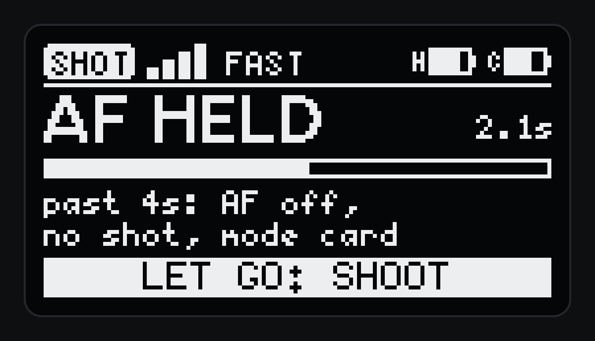

In INTERVAL, BULB and VIDEO modes there is no half-press:

| How long you hold | What happens |
|---|---|
| Under 1 s | Tap: the mode's action. |
| 1 s | MODES zone. Let go to open the mode card. |
| 7 s | NOTHING. |

On other screens:

| Screen | Tap | Hold 1 s |
|---|---|---|
| A view page (LINK, HUNT, GPS, RANGE) | The current mode's tap action | Next view |
| Mode card, value editor, ARM screen, yes/no question | Next item, or back | Pick, keep or confirm |
| `AF LOCKED` | Fire | Unlock |

Two rules hold everywhere. Anything running stops on press-down: if a timer, interval, burst or bulb is going, the moment you press stops it, and the rest of that press does nothing. And the bottom bar of the screen always tells you what a press will do next, for example `TAP SHOT  HOLD AF` or `ANY PRESS: STOP`.

### Other press styles

Chosen with the `Press` item in the setup menu.

| Style | How it works |
|---|---|
| A | As above. Hold for focus, keep holding for modes. |
| B | Hold 1 s and a wheel steps through the mode card items by itself every 0.7 s. Let go on the one you want. No half-press focus, except in HOLD AF mode. |
| C | A ladder: tap is `SHOOT`, 1 s is `MENU`, 4 s is `OFF`, 8 s is `NOTHING`. Let go on a step to pick it. Adds HOLD AF to the mode card. |
| Classic | Click (under 1 s) takes a photo, hold 1 s for the next page, hold 4 s for off. No mode card. |

### Optional extra switches

Two extras for anyone happy with a soldering iron. The remote is complete without them.

An aux button is a second button on GPIO6. Tap opens the mode card and steps through it. Hold 1 s moves to the next view. PRG then becomes a pure shutter button: holding past the AF limit shows `AF TIMED OUT` instead of opening the card. If the aux button wakes the board, it only wakes it.

A two-stage shutter switch (half contact on GPIO6, full on GPIO4) gives you the feel of a real shutter release. Half is focus, full is shoot, letting go is release. This always uses the classic screens, and PRG becomes the page button: click for next page, hold 4 s for off.

Wiring for both is in the [Build guide](build-guide.md).

## The mode card

Let go in the MODES zone and the mode card opens.

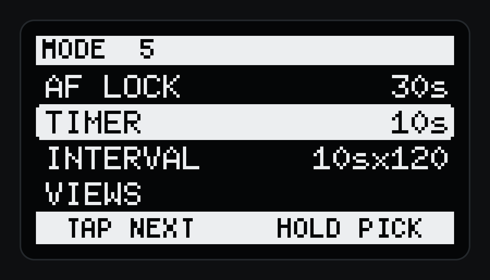

- Header: `MODE` and the seconds left before it closes. It closes by itself after 6 seconds without a press.
- Bottom bar: `TAP NEXT     HOLD PICK`.
- Items: the enabled shooting modes, then `VIEWS`, `SETUP` and `OFF`.

If you opened it by holding through a half-press, the header says `AF off, no shot` so you know nothing fired.

| You pick | What happens |
|---|---|
| A different mode | The handheld switches to it and the LED blinks once for each position down the list. |
| The mode already in use | Its value editor opens (TIMER, AF LOCK, INTERVAL, BURST, BULB). |
| `VIEWS` | Goes to the first view page. |
| `SETUP` | Asks `SETUP?`. Hold for yes, tap for no. Yes restarts into the setup menu. |
| `OFF` | The handheld goes to sleep. PRG wakes it. |

### Value editors

Tap steps through the choices, hold keeps the one shown. The current value is marked `now`. It closes after 6 seconds idle without saving.

| Editor | Choices |
|---|---|
| `TIMER` | 2, 5, 10, 20 s |
| `AF LOCK TIME` | 10, 30, 60 s |
| `INTERVAL: EVERY` | 2, 3, 5, 10, 15, 30, 60 s |
| `INTERVAL: COUNT` | 10, 30, 60, 120, 360 shots, or `until stop` |
| `BURST` | 0.5, 1, 2, 3 s |
| `BULB` | 30 s, 1, 2, 4, 8, 15, 30 min |

Finer values can be set from the [serial console](#serial-console-reference).

Only SHOT or AF LOCK is remembered when the handheld is fully powered off and on. The other modes are remembered through a normal sleep.

## Shooting modes

The default mode card has SHOT, AF LOCK, TIMER and INTERVAL. Set `Modes shown` to `All` in the setup menu to add BURST, BULB and VIDEO.

| Mode | A tap does | Setting (default) | Works in relay? |
|---|---|---|---|
| SHOT | One photo: focus, wait, shoot, release | Focus wait (500 ms) | Yes |
| AF LOCK | Locks focus. Next tap fires at once | Lock time 5 to 120 s (30 s) | Yes |
| TIMER | Starts a countdown, fires at zero | 1 to 60 s (10 s) | Yes |
| INTERVAL | Opens the ARM screen for a timed series | Every 2 to 3600 s (10 s), count 0 to 9999 (120) | Yes, within the airtime limit |
| BURST | Holds the shutter down for a set time | 0.2 to 10 s (1 s) | Direct mode |
| BULB | Opens the shutter and closes it after a set time | 1 to 1800 s (120 s) | Direct mode |
| VIDEO | Starts recording. Next tap stops it | None | Yes |
| HOLD AF | Tap shoots, hold focuses, let go shoots | AF limit (4 s) | Yes |

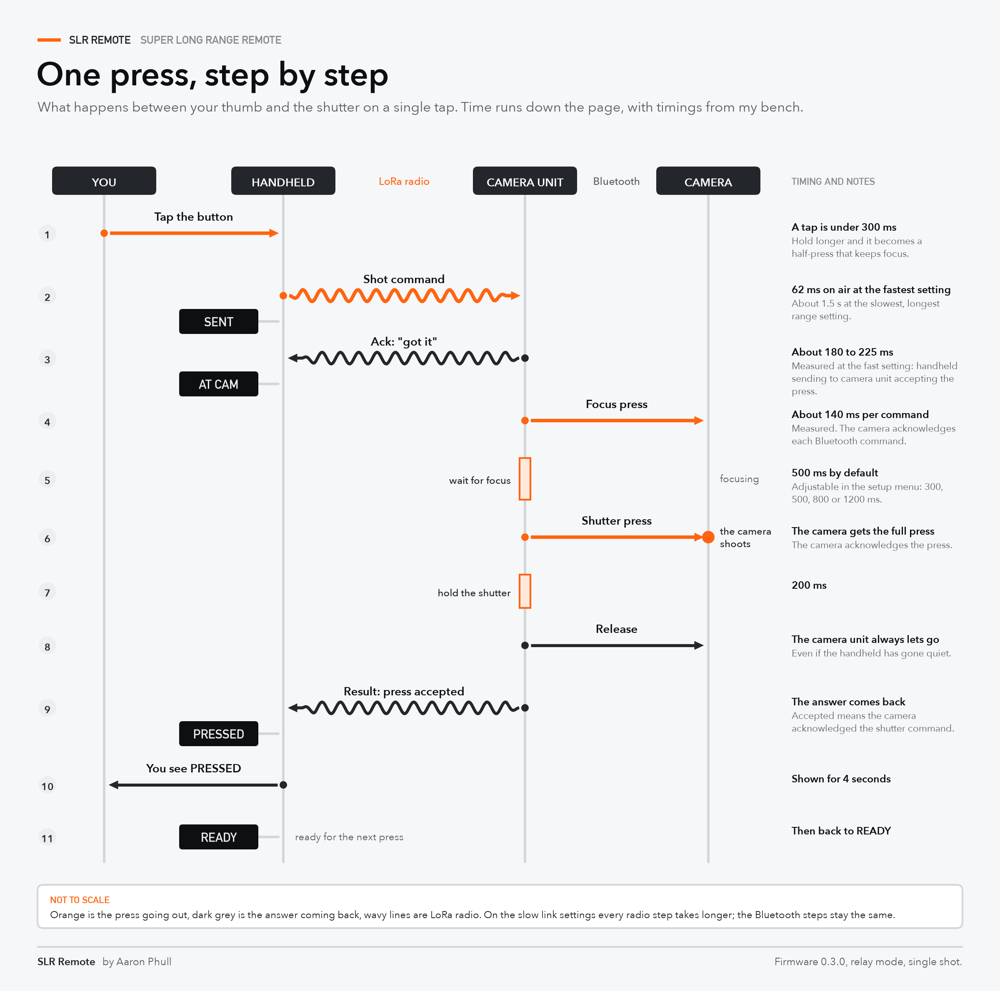

### SHOT

The everyday mode, and it works like the shutter button you already know.

Tap, and the camera gets a half-press to focus, then after the focus wait a full press, then a release. The shutter is held for 200 ms.

Hold, and focus is held for as long as you hold. The screen shows `AF HELD`, the seconds and a progress bar. Let go to shoot. The shot never goes sooner than the focus wait after focus started, so the lens always gets its moment.

Hold past the AF limit and focus is released, nothing fires, and the mode card is offered.

On the slow link setting the hold screen adds `tap is faster`, because a hold needs more radio messages than a tap.

In direct mode with no camera link yet, a hold shows `AF: NO CAMERA`, `connecting...`. Letting go sends a full shot that waits up to 10 seconds for the camera.

### AF LOCK

For the moment you are waiting on: the bird about to leave the branch, the rider coming into frame. Focus first, then the shutter goes the instant you tap.

1. Tap. The camera focuses and holds: `AF LOCKED`, with a countdown.
2. Tap again. It fires at once: `FIRED`.

Hold 1 s instead to unlock without shooting (`AF UNLOCKED`, `no shot`). If the countdown reaches zero, focus is let go (`AF RELEASED`, `timeout, no shot`).

### TIMER

The self-timer for group shots and self-portraits, with the countdown in your hand instead of on the camera.

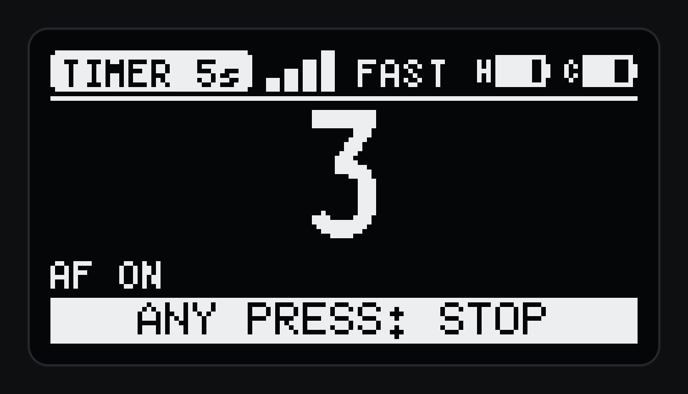

Tap and a big countdown starts. Any press stops it. At zero, one shot goes. In relay the shot is sent slightly early, by the link's measured round-trip time, so it lands at zero.

Hold, then let go, and you get the same countdown with focus kept on all the way through.

If you press within 1.5 seconds after zero, the screen says `TOO LATE`, `shot was already sent`. That is a real shot. If the press caught the shot before it left the handheld, it says `STOPPED`, `timer: shot cancelled`.

### INTERVAL

A series of shots at a fixed gap. Clouds over a ridge, a tide coming in, a camera trap that fires every minute until you tell it to stop.

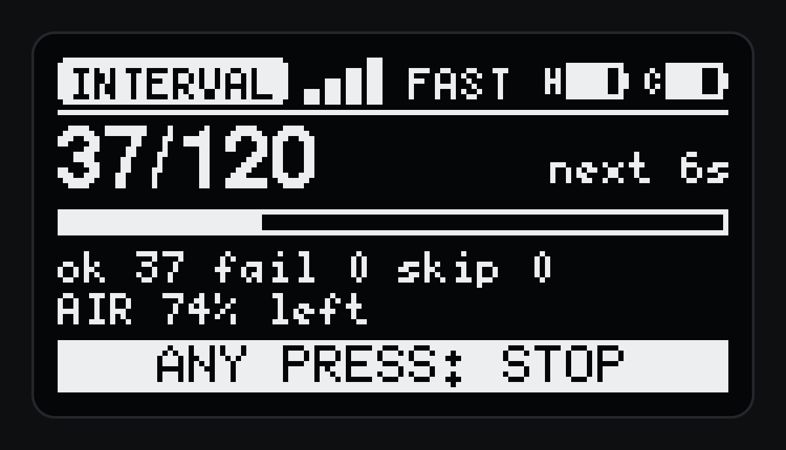

1. Tap. The ARM screen shows the plan, for example `10s x 120`, how long it will run, the battery level, and `nothing has fired yet`.
2. **Hold 1 s to start.** Tap goes back. The screen closes after 15 seconds idle.
3. The first shot fires at once. The running screen shows shots done, time to the next, counts of `ok`, `fail` and `skip`, and in relay the airtime left.
4. Any press stops it.

The handheld will refuse to start if:

- The battery is below 15%.
- In relay, the series needs more airtime than is left this hour. The screen says `needs AIR n% have n%` and suggests what would fit, for example a longer gap or fewer shots.

It stops by itself when:

| Screen | Why |
|---|---|
| `DONE` | The count is complete. |
| `NO LINK` or `NO CAMERA` | Three shots in a row failed. |
| `AIR LIMIT` | Three shots in a row were skipped to stay inside the airtime limit. |
| `BATTERY 5%` | The handheld battery is nearly empty. |
| `4 h LIMIT` | A run never lasts more than 4 hours. |

During a long run the screen dims after 15 seconds and goes dark after 60. Any press brings it back, and also stops the run.

### BURST (direct mode)

Tap and the shutter is held down for the burst time, so a camera in continuous drive keeps shooting. Any press stops it early. In style A, a hold focuses first and letting go starts the burst.

Burst runs in direct mode in firmware 0.3.0. In relay the mode card marks BURST and BULB `DIRECT`. Pick one and the screen says `NOT IN RELAY`, `BURST`, `is direct only for now`. If BURST is already the mode, a tap says `NOT IN RELAY`, `BURST is direct only`, `nothing fired`.

### BULB (direct mode)

Long exposures without a cable or a locked thumb. Set the camera to bulb, tap, and the shutter opens while a clock counts up on the handheld. It closes at the set time, anywhere from 30 seconds to 30 minutes, or the moment you press. To protect a long exposure it will not open below 15% battery.

BURST and BULB are both capped by a hold limit (default and maximum 1800 seconds, set with `holdcap` on the console).

### VIDEO

Switch the camera to movie mode, pick VIDEO on the handheld, and a tap starts recording. Tap again and it stops. It works from the same distance as everything else, so you can roll the camera from wherever you are standing.

The handheld sends one plain press with no focus wait and runs its own clock: `REC? 0:42`, with the bar showing `TAP: STOP`. The question mark is there because the camera does not report its recording state back, so the timer is the handheld's own count.

One thing to remember: the camera decides what a press means. In movie mode it starts and stops a recording. In a stills mode the same press takes a photo.

### HOLD AF

A variant of SHOT. Tap shoots. Hold focuses and letting go shoots. Past the AF limit it shows `AF TIMED OUT`, and holding on further opens the mode card.

### Messages you may see in any mode

| Message | Meaning |
|---|---|
| `BUSY`, `last shot still running` | You pressed before the last shot finished. Nothing fired. |
| `PRESS LOST`, `nothing fired` | The press was not read cleanly. |
| `STOPPED`, `the last run was cut`, `RESET` | Shown once after a restart or power loss interrupted a run. |

## View pages

Pick `VIEWS` on the mode card, then hold 1 s to move to the next. A tap on a view page still does the current mode's tap action, so you can shoot from here.

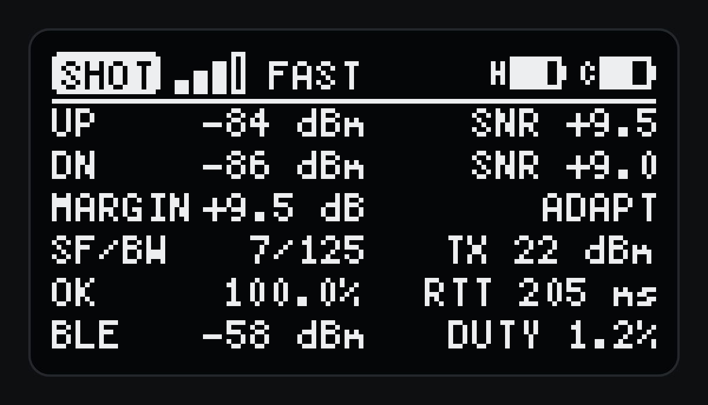

| Page | Shows |
|---|---|
| LINK (relay) | Signal each way (`UP`, `DN`), spare signal (`MARGIN`) with `ADAPT` or `FIXED`, the spreading factor and transmit power, success rate over the last 20 pings (`OK`), round-trip time (`RTT`), Bluetooth signal at the camera end, and `DUTY`, this board's share of its airtime used. |
| LINK (direct) | `MODE DIRECT BLE`, camera state, Bluetooth signal, camera name, last press. |
| HUNT (relay) | A big live signal reading with a bar and a "best so far" marker. Walk or turn and watch it. Useful for finding a good spot for the camera unit or pointing an antenna. It pings often, and slows down once either board has used 70% of its airtime (`HUNT SLOWED: DUTY`). |
| GPS | GPS state and satellite count. In relay, if both units have a fix: distance and compass direction to the camera unit, with an arrow. |
| RANGE | The range log: on or off, rows recorded, success rate, and distance in relay. The log runs while this page is showing. |

The range log is the tool for a walk test like the one in [Range](range.md). Read it back with `dump` on the console.

## Sleep, wake and battery

### Handheld

- It goes to sleep after **60 seconds** with no press. It never sleeps while something is running, held, locked or queued, or while the mode card or an editor is open.
- Plugged into a computer's USB port it stays awake. A plain charger does not keep it awake.
- A press during the `SLEEP` shutdown screen cancels the sleep and is handled as a normal press.
- **PRG wakes it.**
- Before sleeping it releases anything it was holding and tells the camera unit, so the camera unit does not go looking for it.

You never have to wake it first. By default (`Wake press` set to `Act`), the tap that wakes the handheld also takes the photo, in SHOT and HOLD AF modes. Pull it out of your pocket, tap once, and that is one photo. Set `Wake press` to `Wake` and the first press only wakes: `AWAKE`, `your press only woke me`, `nothing was fired`. A wake press never starts autofocus.

To switch it off on purpose, pick `OFF` on the mode card. This is the same deep sleep. PRG wakes it.

If PRG gets held down for 15 seconds, squashed in a bag say, nothing fires, anything held is released and the board sleeps. It then checks every 30 seconds whether the button has been let go, and every 2 minutes after ten checks.

### Battery

- The percentage comes from the cell voltage (3.30 V is 0%, 4.15 V is 100%) and is read every 10 seconds.
- Icons blink at 10% or less.
- INTERVAL and BULB will not start below 15%. Running modes stop at 5%.
- The cell charges through the board's USB-C port.

The handheld spends most of its life asleep and wakes the instant you press, so it sips power. The camera unit stays on to listen for you, so it is the one to charge first.

## The camera unit

Put it near the camera, switch it on and forget about it. Once it has a camera saved, it connects by itself and reconnects if the link drops.

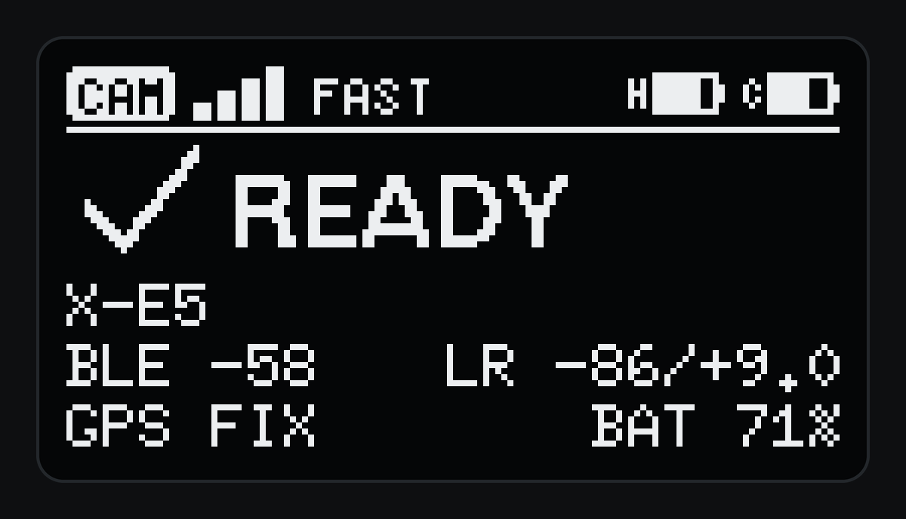

- The screen turns off after 10 seconds to save power. The unit keeps running. PRG, or an incoming press, turns the screen back on.
- With the screen on, a PRG click steps through its pages: CAMERA, LINK, GPS.
- **Hold PRG for 4 seconds to turn it off** (`OFF`, `Release button`). PRG wakes it.
- It does not go to sleep by itself. Turn it off when you are done.

The CAMERA page shows the Bluetooth state as the headline:

| Word | Meaning |
|---|---|
| `READY` | Connected to the camera. |
| `SCAN` | Looking for the camera. |
| `CONN`, `BOND`, `SETUP` | Connecting and setting up. |
| `PAIR` | Pairing in progress. |
| `FAIL` | The last attempt failed. It will retry. |
| `NO CAM` | No camera saved. |
| `OFF` | A camera is saved but Bluetooth is idle. |

Under that: the camera's name, Bluetooth signal, LoRa signal, GPS state and battery.

### How it looks after the camera

- If it is holding the camera's button and stops hearing the handheld, it lets go by itself. On the fast setting that takes about 10 seconds. I tested this by cutting power to the handheld mid-hold. On slower settings the wait is longer, because the handheld's check-in messages are further apart.
- If the handheld restarts mid-hold, the camera unit lets go as soon as it hears from it.
- The first thing it sends on any new Bluetooth link is a release, in case the camera was left holding a press.
- It releases before it powers off.

## Setup menu

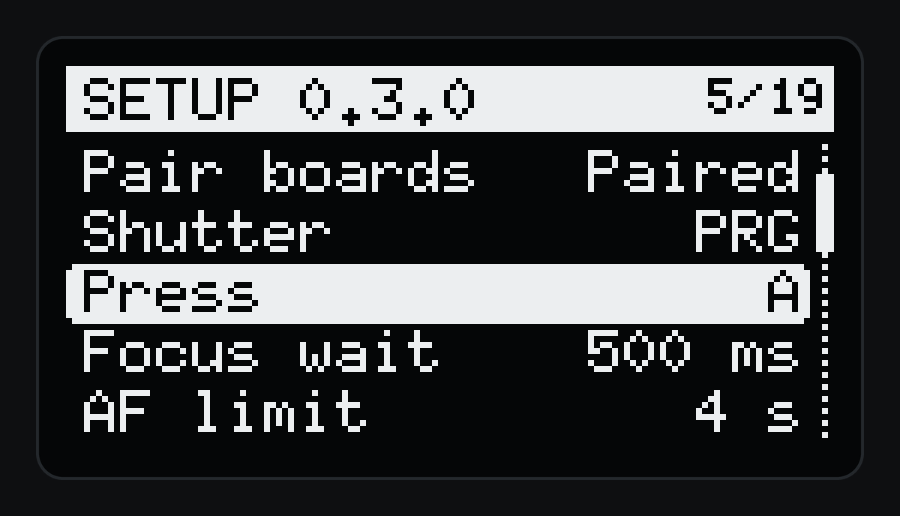

### Opening it

Any of these:

- Tap **RST** twice within 3 seconds. After the first tap the screen says `RST AGAIN NOW = SETUP`.
- On the handheld, pick `SETUP` on the mode card and hold to confirm.
- Send `setup` on the serial console.
- Hold PRG at power-on. Press it just after tapping RST, not before: PRG held while RST is released puts the chip into its download mode (black screen). If that happens, tap RST again.

A board with no role set opens the menu by itself.

### Controls

A PRG click moves to the next item. Holding PRG for 1 s selects or changes it.

The title shows `SETUP 0.3.0` and your position in the list. Choose `Exit` to save and restart. Left alone, the menu saves and restarts after 5 minutes. If it was opened by RST taps and never touched, it leaves after 30 seconds (`NO INPUT`).

### Items

Not every item appears on every unit. "HH" is the handheld, "CU" the camera unit.

| Item | Values | Where | What it does |
|---|---|---|---|
| `Role` | `Handheld`, `Camera` | Both | Which unit this board is. |
| `Mode` | `Direct`, `Relay` | HH | Bluetooth straight to the camera, or LoRa via the camera unit. |
| `Pair camera` | `Saved` or `--` | CU, direct HH | Pairs with the camera. The camera must be in Bluetooth pairing registration. |
| `Pair boards` | `Paired` or `--` | CU, relay HH | Pairs the two boards. Start it on both, check both show the same 6-digit code, hold PRG on each. |
| `Shutter` | `PRG`, `Two-stage` | HH | Use the onboard button, or a fitted two-stage switch. |
| `Press` | `Classic`, `A`, `B`, `C` | HH | The press style. |
| `Focus wait` | 300, 500, 800, 1200 ms | HH | How long a tap gives the camera to focus before the shutter press. Raise it if shots are missed in poor light. |
| `AF limit` | 2, 4, 8, 15 s | HH | How long a hold keeps focus before it lets go without shooting. |
| `Modes shown` | `Basic`, `All`, `Custom` | HH | `Basic` is SHOT, AF LOCK, TIMER, INTERVAL. `All` adds BURST, BULB, VIDEO. `Custom` appears when the list was set from the console. |
| `Wake press` | `Act`, `Wake` | HH | Whether the press that wakes the handheld also takes the photo. |
| `SF` | `Auto`, `SF7` to `SF12` | Relay HH | Link speed. Leave on `Auto`. A fixed value must be set the same on both boards. |
| `Antenna` | 2, 3, 5 dBi | CU, relay HH | The gain of the antenna you fitted. The firmware lowers transmit power to keep the radiated power legal, so set this honestly. |
| `Geotag` | `On`, `Off` | CU | Sends GPS position and time to the camera. Needs the GPS module. |
| `GPS` | `On`, `Off` | HH | Keeps a handheld GPS module on all the time. Only relevant if you fitted one. |
| `Reset taps` | `On`, `Off` | Both | Whether tapping RST twice opens this menu. |
| `Aux button` | `Off`, `GPIO6` | HH | Enables a second button, if fitted. |
| `LED` | `Off`, `Dim`, `Bright` | Both | The onboard LED. |
| `Tally LED` | `Off`, `GPIO3+4`, `GPIO6`, `GPIO4`, `GPIO3` | Both | Where an external tally LED is wired. |
| `About` | `SLR 0.3.0` | Both | Version, unit id, build date and case credit. |
| `Forget camera` | | CU, direct HH | Deletes the saved camera. Asks first: hold for yes, click for no. |
| `Factory reset` | | Both | Wipes settings, both pairings and the range log. Asks first. |
| `Exit` | | Both | Saves and restarts. |

Some options share pins, so turning one on can turn another off. The menu tells you when it does, for example `Aux off: GPIO6` when you enable the two-stage switch.

Step-by-step pairing, with the screens you will see, is in [Flashing and pairing](flashing-and-pairing.md).

## LEDs: onboard and tally

### Onboard LED on the handheld

With `LED` set to `Dim` or `Bright`, the handheld's LED confirms what happened without you looking at the screen.

| Blinks | Meaning |
|---|---|
| 1 short | Focus started or locked. Burst or bulb started. |
| 2 short | A shot was sent. |
| 1 long | Stopped, done, unlocked, or focus released. |
| Several short | You picked a mode. The count is its position on the mode card. |

### Tally LED

For a group shot or a self-portrait, this is how everyone in front of the lens knows the picture is being taken.

A tally LED is the small light that tells people the camera is live. On the camera unit it is lit while the shutter is held down, and for a quarter of a second on each accepted shot. The unit's onboard LED does the same if `LED` is not `Off`. Fit one to the handheld and it lights for about a quarter of a second after an accepted shot, and in direct mode while the shutter is down.

Wiring options, set with `Tally LED`:

| Setting | Wiring |
|---|---|
| `GPIO3+4` | LED across two pins: positive leg on GPIO3, negative leg on GPIO4, with a 220 to 330 ohm resistor in series. |
| `GPIO3`, `GPIO4`, `GPIO6` | LED on that one pin, lit when the pin goes high, with the other leg to ground through a 220 to 330 ohm resistor. |

It is off by default, and a change takes effect after a restart. See the [Build guide](build-guide.md) and the wiring diagram before soldering.

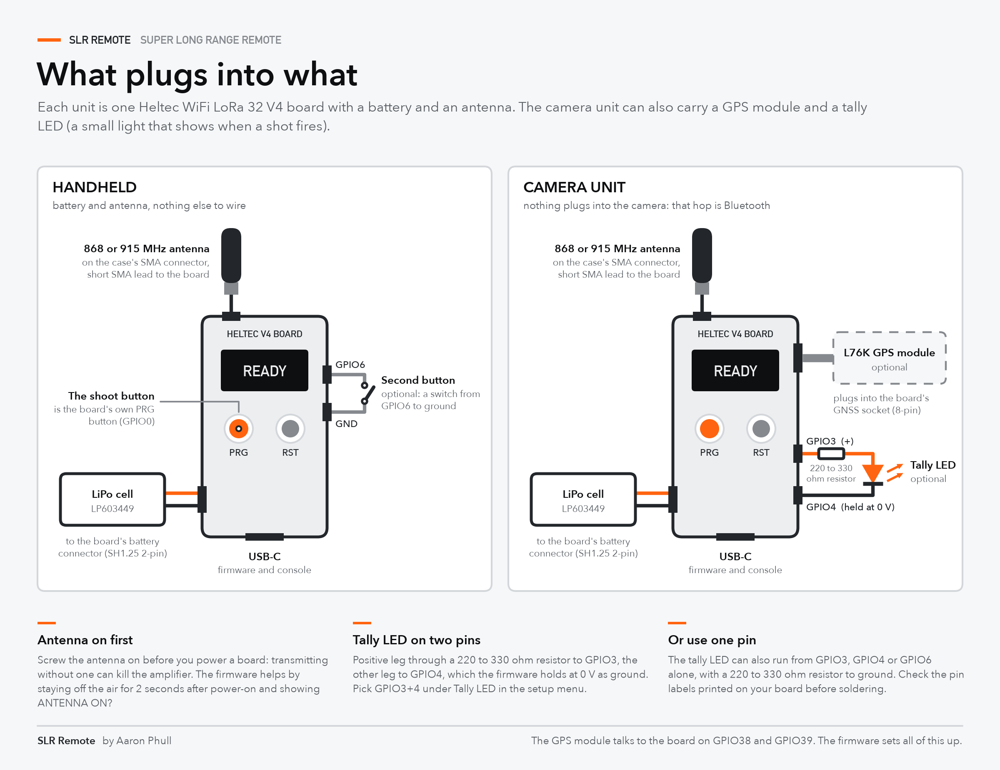

## GPS time and geotagging

GPS is optional. The camera unit's case has a bay for a Quectel L76K module. The handheld needs no GPS of its own.

### Time

When the camera unit has a GPS fix, it includes the time in its replies and the handheld sets its own clock from that. The camera unit's GPS runs while `Geotag` is `On`, so switch that on if you want the shared clock.

### Geotagging

Set `Geotag` to `On` on the camera unit. It keeps a fresh position and UTC time and hands them to the camera over Bluetooth each time the camera asks, for the camera to write into each photo.

If something is wrong, the camera unit shows one of these:

| Message | Meaning |
|---|---|
| `GEO: NO FIX` | No GPS fix yet. Give it a view of the sky. |
| `GEO: NO REQ` | The camera has never asked for a location. |
| `GEO: NO CHAR` | The camera offers no slot to write a location into. |
| `GEO FAIL` | The last write to the camera failed. |

Shutter commands always go ahead of geotag data.

### Distance to the camera

If you also fit a GPS module to the handheld, the GPS page in relay shows the distance and compass direction to the camera unit when both have a fix. Distance is in metres up to 1 km, then kilometres. Handy when the camera is hidden in a hedge and you have wandered off.

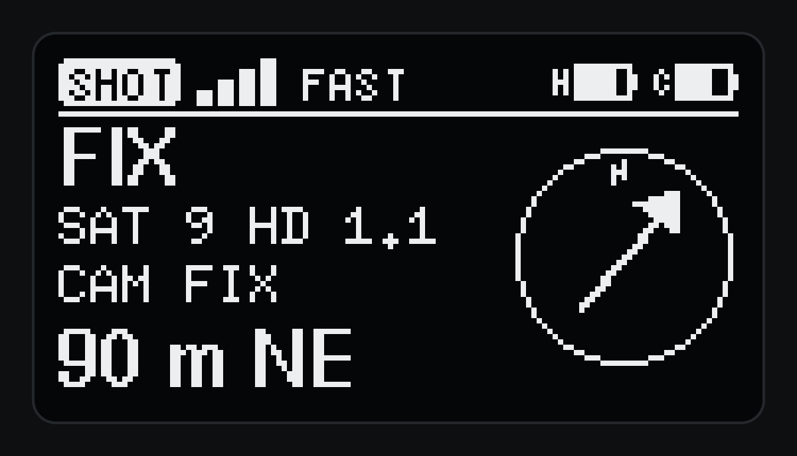

The GPS receiver is only powered when needed: with `Geotag` on (camera unit), or with `GPS` on or the GPS or RANGE page showing (handheld).

## Good to know

- The top word on the screen is `PRESSED`, because that is what the camera confirms. Take a test frame, look at it, then walk away.
- Bulb and burst run in direct mode in this firmware. Everything else works at full range.
- Everything here was tested on the Fujifilm X-E5, on the EU and UK 868 MHz band. The remote uses Fujifilm's standard Bluetooth remote release, so most modern Fujifilm cameras with Bluetooth should behave the same way.

## Serial console reference

Plug a board into a computer by USB-C and open a serial terminal at **115200 baud**. With PlatformIO that is `pio device monitor`. Type one command per line.

- Replies are `ok`, `ok (reboot to apply)`, `error: ...` or a `usage:` line.
- Lines starting with `#` are ignored.
- `help` lists most commands.
- A sleeping handheld has no USB port. Click PRG to wake it first.

### General

| Command | What it does |
|---|---|
| `help` | Lists commands. |
| `stat` | Version, role, mode, uptime, battery, settings, link, Bluetooth, shot and GPS figures. |
| `dump` | Prints the range log. |
| `clear` | Empties the range log. |
| `notify` | Shows the recent Bluetooth notifications from the camera. |
| `role h` or `role c` | Sets handheld or camera unit. Reboot to apply. |
| `mode direct` or `mode relay` | Sets the handheld's link mode. Reboot to apply. |
| `sf auto` or `sf 7` to `sf 12` | Adaptive or fixed spreading factor. A fixed value needs a reboot and must be set on both boards. |
| `focus <0 to 5000>` | Focus wait for a tap, in ms. |
| `gain <0 to 15> [force]` | Antenna gain in dBi. Lowering it needs `force`, because that raises transmit power. Reboot to apply. |
| `geotag on` or `geotag off` | Geotagging (camera unit). |
| `forget-cam` | Deletes the saved camera and its Bluetooth bond. |
| `forget-pair` | Deletes the board pairing. Reboot to apply. |
| `setup` | Restarts into the setup menu. |
| `pair boards` | Starts board pairing. You still confirm with a hold on each board. |
| `pair cam` | Starts camera pairing. |
| `reboot` | Restarts. |
| `reset` | Factory reset, then restart. |

### Handheld behaviour

| Command | What it does |
|---|---|
| `cfg` | Prints every profile setting, one pasteable line each. Good for backing up a setup. |
| `press classic`, `press a`, `press b`, `press c` | Press style. Reboot to apply. |
| `modes shot,aflock,timer,interval` | Which modes are on the card, in order. Up to 8 from `shot`, `aflock`, `timer`, `interval`, `burst`, `bulb`, `video`, `holdaf`. SHOT is always first. |
| `afmax <2 to 15>` | AF limit in seconds. |
| `aflock <5 to 120>` | AF LOCK time in seconds. |
| `timer <1 to 60>` | TIMER length in seconds. |
| `iv <every> <count>` | INTERVAL: gap of 2 to 3600 s, count of 0 to 9999 (0 is until stopped). Refused if the run would pass 4 hours or the gap leaves no room after the focus wait. |
| `burst <200 to 10000>` | BURST length in ms. |
| `bulb <1 to 1800>` | BULB length in seconds. |
| `holdcap <1 to 1800>` | The cap on BURST and BULB in seconds. |
| `wake act` or `wake wake` | Whether a wake tap takes the photo. |
| `rstgest on` or `rstgest off` | Whether RST twice opens setup. |
| `aux off` or `aux 6` | Second button on GPIO6. Reboot to apply. |
| `led off`, `led dim`, `led on` | Onboard LED. `bright` is accepted too. |
| `tally off`, `tally 3`, `tally 4`, `tally 6`, `tally 34` | Tally LED pin. `34` is an LED across GPIO3 and GPIO4. Reboot to apply. This one works but is missing from the `help` list. |

Value changes apply at once. Press style, aux button and two-stage switch changes apply at the next restart.

### For scripts

| Command | What it does |
|---|---|
| `get <key>` | Prints one setting. Keys: `press modes afmax aflock timer iv burst bulb holdcap wake rstgest aux led tally rlog focus sf mode role geotag gain`. |
| `set <key> <value>` | The same as typing `<key> <value>`, for `press modes afmax aflock timer iv burst bulb holdcap wake rstgest aux led focus sf geotag`. Use the plain commands for `role`, `mode`, `gain` and `tally`. |
| `json` | All settings as one JSON object. |
| `jstat` | Live handheld state as JSON: mode, view, screen text, bar, shots, battery, link. |

## Where next

- Something not behaving: [Troubleshooting](troubleshooting.md)
- Quick answers: [FAQ](faq.md)
- How far it reaches and why: [Range](range.md)
- The rules you are operating under: [Safety and legal](safety-and-legal.md)
