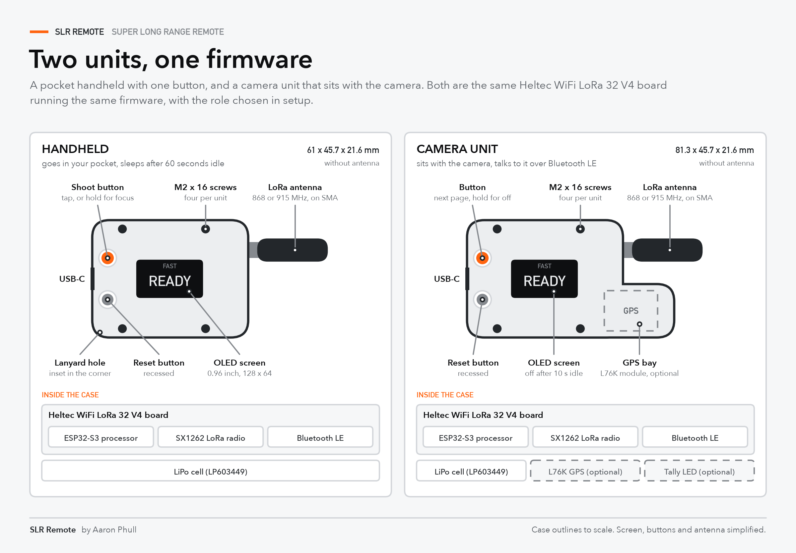

# SLR Remote firmware

A camera remote unlike any other camera remote. One that works for miles. This folder is the brains of it: the firmware for both halves of SLR Remote, currently at version **0.4.0**.

It takes a press of the button in your pocket, carries it over LoRa (a long-range, low-speed radio) to the camera unit, and has the camera unit press the shutter over Bluetooth LE (BLE, the low-power Bluetooth built into the camera). Single shots, half-press focus, timer, interval and video start and stop all run from one button over the long range link, with burst and bulb added in direct mode (one board talking Bluetooth straight to the camera).

There is one firmware image. Each board is told which job it does (handheld or camera unit) in its setup menu, so you flash the same build to both.



New here? Start with [docs/getting-started.md](../docs/getting-started.md). For step-by-step flashing and pairing see [docs/flashing-and-pairing.md](../docs/flashing-and-pairing.md). This page is the reference for people who want to build, read or change the code.

## What is here

| Path | What it is |
|---|---|
| `platformio.ini` | Build settings, pinned library versions, the version number |
| `include/config.h` | Every pin number, radio setting and timing constant in one place |
| `src/` | The parts that touch hardware: radio, Bluetooth, screen, storage, the two roles |
| `lib/core/src/` | Pure logic with no hardware in it: the protocol, press handling, modes, airtime maths. This is what the unit tests cover |
| `test/` | Two unit test suites that run on a computer, no board needed |

Target hardware: Heltec WiFi LoRa 32 V4 (ESP32-S3 processor, SX1262 LoRa radio, 128 x 64 OLED). Both the V4.2 and V4.3 board revisions are handled. An L76K GPS module is optional.

## Build, test, flash

You need [PlatformIO](https://platformio.org/) (the command-line `pio` tool, or the editor extension). It downloads the compiler and libraries itself on first build.

All commands run from this `firmware/` folder.

| Task | Command |
|---|---|
| Build | `pio run -e heltec_v4` |
| Build and flash over USB | `pio run -e heltec_v4 -t upload` |
| Serial console | `pio device monitor` |
| Unit tests (no board needed, on a Mac) | `pio test -e native` |

Notes:

- **Fit the antenna before powering a board.** Click the antenna lead onto the board's small LoRa socket, then screw the antenna for your band onto the lead's SMA end (868 MHz for `EU 868`, 915 MHz for `US 915`). Transmitting with no antenna can damage the radio's amplifier.
- **If the upload cannot find the board:** hold `PRG`, tap `RST`, release `PRG`. That forces the bootloader. Run the upload again.
- **Black screen after that?** The board is still in download mode. Tap `RST` once more.
- **Flash both boards from the same build.** A mixed pair will not talk to each other.
- The console is the board's own USB port at 115200 baud.
- A sleeping handheld disappears from USB. Click `PRG` to wake it. While plugged into a computer it stays awake.

### Library versions

Pinned to the versions I tested, so a clean build cannot quietly pick up something newer:

| Library | Version | Used for |
|---|---|---|
| NimBLE-Arduino | 2.5.2 | Bluetooth LE to the camera |
| RadioLib | 7.8.1 | The SX1262 LoRa radio |
| U8g2 | 2.36.18 | The OLED screen |
| TinyGPSPlus | 1.1.0 | Reading the GPS module |

Platform: `espressif32@6.9.0`, Arduino framework, C++17, 16 MB flash, LittleFS file system.

## First boot

A freshly flashed board has no role and no region, so it boots straight into the setup menu (`SETUP 0.4.0`).

- `PRG` click: next item.
- `PRG` hold 1 s: select or change.
- Set `Role` to `Handheld` or `Camera`.
- Set `Region` to `EU 868` (UK and EU) or `US 915` (United States). It shows `Choose` until you do, and the radio will not transmit while it is unset. Both boards need the same region.
- `Exit` to save and restart.

Or from the console: `role h` or `role c`, then `region eu` or `region us`.

A board that already had a role under an earlier firmware loads as `EU 868`, so an existing pair carries on unchanged after an update.

To get back into the menu later: tap `RST` twice (the screen prompts `RST AGAIN NOW = SETUP` after the first tap), pick `SETUP` from the handheld's mode card, or send `setup` on the console.

Pairing the two boards with each other, and the camera unit with the camera, is covered in [docs/flashing-and-pairing.md](../docs/flashing-and-pairing.md).

## Source map

### `src/` (hardware and application)

| File | What it does |
|---|---|
| `main.cpp` | Start-up: splash, decide between the setup menu and the saved role, then run that role |
| `app.h` | Entry points for the two roles, the setup menu and the console |
| `app_handheld.cpp` | The handheld: button presses to commands, the send queue and retries, link adaptation, sleep and wake, what the screen is told |
| `app_camera.cpp` | The camera unit: checks and answers each radio message, runs the Bluetooth commands, lets go by itself if the handheld goes silent |
| `app_internal.h` | Small pieces shared by the roles, the menu and the console |
| `apperr.h` | Error codes for things that fail on the boards themselves (as opposed to at the camera) |
| `cam_exec.h` | Runs a timed press sequence against the camera and reports only what the camera acknowledged. Used by both roles |
| `fuji.cpp`, `fuji.h` | Bluetooth LE to the camera: find it, pair, reconnect, press, release, optional geotag. Derived from Furble |
| `radio.cpp`, `radio.h` | The SX1262 through RadioLib: always listening, the frequency and bandwidth for the active region, the legal power cap, the 2 s hold-off after power-on |
| `duty.cpp`, `duty.h` | Keeps the airtime count across sleep, restarts and power cuts |
| `pairing.cpp`, `pairing.h` | Pairing the two boards over LoRa: key exchange, the 6 digit check code, and proof both ends hold the key before anything is saved |
| `store.cpp`, `store.h` | Saved settings, the board pairing record, message counters, and the range log file |
| `menu.cpp` | The setup menu |
| `serial.cpp` | The USB console |
| `linebuf.h` | Builds one console line and sends it in one go, so lines from different tasks never interleave |
| `ui.cpp`, `ui.h` | Draws every screen from a plain description of what to show. Holds no state of its own |
| `hw.cpp`, `hw.h` | Power rails, battery reading, LEDs, deep sleep and wake sources |
| `gps.cpp`, `gps.h` | Power and parsing for the L76K GPS module |
| `utc.cpp`, `utc.h` | Wall-clock time: set from GPS on the camera unit, learned over the radio by the handheld |
| `bootgest.cpp`, `bootgest.h` | Ways into the setup menu at boot that do not need `PRG` held: the double `RST` tap, and "menu on next boot" |

### `lib/core/src/` (pure logic, unit tested)

| File | What it does |
|---|---|
| `proto.h`, `proto.cpp` | The radio message format: build, sign, check, reject replays, run each command at most once |
| `linkmgr.h`, `linkmgr.cpp` | Link quality maths, the rules for stepping the spreading factor up and down, the rescue search, check-in and silence timings |
| `airtime.h`, `airtime.cpp` | How long a LoRa message of a given size is on air at each setting |
| `dutycycle.h`, `dutycycle.cpp` | The rolling one-hour airtime budget, kept in one-minute buckets |
| `region.h`, `region.cpp` | The region table: frequency, bandwidth, power rule and airtime limit for `EU 868` and `US 915` |
| `seqplan.h`, `seqplan.cpp` | Works out whether an interval run fits in the airtime budget before it starts |
| `shotseq.h`, `shotseq.cpp` | Turns "take a photo" into timed steps: focus, wait, shutter, release |
| `press.h`, `press.cpp` | Turns raw button samples into tap, hold and let-go events for each press style |
| `modes.h`, `modes.cpp` | The one-button mode engine: SHOT, AF LOCK, TIMER, INTERVAL, BURST, BULB, VIDEO, HOLD AF, the mode card and value editors |
| `buttons.h`, `buttons.cpp` | Debounce and click, long and very long detection for the classic controls and the two-stage switch |
| `battery.h`, `battery.cpp` | Cell voltage to percentage |
| `geo.h`, `geo.cpp` | Distance and bearing between two positions |
| `rangelog_fmt.h`, `rangelog_fmt.cpp` | Formats one row of the range log as CSV |
| `rstgest.h`, `rstgest.cpp` | Decides whether two power-ons close together count as the double `RST` tap |
| `fujievt.h` | Which camera notifications are allowed to count as "the camera answered" |
| `ledcue.h` | The LED blink patterns |
| `crypto_port.h` | The handful of cryptographic functions the rest of the code needs |
| `crypto_port_esp.cpp` | Those functions on the board, using mbedTLS and the hardware random number source |
| `crypto_port_native.cpp` | Those functions for the unit tests on a computer, using macOS CommonCrypto |

### `include/`

| File | What it does |
|---|---|
| `config.h` | Pin map, the radio settings shared by both regions, timing constants, the role and mode names |

## Regions

The long-range radio has two settings, picked with `Region` in the setup menu or `region eu` / `region us` on the console.

| | `EU 868` | `US 915` |
|---|---|---|
| Frequency | 869.525 MHz | 918.0 MHz |
| Bandwidth | 125 kHz | 500 kHz |
| Spreading factor | 7 to 12 | 7 to 12 |
| Coding rate, sync word, preamble | 4/5, private, 8 symbols | The same |
| Power cap | 27 dBm ERP, worked out from the antenna gain | 25 dBm into the antenna, less one dB for each dB of antenna gain over 6 dBi. The rule allows 30 dBm, the firmware holds 5 dB back to stay inside the power density limit, and 25 dBm is also the board's own ceiling |
| Airtime limit | 10% of a rolling hour | None. Airtime is still counted |

- A board with no region never transmits. The radio will not start, board pairing refuses with `Set Region first`, and the running app shows `SET REGION` (handheld, with `SET REGION IN SETUP` on a press) or `SET REGION IN SETUP` (camera unit).
- Both boards must be on the same region. Pairing happens on the active region's channel.
- RadioLib looks after the chip side of the move to 500 kHz and 915 MHz itself, including low data rate optimisation, which is decided from the symbol time and so is off at every spreading factor at 500 kHz. The airtime maths in `lib/core` uses the same rule.
- `US 915` is built to the US rules (47 CFR 15.247, digital modulation) and has not been tested on air or measured in a lab. Reports from US builders are very welcome.

The rules behind each column are in [docs/safety-and-legal.md](../docs/safety-and-legal.md).

## Settings

Settings live in the board's flash and survive power-off. They can be changed three ways: the setup menu on the board, the mode card and value editors on the handheld, or the console.

Defaults for a new board:

| Setting | Default |
|---|---|
| Role | Not set (the board asks) |
| Region | Not set (shows `Choose`, and the radio stays silent until it is set) |
| Link mode (handheld) | Direct |
| Press style | A |
| Focus wait | 500 ms |
| AF limit | 4 s |
| Link speed | Adaptive, starting at SF7 |
| Antenna gain | 3 dBi |
| Modes on the card | SHOT, AF LOCK, TIMER, INTERVAL |
| AF LOCK time | 30 s |
| TIMER | 10 s |
| INTERVAL | every 10 s, 120 shots |
| BURST | 1000 ms |
| BULB | 120 s |
| Hold cap | 1800 s |
| Wake press takes the photo | On |
| Double `RST` tap opens setup | On |
| LED cues | On, bright |
| Second (aux) button | Off |
| Two-stage shutter switch | Off |
| Tally LED | Off |
| Geotag (camera unit) | Off |
| GPS (handheld) | Off |

What each one means, and the on-board menus, are in [docs/user-guide.md](../docs/user-guide.md).

## Console quick reference

Connect at 115200 baud. One command per line. Replies are `ok`, `ok (reboot to apply)` or `error: ...`. Lines starting with `#` are ignored. Type `help` for the list.

### General

| Command | What it does |
|---|---|
| `help` | List commands |
| `stat` | Version, role, mode, uptime, battery, settings, link, Bluetooth, shot and GPS figures |
| `role h` / `role c` | Handheld or camera unit (restart to apply) |
| `region eu` / `region us` | Radio region, `EU 868` or `US 915`. Must match on both boards (restart to apply). `get region` prints `region eu`, `region us` or `region unset` |
| `mode direct` / `mode relay` | Handheld link mode (restart to apply) |
| `sf auto` / `sf 7` to `sf 12` | Adaptive or fixed spreading factor. A fixed value needs a restart and must be set on both boards |
| `focus <0..5000>` | Focus wait for a one-press shot, in ms |
| `gain <0..15> [force]` | Antenna gain in dBi. Lowering it needs `force` because it raises transmit power (restart to apply) |
| `geotag on` / `geotag off` | Camera unit passes GPS position to the camera |
| `setup` | Restart into the setup menu |
| `pair boards` / `pair cam` | Start pairing. You still confirm with a hold on the board itself |
| `forget-cam` | Delete the saved camera and its Bluetooth bond |
| `forget-pair` | Delete the board pairing (restart to apply) |
| `dump` / `clear` | Print the range log as CSV / empty it |
| `notify` | Recent Bluetooth notifications from the camera |
| `reboot` | Restart |
| `reset` | Factory reset and restart |

### One-button controls (handheld)

| Command | What it does |
|---|---|
| `cfg` | Every setting, one pasteable line each |
| `press classic` / `a` / `b` / `c` | Press style (restart to apply) |
| `modes shot,aflock,timer,interval[,burst,bulb,video,holdaf]` | Which modes are on the card. Up to 8. SHOT is always first |
| `afmax <2..15>` | AF limit in seconds |
| `aflock <5..120>` | AF LOCK time in seconds |
| `timer <1..60>` | TIMER in seconds |
| `iv <every 2..3600> <count 0..9999>` | INTERVAL gap in seconds and shot count (0 means until stopped) |
| `burst <200..10000>` | BURST length in ms |
| `bulb <1..1800>` | BULB length in seconds |
| `holdcap <1..1800>` | Longest BURST or BULB hold in seconds |
| `wake act` / `wake wake` | Whether the press that wakes the handheld also takes the photo |
| `rstgest on` / `off` | Double `RST` tap opens setup |
| `aux off` / `aux 6` | Second button on GPIO6 (restart to apply) |
| `led off` / `dim` / `on` | Board LED cues |
| `tally off` / `3` / `4` / `6` / `34` | Tally LED pin. `34` is an LED across GPIO3 and GPIO4 (restart to apply) |

### For scripts

| Command | What it does |
|---|---|
| `get <key>` | Read one setting |
| `set <key> <value>` | Same as typing `<key> <value>` for the shooting settings, plus `focus`, `sf` and `geotag`. `role`, `mode`, `gain` and `tally` have their own commands only |
| `json` | All settings as one JSON object |
| `jstat` | Live handheld state as JSON: mode, view, screen text, shots, battery, link |

A few handy extras: `tally` and `led dim` work even though `help` does not list them, the handheld's `GPS` setting lives in the setup menu, and the range log runs whenever the RANGE page is showing.

## Tests

The logic in `lib/core` is written with no hardware calls in it, so it can be compiled and tested on a computer. Run:

```
pio test -e native
```

There are 163 tests in two suites, using the Unity test framework:

| Suite | Tests | Covers |
|---|---|---|
| `test/test_core` | 72 | Protocol and replay checks, link management, the region table and power caps, airtime and duty cycle maths at both bandwidths, shot timing and other core logic |
| `test/test_onebutton` | 91 | The press classifier and the one-button mode engine |

The radio, Bluetooth and screen drivers were proved the other way: on the bench, with real boards and the camera.

The test build takes its cryptography from macOS CommonCrypto (`crypto_port_native.cpp`), so the suites run on a Mac as they stand. That one small file is all that needs swapping to run them on Linux or Windows.

## Versioning

- The version is set in one place: the `XE5_FW_VERSION` build flag in `platformio.ini`.
- It shows on the splash screen (`v0.4.0`), in the setup menu title, on the `About` screen and in `stat`.
- Changes are listed in [CHANGELOG.md](../CHANGELOG.md).
- Both boards should always run the same version.

**0.4.0** added the `Region` setting, with `EU 868` and `US 915`. The radio settings, power cap and airtime limit are now looked up for the active region at run time. `EU 868` behaves exactly as before. `US 915` is built to the US rules and has not been tested on air.

**0.3.0** followed a line-by-line review of the whole firmware, about 13,000 lines. It found 39 issues, none in the security or legal airtime code. All were fixed except three minor ones left open on purpose.

### Old names in the code

The project was called "XE5 Remote" before it became SLR Remote, and some internal names still say so: the `XE5_FW_VERSION` flag, the `xe5` settings namespace in flash, the `xe5-` labels inside the pairing maths, and a few comments. They are harmless. Renaming the stored ones would wipe settings and pairings on existing boards, so they stay.

You will also see short tags such as `S5:`, `K1:` or `X23:` at the start of some comments. Those are item numbers from my firmware review notes, kept so each fix can be traced back to the finding behind it. The comment after the tag says what the fix does, so you never need the list itself.

## On the bench

Everything here was run on real hardware with a Fujifilm X-E5:

- Half-press holds focus, and letting go takes the shot.
- Single shot, timer and interval all work over the link. Burst and bulb work in direct mode.
- Video works too. With the camera in movie mode, a press starts recording and another press stops it. In a stills mode the same press takes a photo.
- If the handheld loses power in the middle of a held press, the camera unit lets go by itself, about 10 seconds later on the fast link setting.
- At the fast setting a press takes about 180 to 225 ms to go from the handheld sending it to the camera unit accepting it, and each Bluetooth command to the camera takes about 140 ms.

## Licence and credits

The firmware is released under the MIT licence: see [LICENSE](../LICENSE).

The camera Bluetooth handling in `src/fuji.cpp` is derived from the open-source Furble project (github.com/gkoh/furble, MIT, Copyright (c) 2020 Guo-Rong Koh). The notice and full credits are in [CREDITS.md](../CREDITS.md).

Radio rules and safety notes are in [docs/safety-and-legal.md](../docs/safety-and-legal.md).
